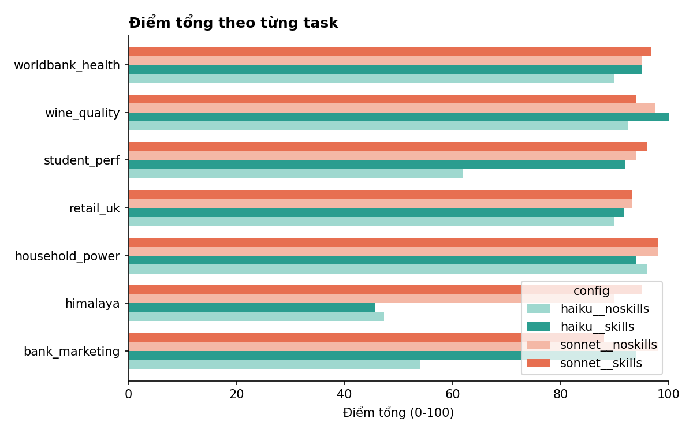
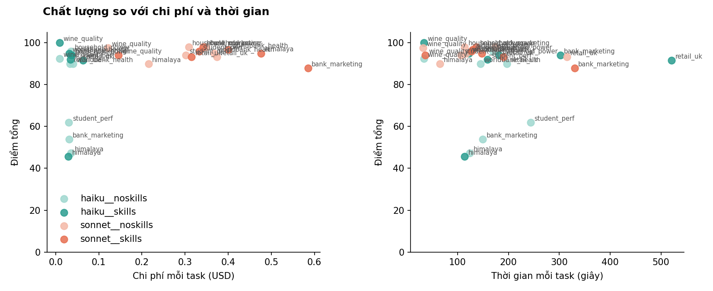
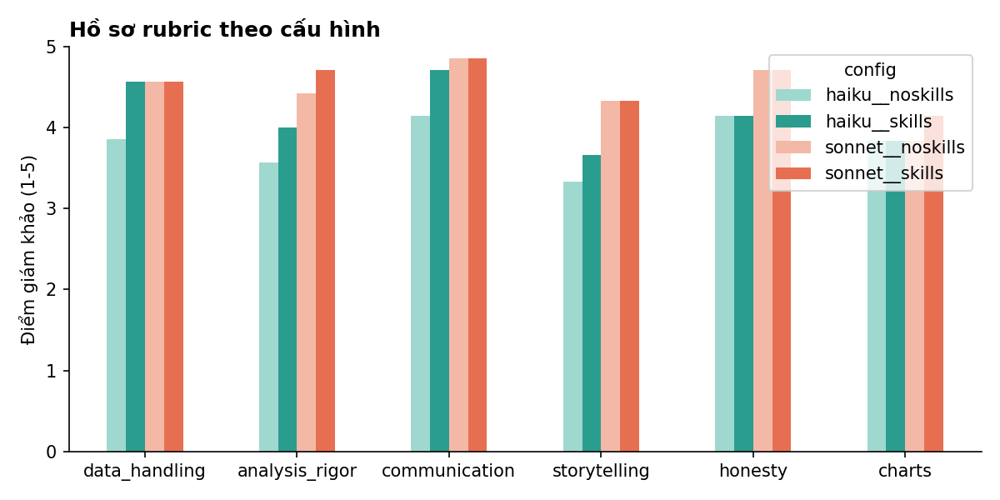

# Benchmark bộ skill - lượt chạy `ab-vi`

## Theo cấu hình (model __ biến thể)
| config | tasks | overall | accuracy | quality | storytelling | cost_total | cost_per_task | time_per_task_s | tokens_per_task | output_tokens_per_task | thinking_tokens_per_task | charts_per_task | turns_per_task | skill_hit_pct | finished | score_per_dollar |
|---|---|---|---|---|---|---|---|---|---|---|---|---|---|---|---|---|
| haiku__noskills | 7 | 76.0 | 78.6 | 72.1 | 3.333 | 0.215 | 0.031 | 151.9 | 878,766.6 | 24,016.1 | 7,029.6 | 1.714 | 28.4 |  | 7 | 2,471.2 |
| haiku__skills | 7 | 87.5 | 91.4 | 81.6 | 3.667 | 0.240 | 0.034 | 204.8 | 822,255.6 | 30,727.7 | 11,074.3 | 2.857 | 21.4 | 0.000 | 7 | 2,553.3 |
| sonnet__noskills | 7 | 95.1 | 100.0 | 87.8 | 4.333 | 2.037 | 0.291 | 132.1 | 385,758.9 | 13,052.4 | 1,017.6 | 1.571 | 16.1 |  | 7 | 326.8 |
| sonnet__skills | 7 | 94.4 | 97.6 | 89.6 | 4.333 | 2.596 | 0.371 | 156.8 | 505,986.1 | 16,623.9 | 1,524.6 | 2.714 | 16.4 | 0.000 | 7 | 254.7 |

## Hiệu quả của skills (có skills - không skills, cùng model và task)
| task | model | d_overall | d_accuracy_pct | d_quality_pct | d_cost_usd | d_wall_s |
|---|---|---|---|---|---|---|
| bank_marketing | haiku | 40.0 | 50.0 | 25.0 | 0.007 | 152.8 |
| bank_marketing | sonnet | -10.0 | -16.7 | 0.000 | 0.236 | 156.4 |
| himalaya | haiku | -1.600 | 0.000 | -4.100 | -0.006 | -10.3 |
| himalaya | sonnet | 5.000 | 0.000 | 12.5 | 0.261 | 82.0 |
| household_power | haiku | -2.000 | 0.000 | -5.000 | 0.000 | 11.5 |
| household_power | sonnet | 0.000 | 0.000 | 0.000 | 0.033 | 22.6 |
| retail_uk | haiku | 1.700 | 0.000 | 4.200 | 0.029 | 323.8 |
| retail_uk | sonnet | 0.000 | 0.000 | 0.000 | -0.059 | -124.9 |
| student_perf | haiku | 30.0 | 40.0 | 15.0 | 0.004 | -84.7 |
| student_perf | sonnet | 2.000 | 0.000 | 5.000 | 0.031 | 20.0 |
| wine_quality | haiku | 7.500 | 0.000 | 18.8 | -0.001 | -0.600 |
| wine_quality | sonnet | -3.500 | 0.000 | -8.800 | 0.024 | 4.600 |
| worldbank_health | haiku | 5.000 | 0.000 | 12.5 | -0.010 | -22.6 |
| worldbank_health | sonnet | 1.700 | 0.000 | 4.200 | 0.031 | 12.5 |

| model | d_overall | d_accuracy_pct | d_quality_pct | d_cost_usd | d_wall_s |
|---|---|---|---|---|---|
| haiku | 11.5 | 12.9 | 9.486 | 0.004 | 52.8 |
| sonnet | -0.686 | -2.386 | 1.843 | 0.080 | 24.7 |

## Theo từng task
| task | config | overall | accuracy_pct | quality_pct | s_storytelling | wall_s | cost_usd | total_tokens | output_tokens | turns | skill_hit_pct | n_charts | has_story |
|---|---|---|---|---|---|---|---|---|---|---|---|---|---|
| bank_marketing | haiku__noskills | 54.0 | 50.0 | 60.0 |  | 149.4 | 0.031 | 671706 | 27591 | 23 |  | 2 | True |
| bank_marketing | haiku__skills | 94.0 | 100.0 | 85.0 |  | 302.2 | 0.038 | 1047480 | 31360 | 24 | 0.000 | 3 | True |
| bank_marketing | sonnet__noskills | 98.0 | 100.0 | 95.0 |  | 173.7 | 0.349 | 510528 | 14162 | 17 |  | 1 | True |
| bank_marketing | sonnet__skills | 88.0 | 83.3 | 95.0 |  | 330.1 | 0.585 | 854178 | 26987 | 20 | 0.000 | 3 | False |
| himalaya | haiku__noskills | 47.3 | 40.0 | 58.3 | 3.000 | 124.0 | 0.035 | 1044580 | 25708 | 34 |  | 1 | True |
| himalaya | haiku__skills | 45.7 | 40.0 | 54.2 | 3.000 | 113.7 | 0.029 | 751121 | 23253 | 26 | 0.000 | 3 | True |
| himalaya | sonnet__noskills | 90.0 | 100.0 | 75.0 | 4.000 | 65.7 | 0.215 | 289940 | 9051 | 15 |  | 1 | True |
| himalaya | sonnet__skills | 95.0 | 100.0 | 87.5 | 4.000 | 147.7 | 0.476 | 637996 | 21000 | 23 | 0.000 | 4 | True |
| household_power | haiku__noskills | 96.0 | 100.0 | 90.0 |  | 169.9 | 0.036 | 1052662 | 28136 | 30 |  | 4 | True |
| household_power | haiku__skills | 94.0 | 100.0 | 85.0 |  | 181.4 | 0.036 | 773710 | 34216 | 25 | 0.000 | 5 | True |
| household_power | sonnet__noskills | 98.0 | 100.0 | 95.0 |  | 113.9 | 0.308 | 317492 | 15530 | 16 |  | 3 | True |
| household_power | sonnet__skills | 98.0 | 100.0 | 95.0 |  | 136.5 | 0.341 | 314098 | 16712 | 13 | 0.000 | 3 | False |
| retail_uk | haiku__noskills | 90.0 | 100.0 | 75.0 | 4.000 | 197.0 | 0.033 | 998079 | 25534 | 33 |  | 2 | True |
| retail_uk | haiku__skills | 91.7 | 100.0 | 79.2 | 4.000 | 520.8 | 0.063 | 1535993 | 61673 | 29 | 0.000 | 2 | True |
| retail_uk | sonnet__noskills | 93.3 | 100.0 | 83.3 | 5.000 | 314.8 | 0.374 | 598249 | 16387 | 24 |  | 2 | True |
| retail_uk | sonnet__skills | 93.3 | 100.0 | 83.3 | 5.000 | 189.9 | 0.315 | 398426 | 15282 | 14 | 0.000 | 3 | True |
| student_perf | haiku__noskills | 62.0 | 60.0 | 65.0 |  | 243.8 | 0.031 | 841726 | 25741 | 28 |  | 1 | True |
| student_perf | haiku__skills | 92.0 | 100.0 | 80.0 |  | 159.1 | 0.035 | 691760 | 32297 | 17 | 0.000 | 2 | True |
| student_perf | sonnet__noskills | 94.0 | 100.0 | 85.0 |  | 107.2 | 0.302 | 234442 | 16068 | 10 |  | 1 | True |
| student_perf | sonnet__skills | 96.0 | 100.0 | 90.0 |  | 127.2 | 0.333 | 456910 | 15097 | 15 | 0.000 | 2 | False |
| wine_quality | haiku__noskills | 92.5 | 100.0 | 81.2 |  | 34.1 | 0.010 | 208273 | 6922 | 9 |  | 0 | True |
| wine_quality | haiku__skills | 100.0 | 100.0 | 100.0 |  | 33.5 | 0.009 | 165406 | 6176 | 6 | 0.000 | 0 | False |
| wine_quality | sonnet__noskills | 97.5 | 100.0 | 93.8 |  | 32.2 | 0.121 | 179973 | 3875 | 8 |  | 0 | False |
| wine_quality | sonnet__skills | 94.0 | 100.0 | 85.0 |  | 36.8 | 0.146 | 193547 | 4248 | 8 | 0.000 | 1 | False |
| worldbank_health | haiku__noskills | 90.0 | 100.0 | 75.0 | 3.000 | 145.2 | 0.040 | 1334340 | 28481 | 42 |  | 2 | True |
| worldbank_health | haiku__skills | 95.0 | 100.0 | 87.5 | 4.000 | 122.6 | 0.031 | 790319 | 26119 | 23 | 0.000 | 5 | True |
| worldbank_health | sonnet__noskills | 95.0 | 100.0 | 87.5 | 4.000 | 117.2 | 0.368 | 569688 | 16294 | 23 |  | 3 | True |
| worldbank_health | sonnet__skills | 96.7 | 100.0 | 91.7 | 4.000 | 129.7 | 0.400 | 686748 | 17041 | 22 | 0.000 | 3 | True |

## Các tiêu chí bị trượt
| task | config | failed_checks |
|---|---|---|
| bank_marketing | haiku__noskills | Dùng bank-additional-full.csv | Xử lý pdays=999 (hoặc -1) và 'unknown' một cách tường minh | Yếu tố hàng đầu khớp với tham chiếu (vĩ mô, poutcome/pdays, contact, month) |
| bank_marketing | haiku__skills |  |
| bank_marketing | sonnet__noskills |  |
| bank_marketing | sonnet__skills | Xử lý pdays=999 và 'unknown' một cách tường minh |
| himalaya | haiku__noskills | 1. Lọc đúng Everest, dùng members.csv (cấp cá nhân) với mẫu số rõ ràng | 2. Tỉ lệ tử vong theo thập kỷ khớp by_decade (thành viên ~2% → ~1%; nhân viên ~14% → ~1%) | 4. Cho thấy thay đổi trong kỷ nguyên thương mại: số người/chuyến tăng, tỉ lệ thành công tă |
| himalaya | haiku__skills | 1. Lọc Everest đúng và dùng members.csv (cấp cá nhân) với mẫu số rõ ràng | 2. Tỉ lệ tử vong theo thập kỷ của thành viên và nhân viên thuê khớp by_decade | 4. Cho thấy điều gì thay đổi trong kỷ nguyên thương mại (số người leo, tỉ lệ thành công, o |
| himalaya | sonnet__noskills |  |
| himalaya | sonnet__skills |  |
| household_power | haiku__noskills |  |
| household_power | haiku__skills |  |
| household_power | sonnet__noskills |  |
| household_power | sonnet__skills |  |
| retail_uk | haiku__noskills |  |
| retail_uk | haiku__skills |  |
| retail_uk | sonnet__noskills |  |
| retail_uk | sonnet__skills |  |
| student_perf | haiku__noskills | 4. Kết luận khớp tham chiếu: liên quan âm nhỏ ở cả hai môn, rõ nhất ở Bồ Đào Nha; Toán yếu | 5. Không dùng từ ngữ nhân quả; nêu ít nhất một biến gây nhiễu |
| student_perf | haiku__skills |  |
| student_perf | sonnet__noskills |  |
| student_perf | sonnet__skills |  |
| wine_quality | haiku__noskills |  |
| wine_quality | haiku__skills |  |
| wine_quality | sonnet__noskills |  |
| wine_quality | sonnet__skills |  |
| worldbank_health | haiku__noskills |  |
| worldbank_health | haiku__skills |  |
| worldbank_health | sonnet__noskills |  |
| worldbank_health | sonnet__skills |  |

## Nhận xét của giám khảo
- **bank_marketing / haiku__noskills** (54.0): Agent làm việc cẩn thận về phương pháp: loại duration vì rò rỉ (AUC 0,94 nếu giữ lại), dùng hai baseline (ngẫu nhiên và quy tắc poutcome), báo PR-AUC, precision/recall và lift top 20%, có thêm holdout theo thời gian cho thấy lợi thế thu hẹp (GBM 0,687 so với 0,644), và nói rõ dữ liệu trôi dạt (tỷ lệ đăng ký 31,6% so với 6,7%). Lỗi chính là chọn sai bộ dữ liệu: bộ chính là bank-full.csv thay vì bank-additional-full.csv, kèm lập luận sai rằng bank-full là bộ đầy đủ nhất. Hệ quả là danh sách yếu tố quan trọng thiếu các chỉ số vĩ mô (nr.employed, euribor3m), vốn là tín hiệu mạnh nhất. Bộ đúng chỉ xuất hiện ở phần kiểm tra độ nhạy (AUC 0,802) và không có phân tích độ quan trọng biến trên bộ đó. pdays (giá trị sentinel) được dùng như biến số thường, các nhóm 'unknown' chỉ được one-hot ngầm, và không kiểm tra dòng trùng lặp. Báo cáo viết bằng tiếng Việt rõ ràng, trả lời trực tiếp, có nêu hạn chế và tránh diễn giải nhân quả. Hai biểu đồ có nhãn tiếng Việt, số liệu khớp với bảng; tiêu đề biểu đồ so sánh mô hình nêu đúng câu hỏi chính, còn tiêu đề biểu đồ yếu tố quan trọng chỉ mô tả, chưa nêu thông điệp. Không phát hiện số liệu bịa ngoài nhận định sai về bộ dữ liệu.
- **bank_marketing / haiku__skills** (94.0): Bài làm chất lượng cao. Agent dùng đúng file bank-additional-full.csv, bỏ 12 dòng trùng, loại duration và giải thích lý do rò rỉ. pdays=999 được mã hóa bằng cờ, còn 'unknown' được giữ thành nhóm riêng. ROC AUC 0,814 (GB) và 0,802 (LR) khớp với tham chiếu không có duration. Các thước đo phù hợp dữ liệu mất cân bằng được báo cáo đầy đủ: PR AUC 0,491 so với 0,113, lift theo decile, thu hồi top 20% là 66,5% so với 37,7% của luật poutcome. Agent cũng có phân tích bỏ nhóm chỉ số vĩ mô (AUC 0,781) và kiểm tra độ nhạy trên bank-full. Các yếu tố quan trọng (nr.employed, emp.var.rate, contact, month, euribor) khớp tham chiếu và được trình bày là tương quan, không phải nhân quả. Mọi con số đều khớp với các file CSV. Điểm trừ chính: agent không kiểm định theo thời gian. Lý do đưa ra là 'không có cột ngày đầy đủ', nhưng dữ liệu đã được sắp theo ngày nên hoàn toàn có thể chia theo thứ tự dòng. Agent có thừa nhận ước lượng có thể lạc quan, nhưng không định lượng mức sụt giảm (tham chiếu cho thấy AUC giảm còn khoảng 0,70–0,72). Biểu đồ rõ ràng, có nhãn tiếng Việt và khớp với số liệu, nhưng tiêu đề chủ yếu mang tính mô tả hoặc đặt câu hỏi thay vì nêu thông điệp chính. Câu trả lời và answer.md đều bằng tiếng Việt, kết luận được nêu ngay đầu.
- **bank_marketing / sonnet__noskills** (98.0): Bài làm chất lượng cao. Agent dùng đúng tệp đầy đủ (41.188 dòng, 11,3%), loại duration vì rò rỉ và đạt AUC 0,80, PR-AUC 0,47 với CV ngẫu nhiên, khớp tham chiếu. Agent so với ba baseline (ngẫu nhiên, quy tắc poutcome, chỉ-euribor) bằng PR-AUC và lift; các con số lift 4,6, tỷ lệ 51% và recall 46% khớp với decile_gain_cv.csv. Agent xử lý pdays=999 bằng NaN cộng một cờ, giữ 'unknown' thành nhóm riêng và có nêu 12 dòng trùng. Điểm nổi bật là agent tự kiểm định theo trục thời gian: AUC còn 0,66 và thua baseline chỉ-euribor. Agent trung thực thừa nhận 0,80 là con số lạc quan và khuyên chạy thử có nhóm đối chứng. Các yếu tố quan trọng nhất khớp tham chiếu (vĩ mô, tháng, kênh liên hệ, pdays/poutcome). Câu trả lời bằng tiếng Việt, trả lời trực tiếp ngay từ đầu. Biểu đồ rõ ràng và khớp số liệu, nhưng tiêu đề chỉ mô tả, không nêu ý chính. Ngoài ra model_log.txt chỉ ghi lỗi của model.py nên không đối chiếu được log của model2.py.
- **bank_marketing / sonnet__skills** (88.0): Bài làm chất lượng cao. Agent dùng đúng tệp đầy đủ, loại duration (và cả campaign) với lý do rõ ràng. AUC ngẫu nhiên là 0,81 và PR-AUC 0,486, khớp mức tham chiếu không rò rỉ. Mô hình được so với hai baseline bằng PR-AUC, recall và lift. Agent còn kiểm tra theo thời gian (70/30 và rolling 4 khối) và thẳng thắn nói lợi thế co lại còn AUC khoảng 0,60–0,62, gần mức quy tắc đơn giản. Agent giải thích nguyên nhân bằng sự thay đổi chế độ dữ liệu (tỷ lệ đăng ký từ 3% lên 46%, euribor từ 4,9 xuống 0,8). Các yếu tố quan trọng (nr.employed, emp.var.rate, month, contact, poutcome/pdays) khớp tham chiếu và được diễn giải là liên quan, không phải nhân quả. Các số liệu nêu ra đều khớp CSV. Có ba điểm trừ. Thứ nhất, các giá trị 'unknown' bị xử lý ngầm, không được nhắc tới. Thứ hai, 12 dòng trùng được giữ nguyên. Thứ ba, ở phép chia thời gian 70/30, quy tắc poutcome thực ra nhỉnh hơn GB-C (AUC 0,63 so với 0,61; PR-AUC 0,42 so với 0,33) nhưng chỉ được mô tả là 'gần mức quy tắc'. AUC theo thời gian của agent thấp hơn tham chiếu (khoảng 0,70) do cách chia khác. Ba biểu đồ có tiêu đề nêu thông điệp, nhãn tiếng Việt rõ ràng và số liệu khớp bảng. Câu trả lời và answer.md đều viết bằng tiếng Việt.
- **himalaya / haiku__noskills** (47.3): Agent lọc đúng Everest và đưa ra câu trả lời trực tiếp bằng tiếng Việt, có story.md, biểu đồ và CSV. Agent cảnh báo n nhỏ ở các thập kỷ đầu và tách riêng hai năm 2014–2015. Tuy nhiên agent dùng mẫu số cấp chuyến từ expeditions.csv thay vì members.csv. Với thành viên, kết quả gần khớp chuẩn (khoảng 2% → 1%). Với nhân viên được thuê, tỉ lệ trước 1990 chỉ còn khoảng 2% so với chuẩn 14,4%, dẫn tới kết luận sai rằng hai nhóm có rủi ro ngang nhau trước 1990. Lựa chọn này có nêu lý do, nhưng nó che mất phát hiện chính: rủi ro của nhân viên giảm mạnh hơn nhiều. Phần thay đổi trong kỷ nguyên thương mại còn thiếu: không bàn tỉ lệ thành công, việc dùng oxy hay tỉ trọng nhân viên. Biểu đồ rõ ràng và có đường chia 1990, nhưng tiêu đề chỉ mô tả chứ không nêu kết luận và không ghi n. story.md dễ đọc nhưng thiếu cảnh báo tương quan không phải nhân quả.
- **himalaya / haiku__skills** (45.7): Agent lọc Everest đúng. Số liệu thành viên đoàn khớp tham chiếu (khoảng 2% → 1,04%), và số chuyến theo thập kỷ cũng khớp. Có khoảng tin cậy Wilson, có cảnh báo cỡ mẫu nhỏ và phân tích độ nhạy cho 2014–2015. Tuy nhiên, agent dùng mẫu số nhân viên thuê từ hired_staff cấp chuyến (12.741 người) thay vì các dòng người trong members.csv. Lựa chọn này có nêu rõ, nhưng khiến tỉ lệ tử vong nhân viên trước 1990 chỉ còn 2,06%, so với 14,36% theo tham chiếu. Hệ quả là thông điệp chính bị đảo: agent nói hai nhóm ngang nhau trước 1990 và nhân viên an toàn hơn khách sau 1990. Phần 'điều gì thay đổi' còn thiếu tỉ lệ thành công, mức dùng oxy và tỉ trọng nhân viên; agent còn viết sai rằng dữ liệu không có thông tin về oxy. story.md bằng tiếng Việt, dễ hiểu, có nêu đây là tương quan chứ không phải nhân quả, nhưng không nhúng biểu đồ. Tiêu đề biểu đồ chỉ mô tả, không nêu điều rút ra; đường đánh dấu 'kỷ nguyên thương mại' đặt khoảng năm 1985 thay vì 1990.
- **himalaya / sonnet__noskills** (90.0): Bài chạy chắc chắn: lọc EVER đúng, 21.813 lượt và mọi tỉ lệ theo thập kỷ, theo giai đoạn đều khớp ground truth. Tác giả chọn mốc trước 1990 là 1950–1989 và đã nêu rõ con số 267 lượt. Bài nói rõ mẫu số, cảnh báo mẫu nhỏ ở 1970s và tách riêng 2014 (17 ca) và 2015 (11 ca nhân viên, đã đối chiếu với dữ liệu thô). Bài cũng tính thêm tỉ lệ tử vong trên mỗi lần lên đỉnh, rất đáng giá. Phần kỷ nguyên thương mại có đủ số người, tỉ lệ lên đỉnh, oxy và nguyên nhân tử vong, nhưng không nêu số đoàn theo thập kỷ. Bài gọi sự cố 2015 là 'tuyết lở' mà không nhắc động đất. Có một câu suy diễn nguyên nhân là 'dây cố định, oxy', nhưng bài vẫn có lưu ý rằng không chứng minh được nhân quả. Biểu đồ đúng số liệu nhưng tiêu đề chỉ mô tả, chưa nêu kết luận. Nhãn ở 2000s và 2010s chồng lên nhau, và biểu đồ bỏ các thập kỷ trước 1970. Toàn bộ bài viết bằng tiếng Việt, rõ ràng, đi thẳng vào câu trả lời.
- **himalaya / sonnet__skills** (95.0): Bài làm chất lượng cao. Agent tự phát hiện bảng members ghi thiếu nhân viên thuê (độ phủ chỉ 7–75%), trong khi số ca tử vong của hai bảng khớp nhau. Từ đó agent chọn mẫu số cấp đoàn, nói rõ lựa chọn và giữ kết quả theo bảng members để đối chiếu. Đây là lựa chọn hợp lý, có thể còn tốt hơn cách tham chiếu. Số ca tử vong theo thập kỷ khớp hoàn toàn với tham chiếu, và tỉ lệ của thành viên (18,7‰ → 10,4‰) khớp mức ~2% → ~1%. Bài có khoảng tin cậy Wilson, kiểm định Fisher, phân tích nhạy khi bỏ 2014–2015 (nhân viên thuê còn 4,2‰), tách riêng 2014 (17/300) và cảnh báo n nhỏ trước 1970. Câu trả lời và story đều bằng tiếng Việt, trả lời thẳng câu hỏi ngay từ đầu và có một thông điệp chính. Điểm thiếu: không phân tích việc dùng oxy; tỉ lệ thành công (7% → 52%) chỉ nằm trong phần lưu ý của answer.md, không có trong story. Story cũng có câu suy đoán nguyên nhân ('khách ít đi qua'), dù nhìn chung đã dè dặt. Biểu đồ có tiêu đề nêu kết luận và có thanh sai số. Tuy vậy, biểu đồ bỏ thập niên 1950, và cách đặt điểm lệch hai bên mốc thập kỷ khiến điểm 1990s của thành viên nằm bên trái đường 'kỷ nguyên thương mại', dễ gây hiểu nhầm.
- **household_power / haiku__noskills** (96.0): Bài làm chất lượng cao: đọc dữ liệu đúng ('?', dd/mm/yyyy), quy đổi kWh đúng qua kW trung bình × 24 (có hiệu chỉnh khoảng trống), lượng thiếu (25.979 phút, 1,25%) và các khoảng trống dài nhất khớp tham chiếu. Mùa vụ đúng: đông cao, tháng 8 thấp nhất, đỉnh tối 20h, cuối tuần cao hơn. Đã phát hiện kỳ nghỉ 8/2008 và các tuần bất thường. Dự báo 12/2010 ≈1.033 kWh (95%: 851–1.255, khuyến nghị 800–1.300) nằm trong khoảng hợp lý, có backtest và nêu rõ hạn chế. Điểm trừ: biểu đồ tổng tháng nhân ×31 cho mọi tháng, nên tổng các tháng ngắn bị thổi phồng. Trích dẫn ngày 16/12/2006 là 73 kWh, dù đây là giá trị ngoại suy từ một ngày thiếu dữ liệu. Không báo tổng kWh theo năm. Tiêu đề biểu đồ chỉ mô tả, không nêu kết luận, và trên biểu đồ mùa vụ chú giải chồng lên nhãn. Toàn bộ trình bày bằng tiếng Việt, rõ ràng, có đơn vị.
- **household_power / haiku__skills** (94.0): Bài làm chất lượng cao, cả 5 mục kiểm tra đều đạt.

- **Xử lý dữ liệu:** Đọc đúng '?' là giá trị thiếu và đúng định dạng ngày dd/mm/yyyy. Quy đổi kWh đúng (24 × kW trung bình, tương đương tổng/60). Tổng tháng khớp số tham chiếu, ví dụ 2007-12 là 1210 và 2008-08 là 206 kWh. Số phút thiếu (25.979, 1,25%) và các khoảng trống dài nhất (120, 87, 62, 55 giờ) đều chính xác.
- **Phân tích:** Mùa vụ mô tả đúng: tháng 1 cao nhất, tháng 8 thấp nhất, đỉnh 20:00, đáy 04:00, cuối tuần cao hơn ngày thường. Bất thường tháng 8/2008 được phát hiện và giải thích hợp lý (công tơ phụ gần 0, chỉ còn tải nền). Xu hướng đánh giá bằng so sánh cùng kỳ tháng 1–10, tránh được nhiễu do tháng bị cắt.
- **Dự báo:** 1.023 kWh với khoảng 90% là 820–1.247 kWh, nằm trong vùng hợp lý. Có kiểm thử ngược 24 tháng (MAPE 10,7%) và phân tích độ nhạy.
- **Trình bày:** Viết bằng tiếng Việt, rõ ràng, nêu câu trả lời trước, có đủ đơn vị, giả định và hạn chế.

Điểm trừ nhỏ:
- Biểu đồ tổng tháng hiển thị tháng 12/2006 ngoại suy khoảng 1.400 kWh, dù có tô xám là tháng bị cắt.
- Gán tuần cuối 2006 cho 'Tết dương lịch' là suy đoán không có bằng chứng.
- Tiêu đề biểu đồ chỉ mô tả, không nêu ý chính.
- Phương pháp dự báo khá đơn giản: dựa trên một tháng 12 duy nhất.
- **household_power / sonnet__noskills** (98.0): Bài làm chất lượng cao. Phần dữ liệu xử lý đúng mọi bẫy: đọc '?' là giá trị thiếu, parse ngày dd/mm/yyyy, đổi sang kWh bằng cách chia 60, tách riêng các tháng thiếu ngày và hiệu chỉnh theo độ phủ dữ liệu. Các con số khớp đáp án tham chiếu: 1,25% thiếu, các khoảng trống 120,4/87,3/62 giờ, tổng năm khoảng 9.400–9.800 kWh, tháng 12/2007 là 1.210 kWh. Mùa vụ được mô tả đúng: đông cao, hè thấp, tháng 8/2008 vắng nhà, đỉnh tối lúc 20–21 giờ, cuối tuần cao hơn ngày thường. Dự báo 1.040 kWh nằm trong khoảng hợp lý, có khoảng 80%/95% lấy từ backtest không rò rỉ dữ liệu và nêu rủi ro đuôi. Câu trả lời viết bằng tiếng Việt, kết luận đặt lên đầu, có đơn vị rõ ràng. Agent cũng thành thật thừa nhận chưa mở xem hai biểu đồ. Điểm trừ nhỏ: văn bản chỉ ghi 'đáy tháng 7–8' mà không nói rõ tháng 8 thấp nhất. Biểu đồ mùa vụ theo tháng có tính cả nửa tháng 12/2006 (mức cao) nên tháng 12 nhỉnh hơn tháng 1. Biểu đồ 2 và 3 có tiêu đề mô tả chứ chưa nêu thông điệp chính. Ở biểu đồ 3, chú giải đè lên điểm dự báo.
- **household_power / sonnet__skills** (98.0): Bài làm đạt chất lượng cao, đạt cả 5 tiêu chí. Dữ liệu được đọc và làm sạch đúng ('?' giữ là NaN, ngày dd/mm/yyyy, kWh = kW/60). Tổng tháng sau khi hiệu chỉnh khoảng trống khớp gần như tuyệt đối với đáp án tham chiếu. Phần mùa vụ theo năm, tuần và giờ đều đúng, và T8/2008 được nhận diện là giai đoạn bất thường lớn nhất. Các tuần bất thường được dò bằng robust z so với cùng kỳ các năm khác, và tuần thiếu dữ liệu được tách riêng. Dự báo 1.052 kWh nằm trong khoảng hợp lý, có KTC 80% và 95% lấy từ kiểm tra lùi và có so sánh với mô hình chuẩn. Phần hạn chế nêu thẳng thắn, không khẳng định quan hệ nhân quả. Câu trả lời đưa kết luận trước, có số liệu kèm đơn vị và viết bằng tiếng Việt. Biểu đồ rõ ràng và khớp số liệu, nhưng có một điểm trừ nhỏ: tiêu đề biểu đồ xu hướng ghi 'giảm nhẹ theo năm', trong khi văn bản kết luận xu hướng 'gần như đi ngang' (p = 0,35, không có ý nghĩa thống kê).
- **retail_uk / haiku__noskills** (90.0): Bài làm tốt và xử lý đúng các bẫy chính. Agent so cùng kỳ T1–T11 với +2,3%, độ nhạy 1/1–9/12 ra +2,7%, khớp tham chiếu 2,67%. Agent trừ ròng hoàn trả, loại mã phí và nêu rõ phần thiếu mã khách. Cầu nối mới/cũ khớp tham chiếu: mất khách khoảng £1,05M, khoảng 37% khách 2010 không quay lại. Các thị trường tăng/giảm mạnh nhất (Australia, Pháp, EIRE, Đan Mạch, Thụy Điển) cũng đúng. Agent có cảnh báo Australia gần như chỉ do một khách hàng. Story.md bằng tiếng Việt, có mạch rõ và kết bằng đề xuất hành động. Hai biểu đồ (thác nước và thanh ngang) có tiêu đề nêu kết luận, nhãn số khớp với văn bản. Điểm trừ: agent không nêu rõ việc hai sheet chồng lấn. Thông điệp 'tăng nhờ khách mới' chưa chính xác: phần có mã khách thực ra giảm ròng nhẹ, mức tăng tổng đến từ giao dịch không mã. Tỷ lệ 14% không có mã chỉ đúng cho 2011. Trả lời cuối còn kèm chi tiết thừa về bảng màu.
- **retail_uk / haiku__skills** (91.7): Bài làm chất lượng cao. Agent xác minh và loại vùng chồng 22.523 dòng giữa hai sheet, so cùng kỳ 1/1–9/12 (+3,0%, khớp tham chiếu 3,1%) và nêu rõ so sánh ngây thơ cho −1,2% là sai. Hoá đơn huỷ được tính ròng nhất quán. Cầu nối khách mới/cũ khớp tổng Δ, phần thiếu mã khách được tách riêng và có kiểm tra độ nhạy. Các thị trường tăng/giảm khớp tham chiếu: Úc, Pháp tăng; Ireland, Đan Mạch, Thụy Điển giảm; Anh gần như đi ngang. Điểm yếu: chưa loại ~11,8k dòng trùng nguyên bản; giữ các mã phí (có nêu và định lượng ~−£76k); so sánh số khách mới 2010 với 2011 (−54%) bị lệch do dữ liệu chỉ bắt đầu từ 12/2009, mà hạn chế này không được nêu riêng cho phép so sánh đó. Story tiếng Việt có mạch rõ ràng, khuyến nghị được đặt trong mục 'Quyết định đề xuất' và nêu rõ hạn chế (không có chi phí, không suy ra nhân quả). Hai biểu đồ (thác nước và thanh ngang) dễ đọc, khớp số liệu, nhưng tiêu đề chỉ mô tả, chưa nêu kết luận.
- **retail_uk / sonnet__noskills** (93.3): Bài làm chất lượng cao: tác giả loại phần chồng lấn giữa hai sheet, so cùng kỳ 1/1–9/12 (+1,6%, nằm trong ngưỡng so với tham chiếu 2,67–3,93%) và cảnh báo con số so cả năm −2,4% là sai lệch. Hóa đơn hủy được trừ nhất quán. Phần cầu nối khách mới/cũ khớp tốt với tham chiếu: khách mới +1,41 triệu, tỷ lệ giữ chân 63%, đơn không có mã khách được tách riêng. Úc, Pháp và EIRE được xác định đúng là các thị trường biến động lớn nhất. Điểm yếu chính: Anh được báo −70 nghìn GBP, trong khi tham chiếu là +43 nghìn GBP (ngược dấu), có lẽ do bỏ các dòng Price≤0 và giữ dòng trùng lặp gốc. Doanh thu cũng gồm cả phí như POST, M (có ghi chú). story.md có mạch kể rõ ràng, khuyến nghị dạng gợi ý, có phần giới hạn dữ liệu và cảnh báo rủi ro tập trung vào vài tài khoản. Câu 'giữ chân rẻ hơn để sửa' hơi khẳng định quá mức khi không có dữ liệu chi phí. Hai biểu đồ (thác nước và thanh ngang) có tiêu đề nêu thông điệp chính và khớp với số liệu. Toàn bộ bài viết bằng tiếng Việt.
- **retail_uk / sonnet__skills** (93.3): Bài làm chất lượng cao. Agent bỏ phần trùng giữa hai sheet, so cùng kỳ 01/01–09/12, trừ hàng hủy, loại mã không phải sản phẩm và hóa đơn A. Tăng trưởng +2,5% gần ref (+2,67%). Phần tách khách mới/cũ khớp ref rất sát (1.532 khách mới, +£1,43tr; rời bỏ −£1,07tr; giữ lại 63%). Thị trường tăng/giảm khớp ref: Úc, Pháp tăng; EIRE, Đan Mạch, Thụy Điển giảm. Agent còn tự phát hiện mức tăng ở Úc gần như chỉ từ một khách. Story tiếng Việt có một thông điệp rõ ràng và khuyến nghị cụ thể cho CEO, nêu đủ các lưu ý (thiếu ID, dữ liệu quan sát, định nghĩa khách mới). Điểm trừ: không loại các dòng trùng lặp gốc ngoài phần chồng sheet; tỷ trọng của Anh ghi sai 89% (đúng là ~84%); mô tả xu hướng theo tháng hơi không chính xác. Biểu đồ waterfall có tiêu đề nêu kết luận và khớp số liệu; hai biểu đồ còn lại chỉ có tiêu đề mô tả.
- **student_perf / haiku__noskills** (62.0): Agent xử lý dữ liệu khá cẩn thận: dùng sep ';', ghép học sinh trùng với SE cluster theo học sinh, phát hiện 53 dòng G3 = 0 và có phân tích độ nhạy. Agent cũng báo cáo Spearman ρ ≈ −0,18 kèm KTC bootstrap và Cohen d = −0,50, đều khớp tham chiếu về độ lớn. Điểm yếu thứ nhất là con số 370 cặp / 674 học sinh lệch khỏi 382/662 của tham chiếu, dù agent có nêu rõ lý do. Thứ hai, không có Spearman hay effect size riêng cho từng môn, nên bỏ lỡ phát hiện liên quan rõ nhất ở môn Bồ Đào Nha và mẫu hình Toán thay đổi theo cách xử lý G3 = 0. Thứ ba, thông điệp chính 'mối liên quan biến mất khi kiểm soát G2' là điều chỉnh quá mức theo một biến gần như trùng với kết quả, dễ gây hiểu lầm. Ngoài ra không nêu biến gây nhiễu cụ thể nào. Biểu đồ có tiêu đề rút ra kết luận và KTC rõ ràng, chỉ có nhãn n hiển thị dạng số thập phân (n=376.0). Câu trả lời viết bằng tiếng Việt đúng yêu cầu.
- **student_perf / haiku__skills** (92.0): Bài phân tích chắc chắn và các số liệu khớp với tham chiếu: Spearman từng môn khi bỏ và khi giữ G3=0 trùng gần như tuyệt đối. Bài xử lý tốt cả hai bẫy chính. Với học sinh trùng, bài phát hiện khóa của student-merge.R tạo ghép nhiều-nhiều, ghép 1-1 được 370 cặp (674 HS) và có giải thích lựa chọn. Với 53 dòng G3=0, bài loại khỏi phân tích chính, có lý do rõ và có kiểm tra độ nhạy. Bài dùng đúng kiểm định thứ bậc (Spearman, Mann–Whitney, rank-biserial), dùng SE cluster theo học sinh, hiệu chỉnh nhiều mức và nêu rõ hạn chế cùng tính quan sát của dữ liệu. Điểm yếu thứ nhất: mô hình hồi quy gộp đưa đồng thời Dalc và Walc, còn mô hình từng môn đưa riêng từng biến, nhưng bài không nói ra. Vì vậy hệ số gộp −0.34/−0.27 và kết luận 'gộp không còn ý nghĩa' dễ gây hiểu nhầm. Điểm yếu thứ hai: nhóm 'cao' định nghĩa là 3–5 (khác tham chiếu 4–5, nhưng có nêu rõ). Thứ ba, tiêu đề biểu đồ mang tính mô tả chứ không nêu kết luận. Biểu đồ forest còn để nhãn mã thô (A_tho, B_hieu_chinh_nen) và tiêu đề có chữ 'hiệu ứng' mang hơi hướng nhân quả. Câu trả lời và answer.md viết bằng tiếng Việt, trả lời trực tiếp ngay từ đầu và có ghi n.
- **student_perf / sonnet__noskills** (94.0): Bài làm chất lượng cao. Agent đọc đúng định dạng, loại trùng học sinh ở mức học sinh và phân tích theo từng môn, coi G3=0 là bỏ thi rồi chạy độ nhạy. Agent dùng Spearman, Mann-Whitney và Cohen's d có CI, cùng hồi quy HC3 kiểm soát yếu tố gây nhiễu. Các số theo môn trong results.csv khớp tham chiếu: Toán ρ −0,12/−0,10 khi giữ điểm 0 và −0,15/−0,19 khi loại; Bồ Đào Nha ρ −0,20/−0,17. Điểm trừ: khóa ghép 25 thuộc tính cho 370/672 thay vì 382/662, nên vẫn còn khoảng 12 học sinh bị đếm đôi. Phần trả lời cuối cùng dựa vào con số gộp và gọi hiệu ứng là 'nhỏ đến vừa', trong khi theo tham chiếu là nhỏ. Agent viết bằng tiếng Việt rõ ràng, trả lời trực tiếp và nêu đủ n và giả định. Biểu đồ đúng số liệu, có CI và n, nhưng tiêu đề chỉ mô tả, không nêu điều rút ra.
- **student_perf / sonnet__skills** (96.0): Bài làm chất lượng cao. Agent dùng đúng dấu phân cách ';' và cả hai file. Học sinh trùng được xử lý cẩn thận bằng ghép 1-1, ra 674 học sinh duy nhất. Con số này lệch so với 662 của tham chiếu nhưng có lập luận và được nêu rõ. Các dòng G3=0 (38 Toán, 15 Văn) được coi là bỏ thi, có phân tích độ nhạy và kiểm định Fisher. Các phương pháp phù hợp với dữ liệu thứ bậc (Spearman, Kruskal ε²), có Hedges g với CI và hồi quy có kiểm soát. Số liệu theo từng môn khớp chính xác với tham chiếu, ví dụ Toán Dalc giữ 0: ρ=−0,121, p=0,0162; Văn Dalc: −0,208. Kết luận đúng: liên quan âm nhỏ, rõ nhất ở môn Văn, môn Toán phụ thuộc vào cách xử lý G3=0. Không có ngôn từ nhân quả và có nêu yếu tố gây nhiễu. Câu trả lời bằng tiếng Việt, đưa đáp án trực tiếp ngay đầu. Điểm trừ nhỏ: cuối câu trả lời có ghi chú thừa về 'answer-qa'. Biểu đồ forest có tiêu đề nửa tiếng Anh ('Effect size…') và nhãn tiếng Việt không dấu. Biểu đồ đường ghi 'p = 0.000' và tiêu đề mang tính mô tả hơn là nêu kết luận. Biểu đồ đọc rõ và khớp với số liệu.
- **wine_quality / haiku__noskills** (92.5): Agent nhận diện đúng cả ba bẫy: không có giống nho, giá, quốc gia; toàn bộ là Vinho Verde Bồ Đào Nha (1.599 đỏ, 4.898 trắng), trích dẫn winequality.names. Agent chuyển sang câu hỏi thay thế hợp lý (cồn là yếu tố tương quan mạnh nhất, r≈0,48/0,44; axit bay hơi; trắng 5,88 vs đỏ 5,64). Các con số đều hợp lý so với dữ liệu, có cảnh báo tương quan ≠ nhân quả và nêu số mẫu nhỏ ở điểm 8–9 (18 và 5). Trả lời trực tiếp ngay từ đầu, viết bằng tiếng Việt. Điểm trừ: dùng nồng độ cồn làm 'chỉ số gần nhất với mức giá' là gượng ép và dễ gây hiểu nhầm, dù có ghi chú rằng cồn không phản ánh giá. Có một lệch nhỏ giữa hai file: answer.md ghi nhóm điểm thấp là '≤4' còn story.md ghi 'dưới 4'. Mục cần bổ sung còn liệt kê 'vùng sản xuất', trong khi vùng đã được biết là Minho. Script nằm ngoài workspace nên không kiểm chứng trực tiếp được.
- **wine_quality / haiku__skills** (100.0): Agent đã từ chối đúng: kiểm tra bằng code 14 từ khóa trong tên cột và trích tệp winequality.names để xác nhận dữ liệu không có giống nho, giá hay quốc gia. Agent cũng chỉ ra rằng toàn bộ mẫu là Vinho Verde của Bồ Đào Nha (đỏ 1.599, trắng 4.898), nên không thể so sánh Pháp với Bồ Đào Nha. Agent không bịa số liệu. Điểm trung bình 5,64/5,88 khớp với quality_by_type.csv và có ghi chú rằng chưa kiểm định thống kê. Agent gợi ý các câu hỏi thay thế phù hợp: chỉ số lý-hóa như nồng độ cồn, và so sánh đỏ/trắng. Agent dừng sớm, chi phí thấp. Câu trả lời viết bằng tiếng Việt, rõ ràng, kết luận nằm ngay đầu. Điểm nhỏ: agent không tính tương quan để xác nhận cồn là yếu tố liên quan mạnh nhất, nhưng việc này là tùy chọn.
- **wine_quality / sonnet__noskills** (97.5): Agent nhận ra đủ cả ba bẫy. Agent trích file winequality.names để khẳng định dữ liệu không có giống nho và giá. Agent cũng nêu rằng toàn bộ 6.497 mẫu (1.599 đỏ, 4.898 trắng) là Vinho Verde của Bồ Đào Nha, nên không thể so với vang Pháp. Phần phân tích thay thế ngắn gọn và đúng: độ cồn là yếu tố tương quan mạnh nhất (0,48 ở vang đỏ, 0,44 ở vang trắng); vang trắng được chấm cao hơn vang đỏ (5,88 so với 5,64); tỷ lệ mẫu từ 7 điểm trở lên là 21,6% ở vang trắng và 13,6% ở vang đỏ. Các con số này khớp với dữ liệu. Agent có nêu lưu ý rằng đây là tương quan, không phải nhân quả. Câu trả lời viết bằng tiếng Việt rõ ràng, đặt kết luận lên đầu. Điểm trừ nhỏ: agent dùng tương quan Pearson nhưng không ghi rõ phương pháp, và không xem xét các mẫu trùng lặp.
- **wine_quality / sonnet__skills** (94.0): Bài làm tốt. Agent từ chối đúng cả hai phần không trả lời được: dữ liệu không có giống nho, giá hay quốc gia, và toàn bộ mẫu là vang Vinho Verde của Bồ Đào Nha. Agent trích đúng nguồn từ winequality.names và nêu đúng số mẫu (1.599 đỏ, 4.898 trắng). Phần phân tích thay thế ngắn gọn và đúng. Cồn là yếu tố tương quan mạnh nhất (r=0,44, so với Spearman tham chiếu 0,447). So sánh đỏ và trắng có cỡ hiệu ứng và kiểm định. Các con số khớp với CSV. Agent nêu rõ hạn chế: chỉ là mối liên hệ, không phải nhân quả; điểm chấm có tính chủ quan; chưa loại dòng trùng lặp. Điểm trừ nhỏ: chưa loại trùng lặp (dù đã nói rõ) và gộp đỏ với trắng khi tính tương quan Pearson. Biểu đồ rõ ràng và khớp số liệu, nhưng tiêu đề chỉ mô tả, chưa nêu kết luận, và chú giải còn để tên biến thô "loai". Câu trả lời và answer.md đều bằng tiếng Việt.
- **worldbank_health / haiku__noskills** (90.0): Bài làm vững về dữ liệu và phương pháp. Agent bỏ được dòng metadata, loại tổng hợp qua IncomeGroup (làm rơi Venezuela, lỗi nhỏ), chọn năm 2019 với n = 186 và có kiểm tra độ bền với 2015/2023. Tương quan log r = 0,81. Agent kiểm soát thu nhập bằng hồi quy bậc hai theo ln GDP, cho thấy chi tiêu gần như không giải thích thêm (R² 0,72 → 0,73, t ≈ 1,9). Danh sách vượt/dưới kỳ vọng khớp ground truth. Việt Nam +2,9 năm (hạng 47/186) nằm trong khoảng hợp lý. Ngoại lai CAR 31,5 tuổi được phát hiện và gắn nhãn 'dữ liệu nghi ngờ'. Tất cả số liệu khớp với log. Điểm yếu: không có Spearman; không có biểu đồ nào về chi tiêu y tế, dù đây là câu hỏi chính; tiêu đề biểu đồ 1 nói 'độ dốc giảm dần' trong khi đường gần như thẳng trên thang log. Story thiếu đề xuất hành động cụ thể cho Bộ Y tế và không tham chiếu biểu đồ. Câu trả lời cuối có đoạn nhiễu về validate_palette.js không liên quan đến người đọc. Toàn bộ bằng tiếng Việt.
- **worldbank_health / haiku__skills** (95.0): Bài làm chất lượng cao. Xử lý đúng các bẫy dữ liệu: bỏ 4 dòng metadata, loại nhóm tổng hợp bằng Region rỗng, dùng thang log, chọn năm 2023 với n=184. Năm 2023 cũng tránh được giá trị ngoại lai của CAR năm 2022, dù bài không nhắc đến CAR. Mọi con số đều khớp run_log và ground truth: Spearman 0,842; R² 0,749 tăng lên 0,759; hệ số 1,077 × ln2 ≈ 0,75 năm, CI 0,10–1,53. Danh sách vượt/dưới kỳ vọng trùng phần lớn với GT. Việt Nam +2,3 năm, hạng 49/184, có kiểm tra độ nhạy 2021–2023. Bài trung thực về hạn chế: chi tiêu tính bằng USD chưa điều chỉnh PPP, đa cộng tuyến 0,91, Nigeria cần kiểm chứng, không khẳng định nhân quả. Câu trả lời, answer.md và story.md đều bằng tiếng Việt, trả lời thẳng câu hỏi trước. Điểm trừ: story.md không nhúng hay dẫn biểu đồ; tiêu đề chart4 không nêu kết luận; câu 'nhiều nước chi cao nhưng vẫn dưới kỳ vọng' chỉ dựa trên phần dư theo thu nhập nên bằng chứng còn lỏng; danh sách ASEAN dưới kỳ vọng trong story bỏ sót Myanmar và Lào.
- **worldbank_health / sonnet__noskills** (95.0): Bài làm chất lượng cao. Dữ liệu được xử lý đúng: bỏ 4 dòng metadata, loại nhóm tổng hợp bằng Region rỗng, chọn năm 2023 với n=184 và kiểm tra lại với 2022. Các con số khớp ground truth: r=0,83, Spearman 0,84; Việt Nam +1,94 năm theo mô hình chỉ GDP và +2,73 năm (hạng 44) theo mô hình đầy đủ; danh sách vượt và dưới kỳ vọng phù hợp. Có bootstrap CI cho hệ số chi tiêu và nêu hiệu ứng giảm mạnh khi kiểm soát thu nhập. Bài trung thực về tính tương quan, chênh lệch đơn vị USD hiện hành và PPP, và chất lượng số liệu (Nigeria, các nước nhỏ). Story bằng tiếng Việt, có thông điệp chính và hàm ý chính sách dạng gợi ý, tiêu đề biểu đồ nêu kết luận. Vẫn còn vài điểm nhỏ. Thứ nhất, con số chính (+1,9, mô hình GDP) và con số 2022 (+3,2, mô hình đầy đủ) lấy từ hai mô hình khác nhau, dễ gây nhầm. Thứ hai, story nói 'đường xu hướng là đường cong' trong khi đường này thẳng trên trục log. Thứ ba, tên nước trên chart 2 để tiếng Anh. Cuối cùng, ngoại lai CAR 2022 không được nhắc, nhưng năm chính 2023 không bị ảnh hưởng.
- **worldbank_health / sonnet__skills** (96.7): Đây là bài phân tích chất lượng cao. Dữ liệu được làm sạch đúng: bỏ 4 dòng metadata, lọc Region rỗng để loại nhóm tổng hợp, dùng năm 2023 với n=184. Các con số khớp ground truth: r=0,829, Spearman=0,842, hệ số logHE=1,14, VN +1,94 năm. Danh sách nước vượt/dưới kỳ vọng khớp GT 2023 (Solomon, Jordan, Lebanon / Nigeria, Nauru, Guinea Xích đạo, Chad, Guyana). Kiểm tra độ vững tốt: bootstrap hạng VN, đối chiếu năm 2019, tương quan riêng phần 0,22. Story bằng tiếng Việt, hướng đúng đối tượng, có thông điệp chính, hàm ý dạng gợi ý và lưu ý rõ (US$ so với PPP, không nhân quả). Điểm trừ nhỏ: chỉ nêu nổi bật phần dư của mô hình chỉ GDP (+1,9), trong khi mô hình đầy đủ cho +2,7. Story không nhắc ngoại lệ CAR. Ở hình 2, nhãn Jordan/Lebanon chồng lên nhau. Tiêu đề hình 3 chỉ mô tả, chưa nêu được kết luận.