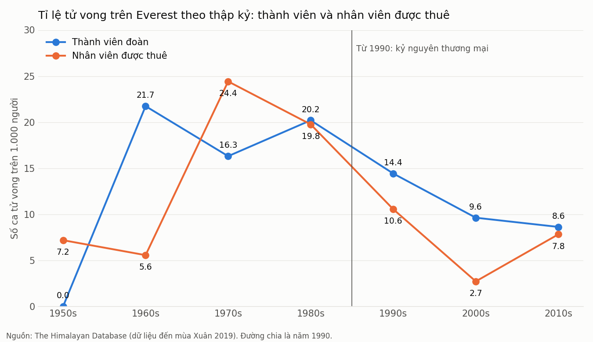

# Leo Everest ngày nay có an toàn hơn không? Câu trả lời là có, nhưng không đều cho mọi người

Everest vẫn là nơi nguy hiểm. Nhưng nếu nhìn vào hơn 2.100 chuyến leo được ghi lại từ năm 1921 đến 2019, rủi ro đã giảm rõ rệt, nhất là sau năm 1990, khi leo núi bắt đầu trở thành một dịch vụ thương mại.

## Những con số chính

- **Trước 1990:** khoảng **20 người trên 1.000** người leo tử vong, cả khách leo lẫn nhân viên được thuê.
- **Từ 1990 đến 2019:** còn khoảng **9 người trên 1.000**.
- **Khách leo** (thành viên đoàn): từ khoảng 20 xuống còn khoảng 10 trên 1.000 người.
- **Nhân viên được thuê** (Sherpa và người hỗ trợ): từ khoảng 21 xuống còn khoảng 7 trên 1.000 người.

## Điều gì đã thay đổi sau 1990?

Trước 1990, khách leo và nhân viên gần như cùng chịu một mức rủi ro cao (khoảng 20 trên 1.000 cho cả hai nhóm). Sau 1990, khoảng cách giữa hai nhóm thay đổi: trong thập kỷ 2000, khách leo chết với tỉ lệ cao hơn nhiều so với nhân viên (khoảng 9,6 so với 2,7 trên 1.000). Dữ liệu không cho biết lý do trực tiếp, nhưng đây là giai đoạn có nhiều đoàn thương mại với nhiều nhân viên hỗ trợ. Tỉ lệ của nhân viên sau đó tăng trở lại ở thập kỷ 2010, chủ yếu do hai năm có nhiều ca tử vong.

Số liệu cho thấy điều gì khác?

- **Đường đi nguy hiểm vẫn là đường đi nguy hiểm.** Phần lớn ca tử vong của nhân viên gắn với thác băng (Khumbu Icefall) và tuyết lở. Năm 2014 và 2015 là hai năm có nhiều nhân viên tử vong nhất trong dữ liệu (17 và 11 người). Nếu bỏ hai năm này, tỉ lệ tử vong của nhân viên thập kỷ 2010 chỉ còn khoảng 3 trên 1.000, thay vì khoảng 8.
- **Phần lớn người chết trong thời kỳ thương mại là khách leo bị bệnh độ cao (AMS), kiệt sức, hoặc ngã.** Trước 1990 thì ngược lại, nhiều ca tử vong là nhân viên.

## Lưu ý khi đọc số liệu

- Dữ liệu chỉ tới mùa Xuân 2019.
- Đây là số người tham gia, không phải số lần leo. Một người tham gia nhiều chuyến sẽ được tính nhiều lần.
- Số nhân viên được thuê trong dữ liệu chỉ tính những người đi trên trại căn cứ (basecamp). Một số giá trị rất lớn (99 người) có vẻ là dữ liệu điền tạm, nhưng việc loại bỏ chúng không làm thay đổi kết luận.
- Những con số này là mức trung bình. Chúng không nói rằng mỗi chuyến leo hiện nay đều an toàn.

**Kết luận:** Everest an toàn hơn đáng kể so với trước năm 1990, đặc biệt đối với khách leo. Nhưng rủi ro cho nhân viên phụ thuộc nhiều vào các sự kiện lớn như thác băng và động đất, và vẫn còn cao.

*Nguồn dữ liệu: The Himalayan Database (dữ liệu từ Elizabeth Hawley và các nguồn liên quan), phiên bản đã làm sạch của TidyTuesday tuần 2020-09-22.*
