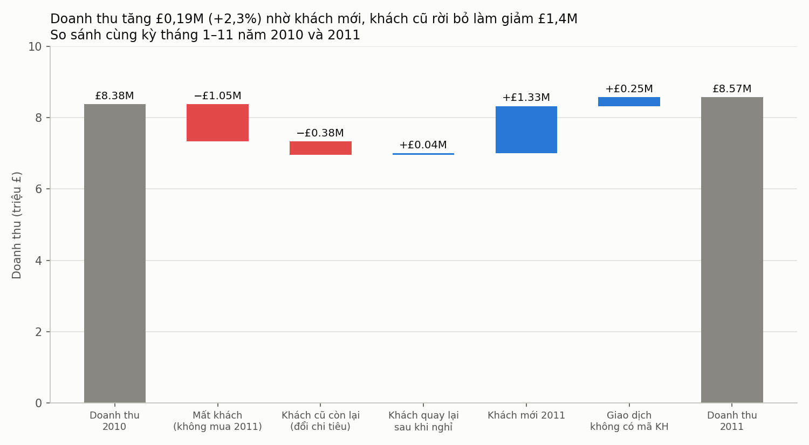
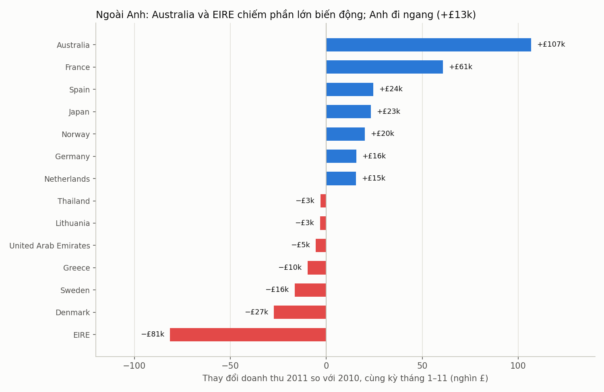

# Doanh thu 2011 tăng nhẹ, nhưng khách cũ đang rời đi nhanh hơn khách mới bù vào

**Tóm tắt cho CEO:** So cùng kỳ tháng 1–11 (năm 2010 và 2011), doanh thu thuần tăng **£194k (+2,3%)**, từ £8,38M lên £8,57M. Phần tăng này đến từ **khách mới**: 1.505 khách mua lần đầu năm 2011 mang về khoảng **+£1,33M**. Nhưng **khách cũ giảm ròng £1,38M**: 37% khách năm 2010 không quay lại mua năm 2011. Nếu không có khách mới, doanh thu có ID khách hàng đã giảm khoảng 19%. Vì vậy, **ưu tiên số 1 nên là giữ chân khách cũ**, còn tìm khách mới để bù phần rò rỉ đó.

## 1. Doanh thu tăng ít, và tăng này dựa vào khách mới

- **So sánh công bằng:** dữ liệu 2011 chỉ đến ngày 9/12/2011, nên so cả năm 2010 với 2011 sẽ làm kết quả sai (ra −1,4%). Ta so cùng kỳ tháng 1–11 của cả hai năm. Nếu so từ 1/1 đến 9/12 thì kết quả là +2,7%, cùng chiều.
- **Cầu nối:**
  - Mất khách (không mua lại năm 2011): **−£1,05M**
  - Khách cũ còn lại đổi chi tiêu: **−£0,38M**
  - Khách quay lại sau khi nghỉ: **+£0,04M**
  - Khách mới 2011: **+£1,33M**
  - Giao dịch không có mã khách: **+£0,25M** (không phân bổ được)
- **Kết luận:** khách mới bù đắp gần hết phần mất mát từ khách cũ. Không có khách mới, doanh thu sẽ giảm.

## 2. Thị trường: Anh đi ngang, tăng trưởng đến từ ngoài Anh

- **Anh (UK):** +£13k (+0,2%), gần như đi ngang. Anh chiếm 84% doanh thu nhưng không tạo ra tăng trưởng.
- **Ngoài Anh:** +£181k. Các thị trường tăng ổn định nhất là **Pháp (+£61k), Tây Ban Nha (+£24k), Nhật (+£23k), Na Uy (+£20k), Đức (+£16k), Hà Lan (+£15k)**.
- **Australia (+£107k) cần thận trọng:** gần như toàn bộ là một khách hàng (mã 12415) mua khoảng £124k trong năm 2011. Đây là đơn hàng lớn một lần, không phải xu hướng thị trường. Không nên đưa Australia vào kế hoạch tăng trưởng nếu chưa xác minh.
- **Ailen (EIRE) giảm mạnh nhất: −£81k (−25%).** Thị trường này chỉ có 3 khách hàng ở cả hai năm, nên đây là rủi ro tập trung khách hàng, không phải rủi ro thị trường chung.
- **Đan Mạch (−£27k, −62%), Thụy Điển (−£16k, −34%), Hy Lạp (−£10k, −72%)** là các thị trường mất khách rõ rệt cần kiểm tra.

## 3. Nên tập trung vào đâu?

**Đề xuất: ưu tiên giữ chân khách cũ, và dùng tìm khách mới để bù phần còn lại.**

Lý do:
1. **Mức rò rỉ lớn hơn mức tăng.** Khách cũ mất ròng £1,38M, trong khi khách mới chỉ bù £1,33M. Doanh thu chỉ tăng được vì khách mới đủ lớn để che lỗ.
2. **Mỗi khách mất đáng giá.** Khách mất năm 2011 chi khoảng £690 mỗi người trong năm 2010. Lấy lại một nửa số khách mất (khoảng 760 người) đã có thể đưa về khoảng £0,5M.
3. **Tăng trưởng khách mới phụ thuộc vào vài khách lớn.** Ví dụ, một khách ở Australia đã tạo gần như toàn bộ mức tăng của thị trường đó. Chưa kiểm tra được khách mới năm 2011 có quay lại năm 2012 hay không, nên không nên coi họ là nguồn doanh thu ổn định.

Hành động gợi ý:
- Rà soát 1.528 khách mất năm 2011, ưu tiên nhóm chi tiêu cao năm 2010.
- Theo dõi tỷ lệ quay lại theo thị trường, bắt đầu từ Ailen và Đan Mạch.
- Tìm khách mới ở các thị trường đang tăng ổn định (Pháp, Tây Ban Nha, Nhật, Na Uy, Đức), không dựa vào một khách lớn.

## Lưu ý về dữ liệu

- Khoảng 14% doanh thu (£0,94M năm 2010, £1,19M năm 2011) không có mã khách hàng, nên không phân loại được là mới hay cũ. Con số phân bổ mới/cũ chỉ tính trên phần có mã.
- Dữ liệu bắt đầu từ tháng 12/2009. "Khách mới 2011" nghĩa là chưa có giao dịch nào trong dữ liệu trước năm 2011, không phải khách hoàn toàn mới trên thị trường.
- Đã loại các dòng phí và chi phí không phải hàng hóa (phí ngân hàng, bưu phí, điều chỉnh), các dòng trùng lặp và các dòng giá bằng 0. Hoàn trả được trừ vào doanh thu ròng.
- Đơn vị giả định là bảng Anh (£), theo dữ liệu gốc.
