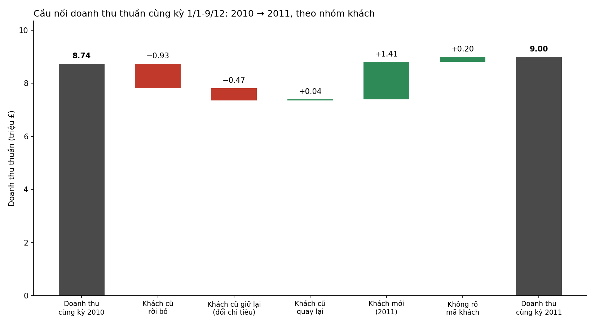
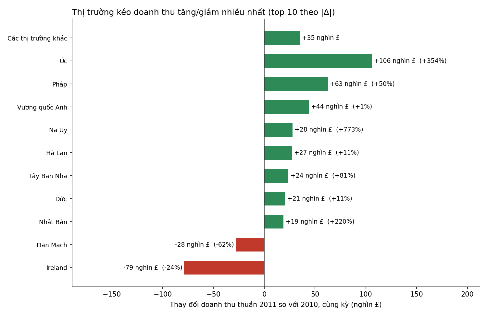

# Tăng trưởng 2011 đến từ khách mới, còn khách cũ đang rò rỉ

**Thông điệp chính:** Doanh thu cùng kỳ 2011 tăng 3%, nhưng toàn bộ mức tăng đến từ khách mới. Khách cũ mất ròng £1,35 triệu. Chúng ta nên **ưu tiên giữ chân khách cũ**, và giữ việc tìm khách mới ở mức vừa phải, tập trung vào các thị trường đang có tín hiệu tốt.

## Bối cảnh

Doanh thu thuần từ 1/1 đến 9/12 mỗi năm (dữ liệu 2011 kết thúc ngày 9/12). So cả năm 2010 với 2011 sẽ cho kết quả −1%, và đó là so sánh sai. So cùng kỳ cho **+£259 nghìn (+3,0%)**, từ £8,74 triệu lên £9,00 triệu.

## Điều đáng lo: khách cũ đang rời đi

Trong 4.258 khách đã mua năm 2010, chỉ **63% còn mua năm 2011**. 1.585 khách rời bỏ, kéo theo **−£925 nghìn**. Khách còn lại chi tiêu ít hơn (doanh thu nhóm này còn 93%), thêm **−£468 nghìn**. Tổng cộng khách cũ mất £1,35 triệu, nhiều hơn cả mức tăng.

## Khách mới đã bù lại, nhưng số lượng giảm mạnh

Khách mua lần đầu trong 2011 mang lại **+£1,41 triệu**. Đây là lý do doanh thu còn tăng. Tuy vậy, số khách mới giảm từ **3.338 xuống 1.529 (−54%)**, và mỗi khách mới chi tiêu ít hơn một chút trong năm đầu (£923 so với £1.043). Nếu tiếp tục như vậy, nguồn tăng trưởng này sẽ yếu dần.

## Thị trường: tăng ở đâu, giảm ở đâu

Vương quốc Anh gần như đi ngang (+0,6%). Phần tăng đến từ ngoài Anh (+£215 nghìn). **Úc (+£106 nghìn), Pháp (+£63 nghìn) và Na Uy (+£28 nghìn)** dẫn đầu, nhưng Úc (9–15 khách có mã) và Na Uy (4–10 khách có mã) rất nhỏ, nên mức tăng phụ thuộc vài đơn hàng lớn. **Ireland (−£79 nghìn, −24%)** là điểm yếu lớn nhất, chủ yếu do khách cũ giảm chi tiêu. Đan Mạch và Thụy Điển cũng giảm vì khách rời bỏ.

## Quyết định đề xuất

**Ưu tiên giữ chân khách cũ.** Ước tính đơn giản: mỗi 10 điểm phần trăm tỷ lệ giữ chân tương đương khoảng 426 khách, tức £139–249 nghìn doanh thu (tùy theo dùng chi tiêu trung vị hay trung bình của khách rời bỏ). Con số này bằng khoảng 55–95% mức tăng cùng kỳ 2011. Đây là đòn bẩy quy mô lớn nhất đang có trong dữ liệu.

**Giữ việc tìm khách mới ở mức vừa phải, có chọn lọc.** Khách mới đã tạo ra phần lớn doanh thu tăng, nên không nên cắt giảm mạnh. Nên tập trung vào Pháp, Đức và Tây Ban Nha, nơi khách mới có tín hiệu tốt.

**Cần kiểm tra thêm trước khi phân bổ ngân sách:** chi phí tìm khách và giữ khách (dữ liệu không có), và lý do khách rời bỏ. Khoảng 12–14% doanh thu không gắn được với mã khách, nên cần rà soát việc ghi nhận mã khách.
