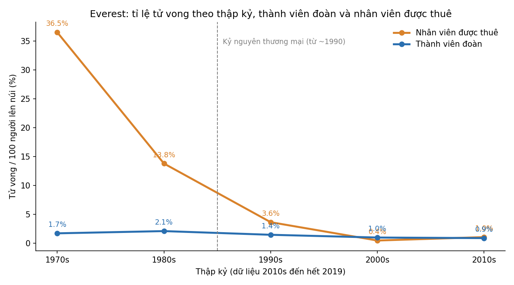

# Everest có an toàn hơn không? Câu trả lời phụ thuộc vào việc bạn là ai

**Có: tỉ lệ tử vong giảm mạnh. Nhưng phần lớn mức giảm nằm ở những người được thuê, và những người này vẫn đang gánh rủi ro nặng nhất khi có thảm họa.**

## 1. Bức tranh chung: rủi ro giảm một nửa

Dữ liệu Himalayan Database ghi nhận 21.813 lượt người lên Everest từ 1921 đến 2019. Trong đó có 306 ca tử vong.

Thành viên đoàn là khách leo núi, những người trả tiền hoặc tham gia đoàn. Cứ 100 người thì có khoảng **2 người** tử vong trong giai đoạn 1950–1989. Từ 1990 con số là **1 người**, cụ thể 1,04%.

## 2. Nhân viên được thuê: từ nguy hiểm nhất thành ngang bằng

Nhân viên được thuê là người khuân vác, dẫn đường và dựng dây cố định, phần lớn là người Sherpa. Họ chịu rủi ro lớn hơn nhiều vào giai đoạn trước:

| Giai đoạn | Thành viên đoàn | Nhân viên được thuê |
|---|---|---|
| 1950–1989 | 2,0% (54/2.721) | **15,7%** (42/267) |
| 1990–2019 | 1,04% (128/12.285) | 1,07% (68/6.368) |

Trước 1990, cứ 100 nhân viên được thuê thì khoảng 16 người không trở về, gấp khoảng 8 lần khách. Từ 1990, hai nhóm gần như bằng nhau, khoảng 1%.

## 3. Điều gì đã thay đổi trong kỷ nguyên thương mại?

- **Số người tăng vọt.** Thập kỷ 1980 có khoảng 2.000 thành viên đoàn và 145 nhân viên. Thập kỷ 2010 có khoảng 5.000 thành viên và 3.800 nhân viên. Mỗi khách giờ đi kèm gần một nhân viên được thuê.
- **Tỉ lệ lên đỉnh tăng.** Với nhân viên, tỉ lệ này tăng từ 18% trước 1990 lên 76% từ 1990. Với thành viên đoàn, nó tăng từ 8% lên 40%. Đây là dấu hiệu của dây cố định, oxy và đội hỗ trợ chuyên nghiệp.
- **Dùng oxy nhiều hơn.** Tỉ lệ người dùng oxy của thành viên đoàn tăng từ khoảng 19% (thập kỷ 1980) lên 62% (thập kỷ 2010).
- **Nguy cơ chuyển hình thức.** Với nhân viên, nguyên nhân chính là tuyết lở (56 ca), sập thác băng (13) và rơi ngã (17). Với khách, rơi ngã (54), bệnh độ cao (27), kiệt sức và tê cóng (50) là phổ biến hơn.
- **Rủi ro tập trung vào vài thảm họa.** Số tử vong của nhân viên thay đổi theo từng năm và dồn vào ít sự kiện. Năm 2014 có 17 ca và 2015 có 11 ca, chủ yếu do tuyết lở. Nếu bỏ hai năm đó, tỉ lệ của nhân viên trong thập kỷ 2010 chỉ còn 0,36%, so với 0,99% của khách.

## 4. Đừng vội ăn mừng

- Tỉ lệ nhân viên đã tăng trở lại, từ 0,45% (thập kỷ 2000) lên 1,04% (thập kỷ 2010). Tỉ lệ của khách giảm nhẹ, từ 0,97% xuống 0,87%.
- Nếu tính theo tỉ lệ tử vong trên mỗi người lên đến đỉnh, mức giảm còn rõ hơn: từ khoảng 25 ca/100 người lên đỉnh (trước 1990) xuống 2,6 ca/100 người (từ 1990) với khách. Nghĩa là rủi ro cho mỗi lần chạm đỉnh giảm mạnh, một phần vì nay nhiều người lên được đỉnh hơn.
- Số nhân viên lớn nghĩa là cả khi tỉ lệ thấp, một vụ tuyết lở vẫn có thể cướp đi nhiều mạng người cùng lúc.

## Kết luận

Everest đã an toàn hơn đáng kể. Nhưng nhờ thương mại hóa, khoảng cách rủi ro giữa khách và người được thuê gần như biến mất trên giấy tờ. Tuy vậy, khi thảm họa như tuyết lở xảy ra, người được thuê vẫn là nhóm chịu thiệt hại nặng nhất.

---
**Lưu ý về dữ liệu.** Dữ liệu đến hết 2019. Số liệu nhân viên được thuê trước 1990 rất nhỏ (267 lượt), nên một vụ tuyết lở đơn lẻ làm tỉ lệ biến động mạnh (ví dụ thập kỷ 1970 đạt 36,5%). Đây là tỉ lệ trên mỗi lượt người lên núi, không phải trên mỗi người, vì một người có thể đi nhiều mùa. Dữ liệu cũng không tính số ngày hoặc số lần qua thác băng. Tỉ lệ "lên đỉnh" lấy từ trường `success`, có thể gồm cả đỉnh phụ. Điều khoản "thương mại" ở đây chỉ là mốc thời gian ước chừng từ 1990, không phải biến đo được.
