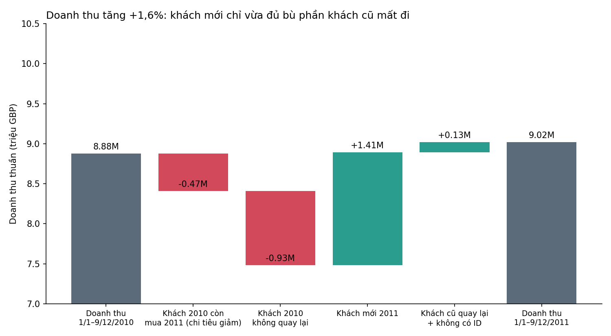
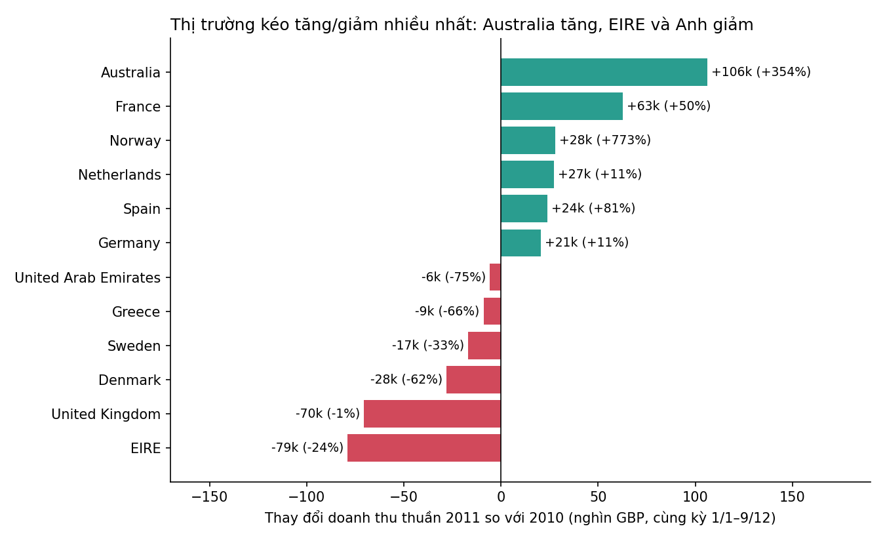

# Doanh thu 2011 gần như đi ngang: khách mới chỉ vừa đủ bù khách cũ rơi rụng

**Gửi CEO — câu hỏi: nên ưu tiên giữ chân khách cũ hay tìm khách mới?**

## Kết luận
Doanh thu thuần 2011 **tăng +1,6% (+145 nghìn GBP)** so với 2010 khi so cùng kỳ 1/1–9/12: 8,88 triệu → 9,02 triệu GBP. Mức tăng gần như đứng yên này che giấu một "thùng thủng": **nhóm khách đã mua năm 2010 làm mất 1,39 triệu GBP**, và **khách mới 2011 (+1,41 triệu) chỉ vừa đủ bù**. Khuyến nghị: **ưu tiên giữ chân khách cũ**, vì đây là chỗ đang rò rỉ nhiều nhất và rẻ hơn để sửa; vẫn duy trì kênh khách mới ở mức hiện tại.

## 1. Thay đổi bao nhiêu — so sánh công bằng
- Dữ liệu 2011 chỉ đến **9/12/2011**. So cả năm 2010 (9,25 triệu) với 2011 (9,02 triệu) sẽ ra **−2,4%** — sai lệch, vì 2010 có thêm 22 ngày cuối tháng 12 (≈0,37 triệu).
- So cùng kỳ 1/1–9/12: **+1,6%**. Số lượng khách mua gần như không đổi (4.256 → 4.243), giá trị đơn trung bình tăng 492 → 535 GBP (+9%), số đơn giảm 19.269 → 18.401 (−4,5%).
- Doanh thu thuần = số lượng × giá, đã trừ hàng trả/hủy (hóa đơn "C"); bỏ các dòng giá ≤ 0 (điều chỉnh); đã loại phần dữ liệu trùng giữa hai sheet (1–9/12/2010 xuất hiện ở cả hai).

## 2. Từ khách mới hay khách cũ?
| Nguồn thay đổi (cùng kỳ) | Triệu GBP |
|---|---|
| Khách mua cả 2010 và 2011 (2.673 khách) chi ít hơn | −0,47 (−7%) |
| Khách 2010 không quay lại 2011 (1.583 khách) | −0,93 |
| Khách mới 2011 (1.528 khách, chưa từng mua trước 2011) | +1,41 |
| Khách cũ quay lại từ T12/2009 + đơn không có mã khách | +0,13 |
| **Tổng** | **+0,14** |

- Toàn bộ mức tăng "ròng" đến từ khách mới; **cơ sở khách cũ co lại ≈ 1,35 triệu GBP (≈ −18% so với doanh thu có mã khách 2010)**.
- Tỷ lệ giữ chân (khách 2010 còn mua 2011) chỉ **63%**. Khách mua trước 2010 giữ chân tốt hơn (81%) khách mới 2010 (58%) → **năm đầu tiên là giai đoạn rơi rụng nhiều nhất**.
- Tuy vậy, khách rời đi nhỏ hơn nhiều: trung bình 584 GBP/khách (trung vị 327) so với 2.529 GBP (trung vị 1.031) ở nhóm ở lại. Nghĩa là "rò rỉ" chủ yếu ở khách nhỏ/mua thử; khách lớn tương đối ổn nhưng **cũng chi ít hơn 7%**.
- Doanh thu tập trung: 10% khách hàng đầu chiếm ≈ 59% doanh thu 2011 → mất một vài khách lớn gây tác động lớn.

## 3. Thị trường nào kéo tăng/giảm

- **Kéo giảm:** **EIRE (Ireland) −79 nghìn (−24%)**, **Anh −70 nghìn (−1%)**, Đan Mạch −28 nghìn (−62%), Thụy Điển −17 nghìn.
- **Kéo tăng:** **Úc +106 nghìn (+354%)**, Pháp +63 nghìn (+50%), Na Uy +28 nghìn, Hà Lan +27 nghìn, Tây Ban Nha +24 nghìn, Đức +21 nghìn. Ngoài Anh: tổng +215 nghìn (+17%).
- Anh vẫn chiếm ~83% doanh thu: khách mới Anh +1,20 triệu nhưng bị bù trừ bởi khách cũ Anh mất 0,79 triệu và chi giảm 0,58 triệu.
- **Thận trọng:** biến động theo nước phụ thuộc vài tài khoản. Úc: một khách (12415) chiếm 124 nghìn trong 136 nghìn doanh thu 2011. EIRE chỉ có 3–5 khách, hai khách chiếm gần hết (một khách giảm 172 → 113 nghìn). Đây là rủi ro tập trung hơn là xu hướng thị trường.

## 4. Gợi ý quyết định
1. **Giữ chân là đòn bẩy lớn hơn.** Chỉ cần giữ thêm 1/3 số khách bỏ đi (giá trị trung bình thấp) cũng ≈ +0,3 triệu GBP, tương đương gần 2 lần mức tăng ròng của cả năm. *(ước tính thô, giả định khách giữ lại chi như nhóm rời đi.)*
2. **Tập trung vào 12 tháng đầu của khách mới**: đơn thứ hai/thứ ba, nhắc mua lại, ưu đãi gói bán sỉ; đo tỷ lệ quay lại sau 90 ngày.
3. **Chăm sóc riêng nhóm khách lớn** (top 10%) và các tài khoản trọng yếu như Ireland, Úc — có người phụ trách (account manager).
4. **Không bỏ khách mới**: đó là nguồn duy nhất giữ doanh thu không giảm; nhưng nếu giữ chân không cải thiện, chi phí thu hút sẽ chỉ để "lấp lỗ".

## Giới hạn dữ liệu
- Dữ liệu bắt đầu 12/2009: "khách mới" 2011 = chưa mua từ 12/2009 đến hết 2010 (có thể một số khách từng mua trước đó). Vì vậy không so "khách mới 2010 vs 2011" trực tiếp (2010 bị thổi phồng do dữ liệu bị cắt đầu kỳ); phân rã dựa trên nhóm khách mua trong 2010.
- ~13–14% doanh thu không có mã khách (không phân loại được mới/cũ). Giữ nguyên 11.812 dòng trùng lặp trong cùng sheet (loại đi: 2010 −0,35%, 2011 −0,2%, kết luận không đổi, tăng ≈ +1,8%).
- Doanh thu gồm cả phí vận chuyển (POST), "DOT", chỉnh tay (M). Không có dữ liệu chi phí nên chưa so được chi phí giữ chân với chi phí thu hút khách.
