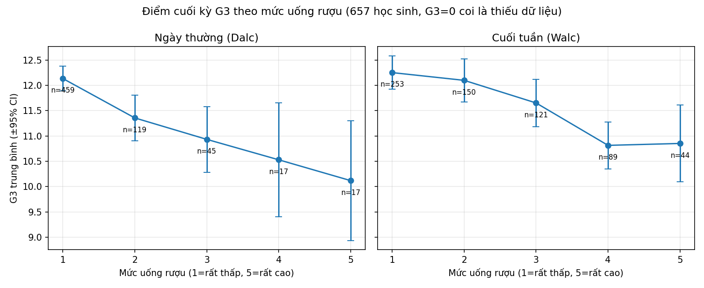

# Câu chuyện dữ liệu: rượu và điểm cuối kỳ

Gộp hai file thành 672 học sinh duy nhất (370 em học cả hai môn), tôi thấy học sinh uống nhiều có điểm G3 thấp hơn. Mức giảm thuộc loại nhỏ đến vừa.

- Mỗi bậc tăng uống rượu ngày thường ứng với G3 giảm khoảng 0,3 điểm sau khi kiểm soát các yếu tố khác (p = 0,004). Nhóm uống nhiều (Dalc ≥3) thấp hơn nhóm còn lại khoảng 1,3 điểm, Cohen's d ≈ −0,5.
- Uống cuối tuần cho kết quả cùng chiều nhưng nhẹ hơn: d ≈ −0,37, thấp hơn khoảng 1 điểm.
- G3 = 0 (53 dòng, đều có absences = 0) giống bỏ thi hơn là điểm thật. Tôi coi chúng là thiếu dữ liệu. Nếu giữ chúng, hiệu ứng yếu đi (d ≈ −0,25 đến −0,29) và không còn ý nghĩa sau hiệu chỉnh. Vì vậy chiều ngược là chắc chắn, còn độ lớn phụ thuộc cách xử lý.
- Cộng gộp 1044 dòng sẽ đếm trùng 370 học sinh và làm p-value đẹp hơn thực tế.

Đây là tương quan trong dữ liệu cắt ngang, không đủ để kết luận rượu làm giảm điểm.

