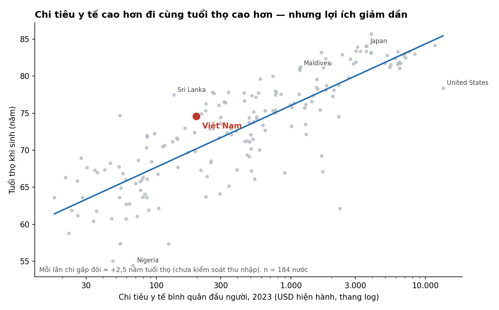
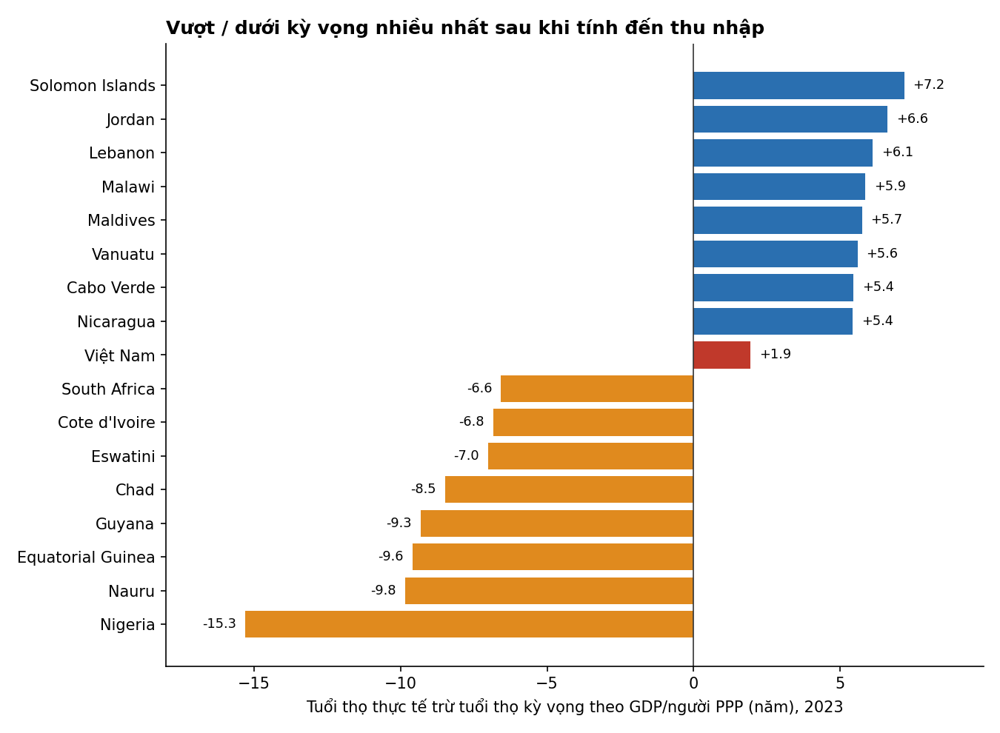
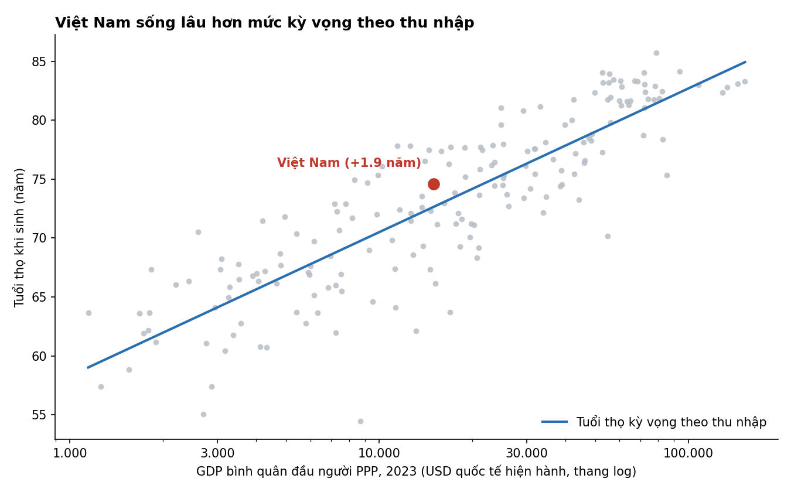

# Chi nhiều cho y tế có sống lâu hơn không? Việt Nam đang "vượt kỳ vọng"

*Dành cho lãnh đạo Bộ Y tế · Dữ liệu World Bank/WHO, năm 2023, 184 quốc gia/vùng lãnh thổ*

## Thông điệp chính

**Việt Nam sống lâu hơn khoảng 2 năm so với mức thu nhập dự báo, trong khi chi y tế bình quân chỉ khoảng 197 USD/người.** Chi tiêu y tế có liên quan tới tuổi thọ, nhưng thu nhập và các yếu tố khác giải thích phần lớn hơn.

## 1. Chi tiêu y tế cao hơn đi cùng tuổi thọ cao hơn, nhưng lợi ích giảm dần

- Tương quan giữa log chi tiêu y tế/người và tuổi thọ là **r = 0,83** (Spearman 0,84).
- Mỗi lần chi tiêu **gấp đôi** tương ứng với tuổi thọ cao hơn khoảng **2,5 năm**. Đường xu hướng là đường cong: từ 30 lên 100 USD tăng nhiều hơn nhiều so với từ 5.000 lên 8.000 USD. Hoa Kỳ chi gần 12.000 USD/người nhưng tuổi thọ (~78) thấp hơn nhiều nước chi chỉ bằng một phần ba.
- **Cẩn trọng:** đây là tương quan, không chứng minh nhân quả. Nước giàu vừa chi nhiều vừa có dinh dưỡng, giáo dục, vệ sinh tốt hơn. Khi đưa cả GDP/người PPP vào mô hình, mỗi lần chi y tế gấp đôi chỉ còn gắn với **~0,8 năm** (khoảng tin cậy bootstrap 95% của hệ số: 0,24–2,14 trên mỗi đơn vị log, tức hiệu ứng nhỏ và không chắc chắn). Năm 2022, cùng mô hình cho hệ số này không còn có ý nghĩa thống kê. Riêng GDP/người PPP giải thích 75% biến thiên tuổi thọ giữa các nước; thêm chi tiêu y tế chỉ nâng lên 76%.

## 2. Sau khi tính đến thu nhập: ai vượt, ai dưới kỳ vọng?

Tuổi thọ "kỳ vọng" được ước lượng từ GDP/người PPP (tuổi thọ ≈ 21,7 + 5,3 × ln GDP; sai số chuẩn ≈ 3,6 năm). Chênh lệch = thực tế − kỳ vọng.

| Vượt kỳ vọng nhiều nhất | Chênh (năm) | Dưới kỳ vọng nhiều nhất | Chênh (năm) |
|---|---|---|---|
| Quần đảo Solomon | +7,2 | Nigeria | −15,3 |
| Jordan | +6,6 | Nauru | −9,8 |
| Lebanon | +6,1 | Guinea Xích đạo | −9,6 |
| Malawi | +5,9 | Guyana | −9,3 |
| Maldives | +5,7 | Chad | −8,5 |
| Vanuatu | +5,6 | Eswatini | −7,0 |

- Nhóm vượt kỳ vọng gồm nhiều nước thu nhập trung bình/thấp có chăm sóc ban đầu rộng (Sri Lanka +5,0, Cabo Verde +5,4, Nicaragua +5,4, Malawi +5,9).
- Nhóm dưới kỳ vọng tập trung ở châu Phi hạ Sahara (gánh nặng HIV/lao/sốt rét, xung đột, bất bình đẳng, như Nam Phi −6,6, Eswatini, Lesotho) và các nước giàu nhờ tài nguyên nhưng thu nhập phân phối không đều (Guinea Xích đạo, Guyana).
- Nigeria (−15,3) gần như chắc chắn một phần do số liệu: tuổi thọ 54,5 là ước tính ngoại suy, độ bất định rất lớn.

## 3. Việt Nam đứng ở đâu?

| Chỉ số (2023) | Việt Nam |
|---|---|
| Tuổi thọ | 74,6 năm |
| Chi y tế/người | 197 USD |
| GDP/người PPP | 15.034 USD quốc tế |
| Chênh so với kỳ vọng theo thu nhập | **+1,9 năm** (hạng 56/184) |
| Chênh so với kỳ vọng theo thu nhập + chi y tế | **+2,7 năm** (hạng 44/184) |
| Hạng trong nhóm thu nhập trung bình cao (56 nước) | **16** |

- Việt Nam cao hơn mức kỳ vọng, nhưng ở mức vừa phải (~0,5 độ lệch chuẩn); đây là **tốt hơn trung bình, chưa phải xuất sắc**. So với các nước cùng mức thu nhập (GDP/người PPP 10–21 nghìn USD), Việt Nam xếp sau Jordan, Lebanon, Sri Lanka, Iran, Peru, Tunisia, Ecuador, Algeria.
- Chỉ **2 nước** sống lâu hơn Việt Nam mà chi y tế/người thấp hơn: Bangladesh (74,7 năm, 54 USD) và Sri Lanka (77,5 năm, 134 USD).
- Việt Nam chi y tế thấp: chỉ 32% số nước chi ít hơn. Điều này làm chênh lệch tăng lên khi tính thêm chi tiêu (+2,7), tức hiệu quả trên mỗi đồng chi khá tốt.

## Hàm ý cho Bộ Y tế

1. **Hiệu quả chi tiêu tương đối tốt**, nhưng không nên diễn giải rằng "chi ít vẫn đủ". Lợi ích giảm dần có nghĩa ở mức chi ~200 USD/người vẫn còn dư địa tăng tuổi thọ khi chi thêm (từ 100 lên 200 USD gắn với hơn 2 năm trong dữ liệu chéo giữa các nước, dù là tương quan).
2. **Học hỏi nhóm vượt kỳ vọng cùng thu nhập** (Sri Lanka, Jordan, Cabo Verde): ưu tiên y tế cơ sở, bao phủ BHYT rộng, giảm chi tiền túi.
3. **Tuổi thọ khi sinh chưa phải số năm sống khỏe**; nên bổ sung chỉ số tuổi thọ khỏe mạnh, bệnh không lây nhiễm và tử vong sớm.

## Lưu ý về dữ liệu và phương pháp

- Năm 2023 là năm gần nhất có đủ dữ liệu chi tiêu y tế (năm 2024 chỉ có ~24 nước). Đã loại nhóm tổng hợp (khu vực, nhóm thu nhập); 184 nước có đủ cả ba chỉ số. Kết quả 2022 tương tự (tương quan của phần dư giữa hai năm 0,77; Việt Nam +3,2 năm).
- **Chi tiêu y tế tính theo USD hiện hành (không phải PPP)**, còn GDP theo PPP. Nước giá rẻ như Việt Nam bị đánh giá thấp về sức mua y tế thực, nên "hiệu quả" của nước thu nhập thấp có thể bị phóng đại một phần.
- Mô hình tuyến tính theo log; không xử lý yếu tố nhiễu (bệnh tật, bất bình đẳng, hút thuốc…). Các nước nhỏ (Nauru, Palau, Maldives) có số liệu biến động mạnh.
- Mã và dữ liệu: `analysis.py`, `charts.py`, `residuals_2023.csv` trong thư mục `outputs/`.
