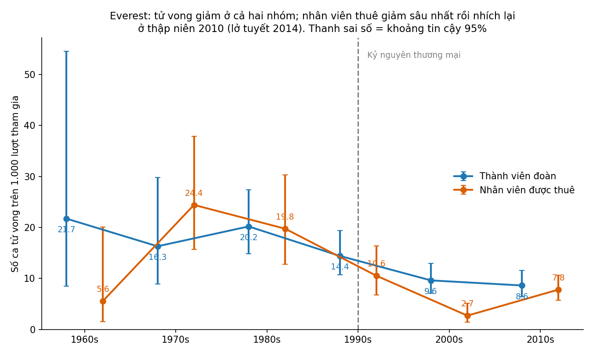
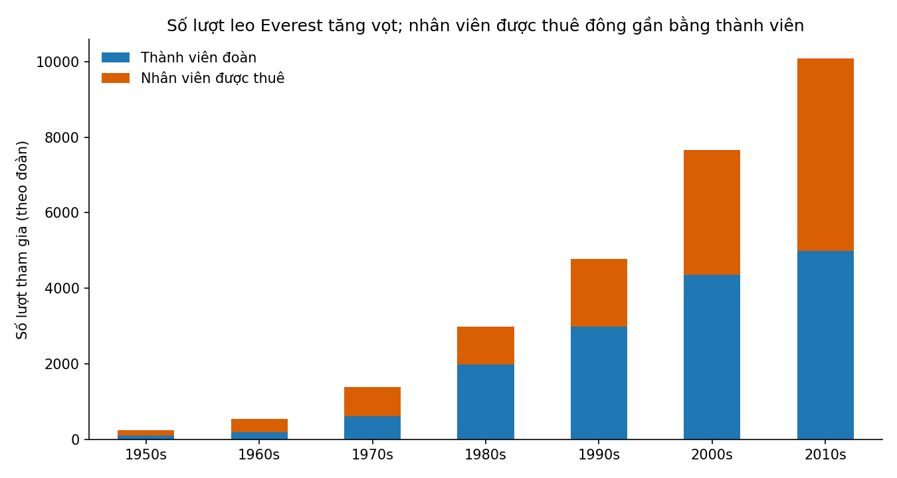

# Everest đông hơn gấp ba, nhưng mỗi lượt leo ít chết người hơn một nửa

*Nguồn: Himalayan Database, các đoàn leo Everest 1950–2019. Số liệu và biểu đồ tính bằng mã trong `analysis_main.py`.*

## Bối cảnh
Hình ảnh quen thuộc về Everest là hàng người xếp hàng ở "vùng tử thần" và những tin về tai nạn. Nhìn vào đó, ai cũng nghĩ ngọn núi ngày càng nguy hiểm. Dữ liệu ghi chép gần 70 năm cho thấy một bức tranh khác.

## 1. Rủi ro trên mỗi lượt leo đã giảm gần một nửa
Trong 1950–1989, cứ 1.000 lượt leo thì khoảng **19 người chết** (thành viên đoàn 18,7; nhân viên được thuê 18,4). Từ 1990 đến 2019, con số là **10,4** với thành viên đoàn và **6,7** với nhân viên được thuê. Cả hai mức giảm đều có ý nghĩa thống kê.

Số ca tử vong tuyệt đối không giảm (60 ca ở 1980s, 83 ca ở 2010s) vì số người leo tăng nhanh: từ khoảng 3.000 lượt ở thập niên 1980 lên khoảng 10.000 lượt ở thập niên 2010. Tỉ lệ giảm nhưng quy mô tăng.

## 2. Kỷ nguyên thương mại: nhân viên được thuê trở thành lực lượng đông đảo
Từ 1990, các công ty dẫn đoàn bán chuyến leo cho khách. Nhân viên được thuê (hầu hết mang quốc tịch Nepal: khuân vác, cố định dây, hỗ trợ) đông gần bằng khách: 5.109 so với 4.980 lượt ở thập niên 2010.

Trước 1990, hai nhóm chịu rủi ro như nhau. Từ 1990, nhân viên thuê thường an toàn hơn khách (2,7 so với 9,6 ca trên 1.000 lượt ở thập niên 2000), có lẽ vì họ có kinh nghiệm và thích nghi tốt hơn. Dữ liệu không chứng minh được nguyên nhân.

## 3. Nhưng rủi ro của họ có dạng khác: một tai nạn có thể lấy đi nhiều người
Thập niên 2010 là bước lùi với nhân viên thuê (7,8 ca trên 1.000 lượt). Phần lớn do hai năm: **lở tuyết ở Khumbu Icefall năm 2014** và **động đất năm 2015**. Trong hai năm đó, 28 trên 744 lượt của nhân viên thuê kết thúc bằng tử vong (37,6‰) trong khi thành viên đoàn là 3 trên 922 (3,3‰).

Nguyên nhân tử vong cũng khác nhau. Từ 1990, 33 trong 68 ca tử vong của nhân viên thuê là do lở tuyết. Dữ liệu không giải thích lý do; có thể do họ làm các việc phải đi lại nhiều trên tuyến có tuyết lở. Khách thì chết nhiều hơn vì ngã, say độ cao, kiệt sức, hạ thân nhiệt.

## Điều rút ra
Leo Everest **an toàn hơn trước** nếu tính theo từng lượt leo. Thành quả này không chia đều: người được thuê chịu rủi ro tập trung vào những chỗ nguy hiểm khách ít đi qua, và vẫn có thể mất cả một nhóm trong một ngày.

## Lưu ý trước khi trích dẫn
- Bảng danh sách thành viên trong dữ liệu **ghi thiếu** nhân viên thuê (chỉ phủ 7% đến 75% tuỳ thập kỷ), nên chúng tôi lấy mẫu số từ bảng tổng hợp theo đoàn. Nếu dùng nhầm bảng kia, nhân viên thuê trước 1990 trông nguy hiểm gấp 8 lần, một kết luận sai.
- Đây là số liệu quan sát; không tách được vai trò của công nghệ, thời tiết, kinh nghiệm hay cách ghi chép.
- Số liệu thập niên 1950–1960 quá ít, khoảng tin cậy rất rộng. Dữ liệu kết thúc ở 2019.
