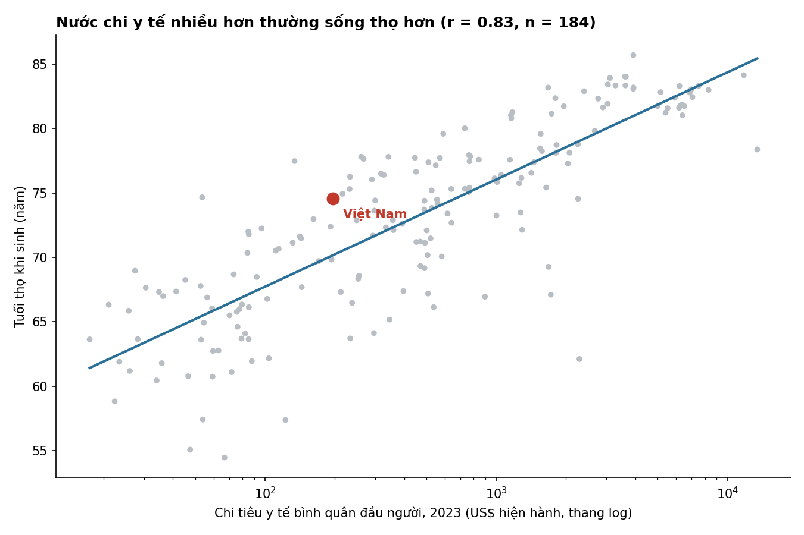
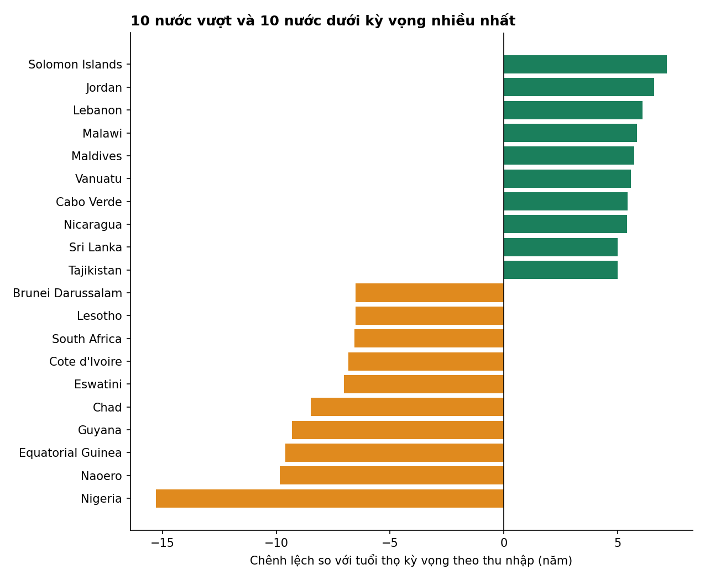
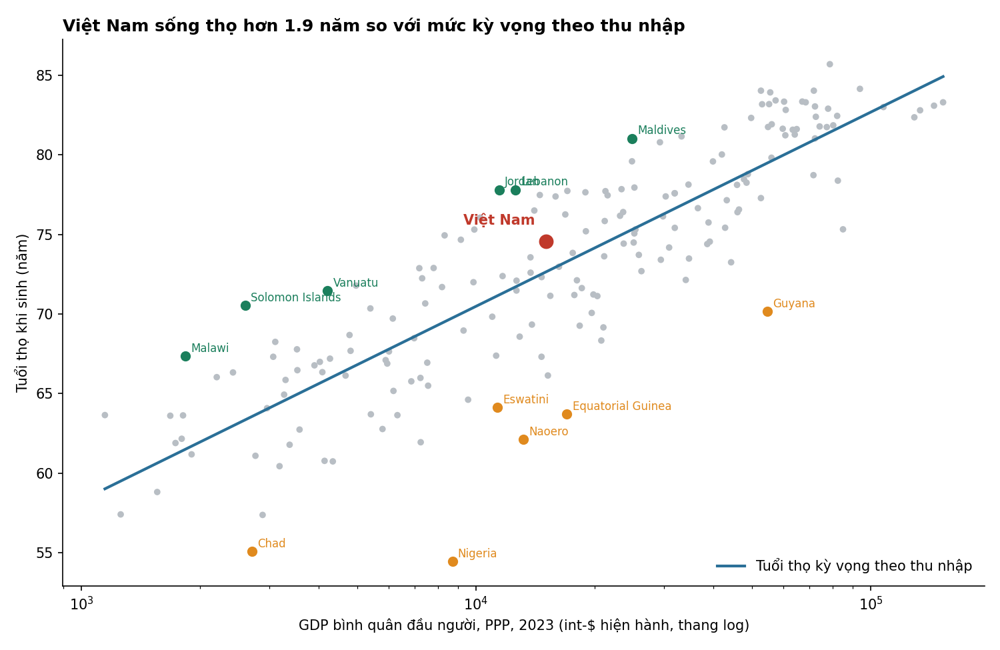

# Chi tiêu y tế và tuổi thọ: Việt Nam sống thọ hơn mức "đáng có" với chi phí thấp

*Dành cho lãnh đạo Bộ Y tế · Dữ liệu World Bank (WHO, UN), năm 2023, 184 quốc gia và vùng lãnh thổ*

## Thông điệp chính
**Việt Nam đạt tuổi thọ 74,6 năm, cao hơn khoảng 1,9 năm so với mức kỳ vọng của các nước cùng thu nhập, dù chi y tế chỉ khoảng 197 US$/người.** Đây là kết quả tốt (hạng 56/184, nhóm ~30% đầu) nhưng chưa thuộc nhóm ngoại lệ hàng đầu.

## 1. Chi nhiều hơn thì sống thọ hơn, nhưng phần lớn là hiệu ứng của thu nhập
- Chi y tế bình quân đầu người và tuổi thọ tương quan mạnh (r = 0,83 với log chi tiêu).
- Thu nhập còn tương quan mạnh hơn (r = 0,86 với log GDP/người PPP), và hai yếu tố đi cùng nhau.
- Khi giữ thu nhập cố định, chi y tế vẫn liên hệ dương nhưng nhỏ: chi tiêu tăng 10% đi kèm khoảng **+0,11 năm** tuổi thọ (khoảng tin cậy 95%: ~+0,02 đến +0,20 năm; tương quan riêng phần 0,22). Đây là **mối liên hệ, không chứng minh nhân quả**.

## 2. Sau khi tính thu nhập: ai vượt và ai dưới kỳ vọng?
- **Vượt kỳ vọng nhiều nhất:** Quần đảo Solomon (+7,2 năm), Jordan (+6,6), Lebanon (+6,1), Malawi (+5,9), Maldives (+5,7).
- **Dưới kỳ vọng nhiều nhất:** Nigeria (−15,3 năm), Nauru (−9,8), Guinea Xích đạo (−9,6), Guyana (−9,3), Chad (−8,5).
- Nhóm dưới kỳ vọng có nhiều nước giàu tài nguyên hoặc chịu gánh nặng bệnh tật/bất ổn (Nigeria, Guinea Xích đạo, Nam Phi, Eswatini, Lesotho): thu nhập cao chưa chuyển thành sức khỏe. Nguyên nhân cụ thể không thể kết luận từ dữ liệu này.
- Các nước đảo nhỏ dễ biến động; nên đọc xếp hạng như tín hiệu, không phải bảng thi đấu.

## 3. Việt Nam đứng ở đâu?
- Tuổi thọ 74,6 năm; kỳ vọng theo thu nhập 72,6 năm, tức **chênh +1,9 năm, hạng 56/184** (bootstrap 95%: hạng 54–58; chênh lệch +1,4 đến +2,5 năm).
- Chi y tế 197 US$/người hạng 125; GDP/người PPP hạng 103; tuổi thọ hạng 84. Tuổi thọ xếp cao hơn cả thu nhập lẫn chi tiêu.
- So với 28 nước có GDP/người PPP trong ±25% của Việt Nam: tuổi thọ trung vị 72,2 năm, chi y tế trung vị 326 US$. Việt Nam sống thọ hơn ~2,4 năm với chi tiêu bằng ~60% mức đó.
- Kết quả ổn định: năm 2019 (trước COVID) Việt Nam +2,9 năm, hạng 45; phần dư hai năm tương quan 0,86.

## Hàm ý cho Bộ Y tế
1. **Giữ vững hiệu quả hiện có.** Dữ liệu không cho biết nguyên nhân; cần đối chiếu với số liệu trong nước (tiêm chủng, y tế cơ sở, bảo hiểm y tế) để hiểu điều gì tạo ra phần vượt trội.
2. **Đừng kỳ vọng "tăng chi là tăng thọ" tuyến tính.** Lợi ích biên của chi tiêu sau khi tính thu nhập là nhỏ, nên chất lượng và phân bổ chi tiêu quan trọng hơn quy mô.
3. **Vẫn còn dư địa.** Sri Lanka (GDP/người PPP gần bằng Việt Nam, chi y tế thấp hơn: ~134 US$) đạt 77,5 năm; Jordan và Lebanon (thu nhập thấp hơn Việt Nam) đạt ~77,8 năm. Đáng nghiên cứu mô hình của các nước này.

## Lưu ý về dữ liệu
- Chi tiêu y tế tính bằng **US$ hiện hành (tỷ giá thị trường)**, còn GDP theo **PPP**, hai thước đo không cùng cơ sở giá; chi tiêu của nước giá dịch vụ thấp như Việt Nam có thể bị đánh giá thấp so với sức mua thực.
- Dùng năm 2023 vì là năm gần nhất có đủ dữ liệu chi y tế (2024 chỉ có 24 nước). 33 nước/vùng thiếu ít nhất một chỉ số nên bị loại; các nhóm tổng hợp (khu vực, nhóm thu nhập) đã bỏ.
- Tuổi thọ là ước tính của UN, sai số lớn ở nước thiếu số liệu hộ tịch (ví dụ Nigeria, Chad).
- Mô hình tuyến tính theo log; phần dư gồm cả sai số mô hình, khác biệt cách đo và yếu tố ngoài y tế (giáo dục, dinh dưỡng, xung đột, HIV...).
