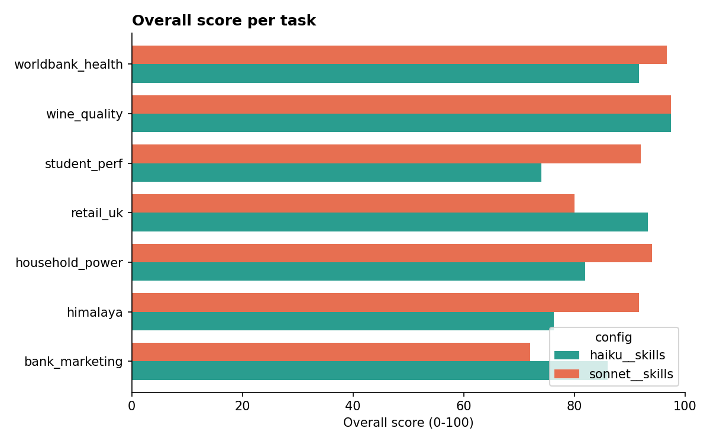
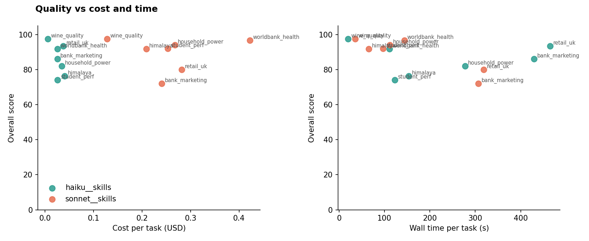
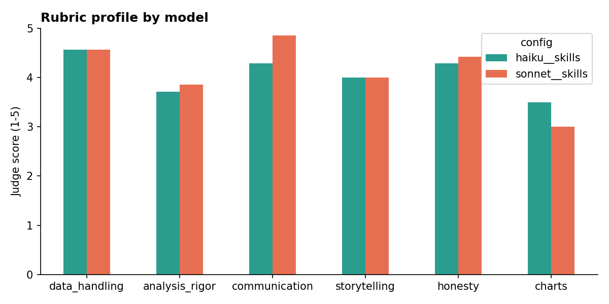

# Skill benchmark - run `full-1`

## By model
| config | tasks | overall | accuracy | quality | storytelling | cost_total | cost_per_task | time_per_task_s | tokens_per_task | output_tokens_per_task | thinking_tokens_per_task | charts_per_task | turns_per_task | skill_hit_pct | finished | score_per_dollar |
|---|---|---|---|---|---|---|---|---|---|---|---|---|---|---|---|---|
| haiku__skills | 7 | 85.8 | 91.4 | 77.4 | 4.000 | 0.196 | 0.028 | 225.6 | 676,046.7 | 24,227.3 |  | 2.143 | 20.4 | 2.043 | 7 | 3,067.7 |
| sonnet__skills | 7 | 89.1 | 95.2 | 80.0 | 4.000 | 1.803 | 0.258 | 154.2 | 345,478.9 | 10,787.3 |  | 1.143 | 12.9 | 0.000 | 7 | 346.1 |

## Per task
| task | config | overall | accuracy_pct | quality_pct | s_storytelling | wall_s | cost_usd | total_tokens | output_tokens | turns | skill_hit_pct | n_charts | has_story |
|---|---|---|---|---|---|---|---|---|---|---|---|---|---|
| bank_marketing | haiku__skills | 86.0 | 100.0 | 65.0 |  | 429.6 | 0.025 | 621166 | 20426 | 17 | 0.000 | 2 | False |
| bank_marketing | sonnet__skills | 72.0 | 66.7 | 80.0 |  | 307.0 | 0.241 | 335086 | 9698 | 13 | 0.000 | 1 | False |
| himalaya | haiku__skills | 76.3 | 80.0 | 70.8 | 4.000 | 153.6 | 0.040 | 1221051 | 32834 | 33 | 0.000 | 3 | True |
| himalaya | sonnet__skills | 91.7 | 100.0 | 79.2 | 5.000 | 65.3 | 0.209 | 229518 | 8072 | 9 | 0.000 | 1 | True |
| household_power | haiku__skills | 82.0 | 80.0 | 85.0 |  | 277.5 | 0.035 | 786191 | 32417 | 22 | 14.3 | 4 | False |
| household_power | sonnet__skills | 94.0 | 100.0 | 85.0 |  | 112.0 | 0.268 | 319151 | 12363 | 13 | 0.000 | 2 | False |
| retail_uk | haiku__skills | 93.3 | 100.0 | 83.3 | 4.000 | 464.9 | 0.038 | 967373 | 33859 | 25 | 0.000 | 2 | True |
| retail_uk | sonnet__skills | 80.0 | 100.0 | 50.0 | 3.000 | 318.9 | 0.282 | 354781 | 13346 | 12 | 0.000 | 1 | True |
| student_perf | haiku__skills | 74.0 | 80.0 | 65.0 |  | 122.6 | 0.026 | 515007 | 24319 | 17 | 0.000 | 1 | False |
| student_perf | sonnet__skills | 92.0 | 100.0 | 80.0 |  | 96.9 | 0.253 | 271906 | 11695 | 10 | 0.000 | 1 | False |
| wine_quality | haiku__skills | 97.5 | 100.0 | 93.8 |  | 19.9 | 0.006 | 101163 | 3115 | 4 | 0.000 | 0 | False |
| wine_quality | sonnet__skills | 97.5 | 100.0 | 93.8 |  | 35.3 | 0.128 | 196932 | 3574 | 9 | 0.000 | 0 | False |
| worldbank_health | haiku__skills | 91.7 | 100.0 | 79.2 | 4.000 | 111.2 | 0.026 | 520376 | 22621 | 25 | 0.000 | 3 | True |
| worldbank_health | sonnet__skills | 96.7 | 100.0 | 91.7 | 4.000 | 143.7 | 0.423 | 710978 | 16763 | 24 | 0.000 | 2 | True |

## Failed checks
| task | config | failed_checks |
|---|---|---|
| bank_marketing | haiku__skills |  |
| bank_marketing | sonnet__skills | 4. Handles pdays=999 and 'unknown' explicitly | 5. Top factors consistent with reference (macro, poutcome/pdays, contact, month) |
| himalaya | haiku__skills | Shows what changed in commercial era: more climbers/expeditions, higher success, more oxyg |
| himalaya | sonnet__skills |  |
| household_power | haiku__skills | Annual seasonality (winter high, Aug lowest) AND daily profile with evening peak |
| household_power | sonnet__skills |  |
| retail_uk | haiku__skills |  |
| retail_uk | sonnet__skills |  |
| student_perf | haiku__skills | Conclusion matches reference (small negative in both courses, clearest in Portuguese; Math |
| student_perf | sonnet__skills |  |
| wine_quality | haiku__skills |  |
| wine_quality | sonnet__skills |  |
| worldbank_health | haiku__skills |  |
| worldbank_health | sonnet__skills |  |

## Judge summaries
- **bank_marketing / haiku__skills** (86.0): This is a solid, leakage-free analysis of the correct file. Duration is dropped with the codebook reason given, and the ROC-AUC values (0.765–0.813) match the reference. The baselines are well chosen (random, majority class, poutcome rule), and the results are reported as lift and capture rather than accuracy. pdays=999, 'unknown' and the duplicate rows are all handled explicitly. The bank-full cross-check and 5-fold CV add robustness, and the causal caveats are good.

There are three main weaknesses:
- **No time-ordered validation.** The agent skipped it on an incorrect premise, since the rows are in date order. This is the most honest test for a next-campaign use case, and the reference shows performance drops substantially under it.
- **Macro indicators set aside.** Excluding them from the recommended model is a defensible judgement, but the justification overstates that they are constant within a campaign. As a result the headline factor list leads with month, contact and age rather than the macro signals.
- **Charts don't match the recommendation.** They show the with-macro model rather than the recommended one (this is disclosed). The titles are descriptive rather than takeaway titles, and PR-AUC is computed but never reported in the answer.
- **bank_marketing / sonnet__skills** (72.0): This is a strong, honest run.

**Data and leakage:** It uses the full file and drops duration for a stated reason. It conservatively drops campaign too, which is defensible.

**Validation:** It reports both a random-CV AUC (0.80, matching the reference) and a more honest time-ordered split. The time-ordered AUC is 0.66, a bit below the reference's ~0.70–0.715, but the split differs (last 30% vs last 25%). It quantifies drift (training rate 5.6% vs test rate 24.6%).

**Baseline:** It compares against a naive constant-rate baseline using PR-AUC and decile lift. It explains why accuracy is misleading and gives a bootstrap CI on the AUC. All the numbers I spot-checked trace to the CSVs.

**Gaps:**
- **'unknown' categories:** They are kept silently and never discussed.
- **Macro indicators:** They get zero importance on the temporal split, so the agent says macro indicators don't help. This contradicts the reference's strongest signals; the agent's explanation is partial but it doesn't explore the artifact.
- **Chart:** It has descriptive rather than takeaway titles. The decile panel shows the gradient-boosting model (top decile 43%), while the text headlines logistic regression's 46.6%, a minor mismatch.

**Caveats:** The caveats on calibration, drift, causality and small subgroups are excellent.
- **himalaya / haiku__skills** (76.3): This is a solid, well-reconciled analysis. Everest filtering and death counts match the reference exactly (58/52 pre-1990, 128/68 after), and member rates agree (about 2%→1%). The agent deliberately used expedition-level headcounts as denominators and documented why. Because of that, hired-staff rates (2.1%→0.7%) are much lower than the reference's member-row rates (14.4%→1.1%); the choice is defensible and both versions point the same way. Rigor includes Wilson CIs, chi-square tests with a clustering caveat, and an excl-2014/2015 sensitivity check. The weak spot is the story's account of the commercial era: it leaves out the huge rise in climber and expedition numbers and the rise in success rate (that is only in answer.md), and calls the change 'smaller teams', which can mislead. Chart titles describe rather than state the takeaway. The story also lacks survivorship/reporting and small-n caveats. No invented numbers found.
- **himalaya / sonnet__skills** (91.7): This is a strong, well-structured analysis. The per-decade member and hired-staff rates match the reference exactly. Uncertainty is handled well: Wilson CIs, Fisher tests, an explicit caution about the 1970s staff figure (19/52), and the 2014/2015 disasters isolated with a rerun that excludes them. The story has one clear message (safer, staff gains largest, progress stalled since 2000) and covers success, oxygen and crowding, with good caveats, including a perceptive check that staff may be undercounted in members.csv. Its main flaw is silently dropping the 1921–1949 rows while claiming the data starts in 1950, and quoting the 21,813 total, which includes the dropped rows. Expedition counts and the hired-staff share are not shown explicitly. The chart is correct and has CIs, but its title is descriptive rather than a takeaway, and the 1970s spike squashes the post-1990 comparison that is the core of the story.
- **household_power / haiku__skills** (82.0): This is a strong, well-validated run. The traps are all handled: '?' is parsed as missing, the dd/mm/yyyy dates are parsed with an explicit format, kWh is computed as kW/60, and gap and partial-month adjustment is done through coverage scaling and same-period comparisons. The reported gaps and annual totals match the reference closely. August 2008 is correctly identified as a real low-use period rather than a data gap, with appropriately cautious causal language.

The Dec 2010 forecast (1,046 kWh, 90% range 878–1,196) is inside the plausible range. It comes with a clear method, a rolling 1-month-ahead backtest (MAPE and coverage) and a naive cross-check.

The main gap is that the question explicitly asked for daily seasonality, and the agent never analysed the hourly profile, so the evening peak is missing. Check 4 fails for that reason.

Smaller issues:
- The method text gives the start date as 1 Dec 2006; it should be 16 Dec.
- Chart titles are descriptive, not takeaway statements.
- The trend conclusion is honestly reported as method-dependent and flat within about ±1% a year.
- **household_power / sonnet__skills** (94.0): This is a strong, accurate run. Parsing, the kWh conversion, gap detection and gap-adjusted monthly totals all match the reference closely. Examples: Aug 2008 206, Dec 2008 949, Dec 2009 1015, missing data 1.25%, and the top gaps are identical. The run covers trend (flat, using Jan–Nov kWh/day), seasonality by month, weekday and hour, and abnormal weeks via robust z-scores, and it correctly calls Aug 2008 an absence rather than a data gap. The forecast of 966 kWh (741–1,192) falls inside the plausible range, and the method, a backtest and caveats are stated. Weak points in rigor: Dec 2007 is excluded post hoc, which lowers the point estimate; the CV comes from only 3 points; and the 4 'estimates' are not independent. The agent discloses all of these. Charts are clean but have descriptive rather than takeaway titles and missing axis labels (e.g. hour). The extrapolated Dec 2006 point (~1,350) is plotted as if it were a full month.
- **retail_uk / haiku__skills** (93.3): Strong run. It correctly handles the sheet overlap (22,523 rows) and native duplicates (11,812), and compares a like-for-like 1/1–9/12 window while explicitly rejecting the naive −2.3% comparison. Cancellations are netted, and a product-lines sensitivity reproduces the reference +2.67% exactly; the headline is +1.76%. The new/churned/retained decomposition reconciles to the total and closely matches the reference (new 1,536 / +1.42M; churned −1.07M; retained −0.39M; 63% repeat). The top countries match the reference (Australia, France, EIRE, Denmark, Sweden). The main weakness is that UK is reported as −59K and framed as the largest leakage market, while under product-only revenue UK grew (+42.7K in the reference). The agent did not carry its own sensitivity through to the country level. The story is well structured for the CEO, with a hedged recommendation and stated limits on margin and acquisition cost. Both charts are clean and their numbers match the logs, but the titles are descriptive rather than takeaway headlines.
- **retail_uk / sonnet__skills** (80.0): The cleaning is solid. The agent removed the sheet overlap (but not the native exact duplicates), used a correct like-for-like window of 1/1–9/12 and explicitly rejected the naive −1.5%. It netted cancellations, excluded non-product codes and arrived at +2.5% growth, close to the reference 2.67%. The country movers match the reference well.

The main weakness is the new-vs-returning analysis. It defines 'existing' as first-purchase-before-year, which is heavily biased because the data only starts in Dec 2009. The agent itself shows this bias reverses the result, yet the headline and CEO recommendation still say existing customers drove the growth. A retained/churned/new cohort decomposition shows the opposite: retained customers' revenue fell £421k, £1.06M was lost from churned customers, and new customers (£1.42M) produced the net gain. The −37% drop in new customers is a partial mitigation but is itself somewhat censoring-affected.

The chart prominently plots the ±£2.1M bars that the text says not to quote, and its titles describe the content rather than state a takeaway. The story structure is reasonable and the caveats are present, but the core message is undermined.
- **student_perf / haiku__skills** (74.0): The run handles the data traps well. It reads the ';' separator and strips the quotes from G1/G2. It reproduces the 382-row R merge, explains why it uses a 370 one-to-one linkage instead, and clusters standard errors by student. G3=0 rows are excluded with a sensible justification and a sensitivity run. Effect sizes are reported: Spearman about −0.18, Hedges g −0.55 and −0.46, and per-level coefficients with CIs. Stated numbers match its own outputs; for example, the chart's n=23+26=49 for Dalc ≥ 4 and 134+69=203 for Walc ≥ 4.

The main weakness is the analysis. The rank tests are pooled only, so the answer misses the reference's per-course findings: the association is clearest in Portuguese, and in Math it is weaker with G3=0 kept and stronger once those rows are excluded. The headline 'mostly goes away' also rests on adjusting for G1/G2, which are near-copies of the outcome and possibly mediators. That is overcontrol, and reading it as 'not caused by drinking' overreaches.

Caveats are good: the data is observational and self-reported, about 50 tests were run, and the heavy-drinking groups are small. The chart is clear, with 95% CIs and n labels. However, it uses a continuous x-axis (ticks at 1.5, 2.5 and so on) for ordinal levels, its title describes the plot rather than stating the takeaway, and the n labels overlap the markers.
- **student_perf / sonnet__skills** (92.0): This is a strong, careful analysis. Both files are loaded correctly and the overlap is found with the documented 13 keys. The agent deliberately keeps only keys that are unique in both files (358 rather than 382) and explains why. Pooled analysis uses one row per student, and per-course analyses are added. G3=0 rows are identified with evidence (0 absences, G2>0) and handled by running the analysis with and without them, plus a check that excluding them doesn't selectively remove heavy drinkers. The methods suit ordinal data: Spearman with bootstrap CIs and Mann-Whitney, plus Cohen's d, slopes and adjusted OLS. All per-course numbers match the reference exactly. The conclusion is right: a small negative association, clearest in Portuguese, with Math weaker when zeros are kept. The answer avoids causal claims and names confounders. Weaknesses: 1. The headline pooled G3 averages Math and Portuguese grades, which mixes course levels across students. 2. "Math essentially nil" leans on d and ignores a significant ρ=−0.12. 3. The joint-model numbers in the final reply don't say which sample they come from. 4. The chart is clear but has a descriptive rather than takeaway title, and fractional ticks on an ordinal 1–5 axis.
- **wine_quality / haiku__skills** (97.5): This is a correct refusal. The agent caught all three traps: there is no grape variety or price column (it quotes winequality.names), and every sample is Portuguese Vinho Verde, so France cannot be compared with Portugal. It gave no answers from general wine knowledge. The counts it reports are correct (1,599 red and 4,898 white), and it describes the variables correctly as 11 physicochemical measures plus quality on a 0–10 scale. It suggests related questions the data can answer: physicochemical drivers of quality such as alcohol, and red vs white. It frames these as association, not causation, but does not compute them (optional), so it never shows that alcohol is the strongest correlate. It stopped cheaply, with no pipeline and no charts. The answer is clear, starts with the direct conclusion, and says what data would be needed to answer the original question.
- **wine_quality / sonnet__skills** (97.5): This is a model refusal. The agent checked the names file and found that grape, price and brand were left out for privacy. It recognized that all samples are Portuguese Vinho Verde, so France vs Portugal cannot be compared, and it refused all three sub-questions without using outside knowledge. As a small, clearly labeled alternative, it reported red vs white quality (5.64 vs 5.88, p≈4e-23) and the physicochemical correlates of quality, with alcohol strongest at +0.44, consistent with the reference. All numbers trace to its CSVs. Minor gaps: the correlation is pooled Pearson and the method is not stated, and red and white are not split. It also gives a p-value without an effect size, though it does note the 0.24-point gap is small. It made no charts, which is appropriate here.
- **worldbank_health / haiku__skills** (91.7): This is a strong run. Headers and aggregates are handled correctly via the Region field, giving 186 countries for 2019. The run uses log scales and reports a raw association of r=0.81 (Spearman 0.84). It controls for income in two ways: residuals from a cubic log-GDP benchmark and OLS with both logs, with bootstrap CIs and a check across 2010 and 2023. It is candid that the income-adjusted spending effect is weak in 2019 (p=0.08) but significant in other years. The over/under-performer lists match the reference well. Vietnam is placed correctly at +2.85 years, and the story shows its gap narrowing from +7.2 (2010) to +2.3 (2023). Every number in the story traces to analysis_log.txt.

Minor gaps:
- The narrowing gap is attributed somewhat causally to 'thu nhập tăng nhanh và chi tiêu chưa theo kịp'.
- The peer comparison uses Vietnam's current income group, not its 2019 one. This is stated in the final reply but only lightly in the story.
- Charts are labelled in English for a Vietnamese ministry audience. Chart 3's title is descriptive rather than a takeaway, and the Vietnam label in chart 1 is slightly ambiguous.
- The CAR outlier is flagged in the story but not handled with a sensitivity check (e.g. rerunning without it).
- **worldbank_health / sonnet__skills** (96.7): This is a strong, well-verified run. The agent skipped the 4 metadata rows and dropped aggregates using the empty Region field. It picked 2023, where 184 countries have all three indicators. Its statistics reproduce the reference exactly: Spearman 0.842; with both log variables in the model, the coefficients are 1.135 (health spending) and 3.85 (GDP), with R² 0.758. It also reports the GDP-only R² of 0.746. The residuals that rank countries come from the GDP-only model. The over- and under-performer lists overlap strongly with the reference 2023 lists, and robustness checks on 2019, 2022, a quadratic model and a model that also includes health spending give rank correlations of 0.94–0.99. Vietnam is +1.94 years in the GDP-only model (reference 1.94) and +2.7 when health spending is also included (reference 2.73); the agent frames this as a stable '+2 to +3' range. The story is useful for the Ministry: one core message (Vietnam's advantage shrank from +11.1 years in 2000 to +1.9 in 2023), comparisons with peers and neighbours, actions framed as suggestions, and clear caveats (association not causation, health spending in current US$ not PPP, outlier data quality). The Central African Republic 2022 outlier is avoided by using 2023 but is never mentioned. The charts are log-scaled and the scatter titles state a takeaway. Weaknesses: the bar chart title is descriptive rather than a takeaway, the Jordan and Lebanon labels overlap (which the agent disclosed), the charts use the raw 'Naoero' label, and the story title is a question, not a takeaway. No numbers were invented.