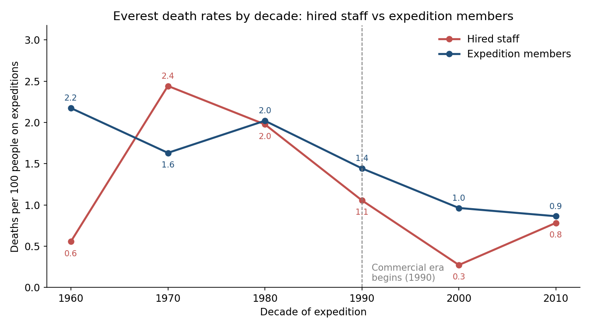
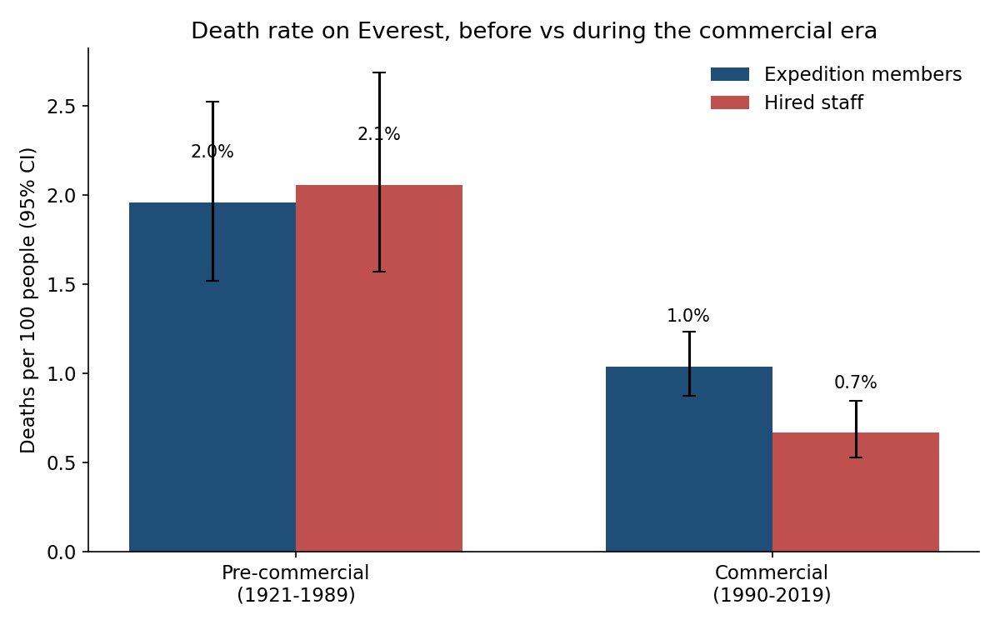

# Is Everest safer now? Yes: per person, deaths fell by half or more after 1990

Everest has become safer, and the gain is largest for the hired staff who carry most of the load. But the improvement has leveled off, and a few disaster years still decide how bad any single season is.

## The short version

Between the pre-commercial era (1921–1989) and the commercial era (1990–2019):

- **Expedition members:** death rate fell from **2.0 to 1.0 per 100** people.
- **Hired staff:** death rate fell from **2.1 to 0.7 per 100** people.

## Where the gain came from

Staff risk fell fastest. The hired-staff rate was 2.4 per 100 in the 1970s and 2.0 in the 1980s. It dropped to 1.1 in the 1990s and about 0.3 in the 2000s. Members improved more slowly: about 2.0 per 100 in the 1980s, 1.0 in the 2000s, and 0.9 in the 2010s.

## What changed on the mountain

The commercial era changed who climbs and how:

- **Smaller teams:** an average expedition went from 14.5 members to 6.3.
- **More oxygen:** the share of members using it rose from 20% to 53%.
- **More guided trips:** a named trekking agency appears on 97% of expeditions, up from 26%.
- **Different killers:** avalanches and icefall collapses made up a smaller share of deaths. Altitude sickness rose from 5% to 15% of deaths, and exhaustion from 2% to 12%.

## The catch: it has plateaued, and it is lumpy

Member death rates have stayed near 1 per 100 since 2000, so the trend has flattened. Hired-staff deaths are concentrated in a few years. The 2014 and 2015 seasons alone account for 28 of the 40 hired-staff deaths in the 2010s. Without those two years, the commercial-era staff rate falls to 0.4 per 100. The member rate barely moves: 1.0 per 100 with those years included, 1.1 without them.

## What this does and does not show

This data shows that deaths per person have fallen, and that the mix of people and equipment changed at the same time. It does not prove that any one change caused the fall: better forecasting, rescue, and route work may all have contributed. The data also stops in 2019.

*Source: Himalayan Database extract for Everest (2,149 expeditions, 1921–2019). Full method and numbers in `answer.md`.*
