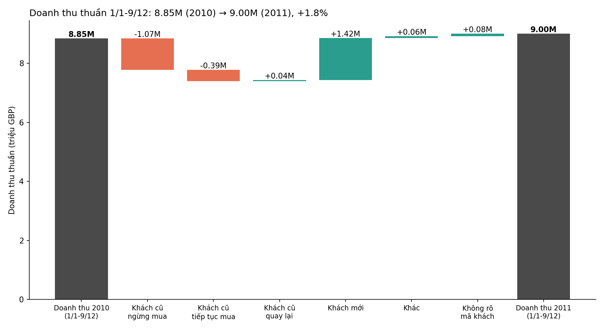
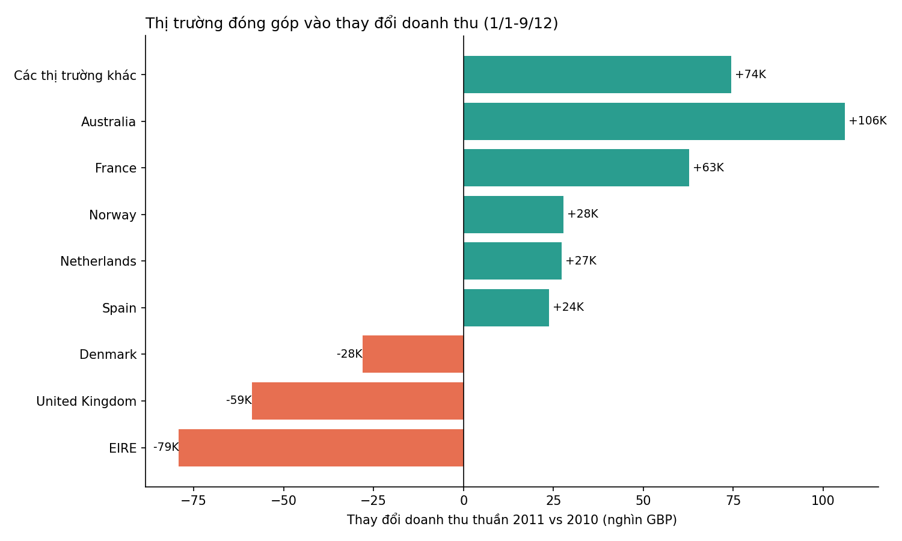

# Doanh thu thuần 2011 vs 2010: khách mới, khách cũ và thị trường

**Câu hỏi:** Doanh thu thuần 2011 thay đổi bao nhiêu so với 2010 (so sánh công bằng)? Phần thay đổi đến từ khách mới hay cũ? Thị trường nào kéo tăng/giảm nhiều nhất?

## Trả lời ngắn

- **So sánh công bằng (1/1–9/12, cùng kỳ hai năm):** doanh thu thuần tăng **+1,8%**, từ 8.845.679 GBP (2010) lên 9.001.425 GBP (2011), tức **+155.746 GBP**.
- **Khách mới** đóng góp **+1.422.846 GBP** (1.536 khách). **Khách cũ** (có mã khách) giảm **−1.351.412 GBP**, trong đó 1.557 khách (37% số khách 2010) ngừng mua gây ra −1.067.564 GBP. Khách không có mã: +84.312 GBP.
- **Thị trường:** UK giảm −58.869 GBP (−0,8%). Ngoài UK tăng +214.615 GBP. Tăng mạnh nhất: Australia (+106K), Pháp (+63K). Giảm mạnh nhất: Ireland/EIRE (−79K), Đan Mạch (−28K), Thụy Điển (−17K).

## Bằng chứng

| Nhóm | Thay đổi (GBP) | Ghi chú |
|---|---:|---|
| Khách mới (lần đầu mua 2011) | +1.422.846 | 1.536 khách, ~926 GBP/khách |
| Khách cũ - ngừng mua 2011 | −1.067.564 | 1.557 khách, ~679 GBP/khách năm 2010 |
| Khách cũ - tiếp tục mua | −385.881 | 2.642 khách; chi tiêu/khách −5,8% |
| Khách cũ - quay lại / chỉ hoàn trả | +102.033 | 41.820 quay lại + 60.213 chỉ hoàn trả; nhỏ |
| Không rõ mã khách | +84.312 | ~20–25% dòng không có mã (theo sheet) |
| **Tổng** | **+155.746** | Khớp chính xác |

Xem `decomposition_by_segment.csv`, `delta_by_country.csv`, `delta_by_country_segment.csv`.

## Phương pháp

1. **Gộp dữ liệu:** hai sheet chồng lấp 1–9/12/2010 (22.523 dòng mỗi bên). Dùng sheet 1 trước 1/12/2010 và sheet 2 từ đó trở đi, rồi loại 11.812 dòng trùng lặp hoàn toàn.
2. **Doanh thu thuần:** số lượng × đơn giá, sau khi trừ hoàn trả; bỏ dòng đơn giá ≤ 0.
3. **So sánh công bằng:** 1/1–9/12 cả hai năm (dữ liệu 2011 kết thúc 9/12/2011). So cả năm 2010 (9.216.136) với 2011 tới 9/12 cho kết quả −2,3%, không đúng.
4. **Phân loại khách:** "mới" = không có giao dịch mua nào trước 2011; "ngừng mua" = có mua trong 2010 nhưng không mua trong 2011 (cùng kỳ); "tiếp tục" = mua cả hai năm.
5. **Phân rã:** tổng thay đổi = tổng các nhóm, kiểm tra bằng assert trong `analysis.py`.

## Giới hạn

- **Tiền tệ:** dữ liệu không ghi đơn vị; giả định GBP.
- **Không có mã khách (~20–25% dòng):** chỉ phân loại được phần có mã; nhóm này đóng góp +84K.
- **"Khách mới" phụ thuộc lịch sử dữ liệu:** dữ liệu bắt đầu 12/2009, nên có thể có khách "mới" đã mua trước đó.
- **Độ tập trung:** khách mới không tập trung (top 10 = 14%), nhưng Australia +106K gần như toàn bộ đến từ khách cũ (+109K), nên tăng trưởng ở thị trường này dựa trên ít tài khoản.
- **Nhạy cảm định nghĩa:** chỉ tính dòng sản phẩm (bỏ phí gửi, phí ngân hàng, điều chỉnh) thì tăng trưởng +2,7% thay vì +1,8%.
- **Quan sát, không phải nhân quả.** Không có dữ liệu chi phí thu hút khách, biên lợi nhuận hay chi phí giữ chân.

## Hàm ý cho quyết định giữ khách hay tìm khách mới

Mất khách cũ và giảm chi tiêu ở khách còn lại cộng lại −1,45M, gần bằng doanh thu khách mới +1,42M. Đề xuất: **ưu tiên giữ chân khách cũ (đặc biệt UK), đồng thời tiếp tục tìm khách mới ở ngoài UK.** Đề xuất này cần kiểm tra lại khi có chi phí thu hút và giữ chân.

## Tệp đầu ra

- `analysis.py`, `concentration_check.py`: mã nguồn, chạy từ thư mục gốc dự án.
- `summary.csv`, `decomposition_by_segment.csv`, `delta_by_country.csv`, `delta_by_country_segment.csv`, `customer_segments.csv`
- `waterfall_change.png`, `delta_by_country.png`
- `story.md`: bản kể chuyện dữ liệu cho CEO
- `run_log.txt`, `concentration_log.txt`
