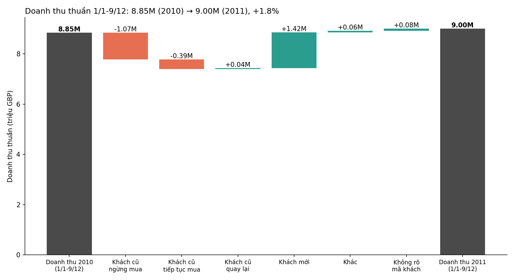
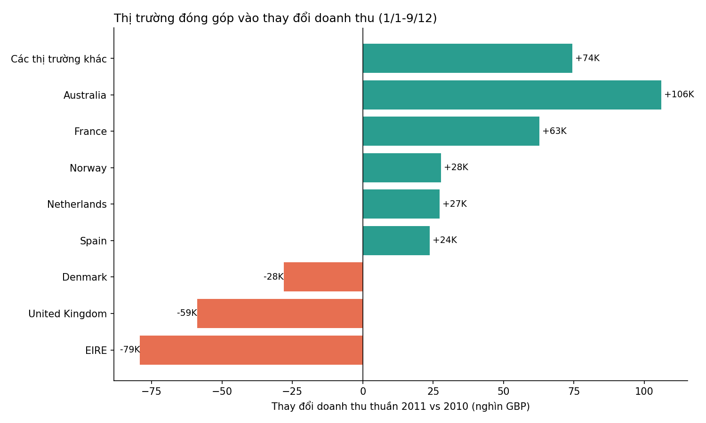

# Tăng trưởng 2011 đến từ khách mới, còn khách cũ đang rò rỉ doanh thu

**Cho:** CEO · **Dữ liệu:** giao dịch bán lẻ online của công ty quà tặng tại Anh, 1/12/2009 – 9/12/2011 · **Đơn vị:** GBP (giả định)

## Tóm tắt

Doanh thu thuần từ 1/1 đến 9/12 tăng **+1,8%** (8,85M → 9,00M GBP, +156K). Mức tăng này hoàn toàn nhờ **khách mới** (+1,42M). Nhóm **khách cũ** giảm **−1,35M**: 37% khách của 2010 đã không quay lại mua trong 2011, và số khách còn lại chi tiêu ít hơn 5,8% mỗi người. Thị trường UK giảm nhẹ (−0,8%), trong khi các thị trường ngoài UK tăng +215K.

## Bối cảnh: so sánh phải công bằng

Nếu so cả năm 2010 (9,22M) với 2011 (dữ liệu chỉ tới 9/12), doanh thu có vẻ giảm 2,3%. Đó là so sánh sai vì 2011 thiếu gần 3 tuần cuối năm. Vì vậy mọi con số dưới đây so cùng kỳ **1/1–9/12** của cả hai năm.

## Diễn biến 1: khách mới bù đắp, nhưng khách cũ đang rò rỉ

- **Khách mới (1.536 khách, lần đầu mua trong 2011): +1,42M.** Trung bình ~926 GBP/khách. Không phụ thuộc vài tài khoản lớn: top 10 khách mới chiếm 14% doanh thu nhóm này.
- **Khách cũ ngừng mua: −1,07M.** 1.557 khách (37% số khách 2010), trung bình 679 GBP/khách trong 2010. Top 10 khách chiếm 20% doanh thu bị mất.
- **Khách cũ tiếp tục mua: −0,39M.** 2.642 khách (63%) vẫn mua, nhưng chi tiêu trung bình giảm từ 2.520 xuống 2.374 GBP/khách (−5,8%).
- **Khách cũ quay lại + hoàn trả không kèm mua: +0,10M** (cộng gộp). Nhỏ, không đổi kết luận.
- **Khách không có mã (~20–25% dòng giao dịch): +0,08M.** Không phân loại được mới/cũ.

Kết luận: khách mới đã bù lại và vượt mức mất mát từ khách cũ. Nếu bỏ khách mới, doanh thu 2011 chỉ còn ~7,58M, giảm ~1,27M (−14%) so với 2010.

## Diễn biến 2: thị trường

- **UK (chiếm ~84% doanh thu 2011): −59K (−0,8%).** Khách mới +1,20M, nhưng khách mất −0,93M và khách còn lại giảm −0,50M. UK đang là nơi rò rỉ lớn nhất.
- **Ngoài UK: +215K (+).** Khách mới +0,22M, khách cũ tiếp tục mua +0,11M, mất khách −0,14M.
- **Tăng mạnh nhất:** Australia +106K (phần lớn từ khách cũ, +109K), Pháp +63K (khách mới +40K), Na Uy +28K, Hà Lan +27K, Tây Ban Nha +24K, Đức +21K (khách mới +57K), Nhật +19K.
- **Giảm mạnh nhất:** Ireland (EIRE) −79K (khách cũ tiếp tục mua −69K), Đan Mạch −28K (mất khách −30K), Thụy Điển −17K (mất khách −30K).

## Gợi ý quyết định: giữ khách cũ hay tìm khách mới?

**Đề xuất: ưu tiên giữ chân khách cũ, đặc biệt ở UK, và tiếp tục tìm khách mới ở ngoài UK.**

Lý do:
1. **Rò rỉ khách cũ lớn hơn lợi ích khách mới.** Khách mất và chi tiêu giảm ở khách còn lại cộng lại −1,45M, gần bằng toàn bộ doanh thu khách mới (+1,42M). Mỗi điểm % tỷ lệ mất khách 2010 gần 42 khách, tương đương ~28K GBP.
2. **Doanh thu khách mới chưa chứng minh được là bền.** Chúng tôi chưa biết bao nhiêu khách mới 2011 sẽ quay lại năm 2012.
3. **Tìm khách mới vẫn có giá trị ở ngoài UK.** Ở đây khách cũ giữ tốt hơn (tiếp tục mua +110K, mất khách −135K) và khách mới vẫn đóng góp +221K.

**Giới hạn của đề xuất:** dữ liệu không có chi phí thu hút khách, biên lợi nhuận hay chi phí giữ chân. Nếu chi phí thu một khách mới thấp hơn nhiều so với chi phí giữ khách cũ, lựa chọn có thể đảo ngược. Phép ước tính "mỗi điểm % tỷ lệ mất khách ≈ 28K GBP" là thô (giả định khách được giữ lại chi tiêu như khách đã mất năm 2010).

## Lưu ý phương pháp

- Doanh thu = số lượng × đơn giá, **sau khi trừ hoàn trả**; loại dòng có đơn giá ≤ 0; loại 11.812 dòng trùng lặp hoàn toàn. Hai sheet dữ liệu chồng lấp 1–9/12/2010 (22.523 dòng mỗi bên); chỉ tính một lần.
- Nếu chỉ tính dòng sản phẩm (bỏ phí gửi, phí ngân hàng...), tăng trưởng là +2,7% thay vì +1,8%. Kết luận không đổi.
- "Khách mới" = không có giao dịch mua nào trước 2011 trong dữ liệu. Dữ liệu bắt đầu từ 12/2009 nên có thể có một số khách "mới" thực ra đã mua trước đó.
- Dữ liệu quan sát, chỉ thể hiện liên hệ, không phải nhân quả.
- Thị trường theo quốc gia trên hóa đơn, không phải nơi ở của khách.
