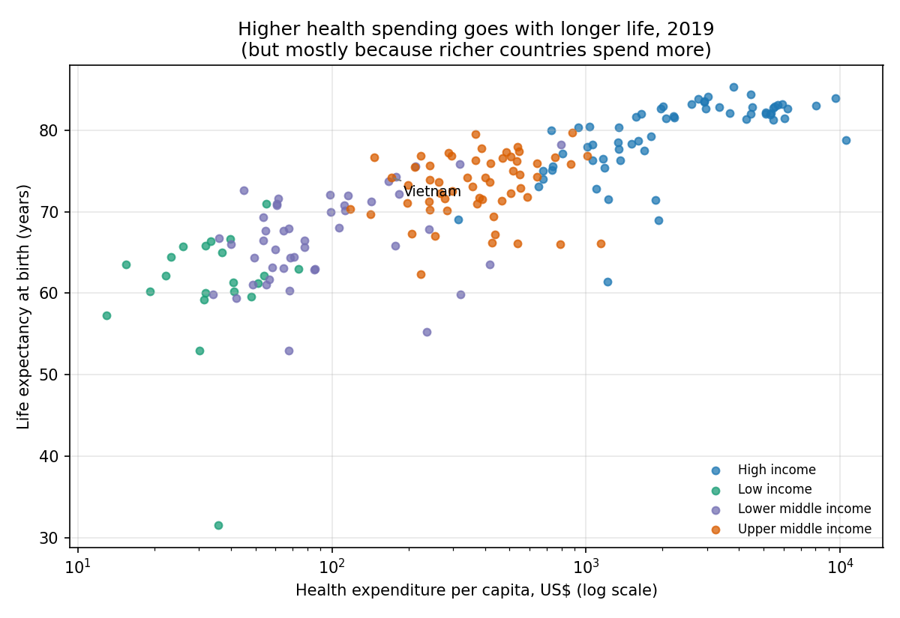
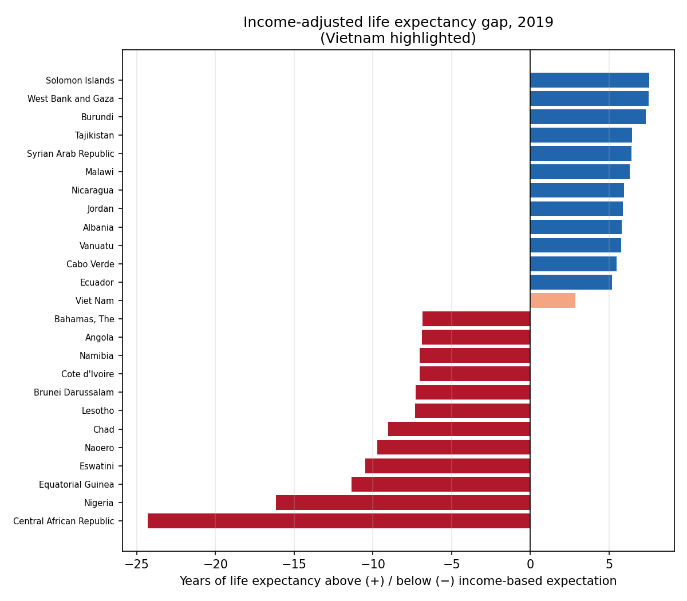

# Chi tiêu y tế và tuổi thọ: nhiều tiền hơn có sống lâu hơn không?

**Đối tượng:** Lãnh đạo Bộ Y tế
**Dữ liệu:** World Bank WDI, 186 quốc gia, năm 2019 (năm trước đại dịch, dữ liệu đầy đủ nhất). Chỉ số: tuổi thọ khi sinh, chi tiêu y tế bình quân đầu người (USD hiện hành), GDP bình quân đầu người (PPP).

## Thông điệp chính

Các nước chi tiêu y tế nhiều hơn thường sống lâu hơn, nhưng phần lớn mối liên hệ này đến từ mức thu nhập. Khi đã tính đến thu nhập, chi tiêu thêm chỉ còn liên quan yếu đến tuổi thọ. **Việt Nam sống thọ hơn mức thu nhập dự kiến khoảng 2,9 năm, nhưng chi tiêu y tế bình quân chỉ bằng khoảng một nửa nhóm nước cùng thu nhập trung bình cao.**

## 1. Chi tiêu cao đi cùng tuổi thọ cao

- Nhóm 25% nước chi ít nhất (trung vị khoảng 49 USD/người/năm) có tuổi thọ trung bình **63,2 năm**.
- Nhóm chi nhiều nhất (trung vị khoảng 2.924 USD) có tuổi thọ trung bình **80,5 năm**.
- Tương quan giữa chi tiêu (logarit) và tuổi thọ là r = 0,81.

## 2. Thu nhập giải thích phần lớn khoảng cách

- Riêng thu nhập (GDP/người PPP) giải thích 72% biến thiên tuổi thọ giữa các nước.
- Thêm chi tiêu y tế chỉ nâng lên 72,6%.
- Khi giữ thu nhập không đổi, tương quan riêng giữa chi tiêu và tuổi thọ chỉ còn r = 0,13 (p = 0,08, chưa đạt mức ý nghĩa thông thường 5%).
- Ước tính năm 2019: gấp đôi chi tiêu y tế bình quân liên quan tới khoảng **+0,6 năm** tuổi thọ, khoảng tin cậy 95% từ -0,3 đến +1,4 năm. Con số này không chắc chắn.
- Kiểm tra lại ở hai năm khác: năm 2010 cho khoảng +1,4 năm khi gấp đôi chi tiêu, năm 2023 cho khoảng +0,8 năm. Ở hai năm này mối liên hệ độc lập với thu nhập đạt ý nghĩa thống kê, nên 2019 là năm yếu nhất. Xem `robustness_by_year.csv`.

Ý nghĩa: chi tiêu thêm có liên quan tới tuổi thọ dài hơn, nhưng độ lớn của hiệu ứng không ổn định qua các năm và phần lớn khác biệt vẫn do thu nhập. Hiệu quả sử dụng tiền có thể quan trọng không kém số tiền.

## 3. Nước nào vượt và dưới kỳ vọng nhất

Kỳ vọng được tính từ thu nhập: tuổi thọ dự kiến của một nước có cùng GDP/người. Chênh lệch dương nghĩa là sống lâu hơn kỳ vọng.

| Vượt kỳ vọng | Chênh lệch (năm) | Dưới kỳ vọng | Chênh lệch (năm) |
|---|---|---|---|
| Quần đảo Solomon | +7,5 | Cộng hòa Trung Phi | -24,3 |
| Palestine (Bờ Tây và Gaza) | +7,5 | Nigeria | -16,2 |
| Burundi | +7,3 | Guinea Xích Đạo | -11,4 |
| Tajikistan | +6,5 | Eswatini | -10,5 |
| Syria | +6,4 | Nauru | -9,7 |
| Malawi | +6,3 | Chad | -9,0 |
| Nicaragua | +6,0 | Lesotho | -7,3 |
| Jordan | +5,9 | Brunei | -7,3 |
| Albania | +5,8 | Côte d'Ivoire | -7,1 |
| Vanuatu | +5,8 | Namibia | -7,0 |

Trong 15 nước dẫn đầu mỗi nhóm, nhóm dưới kỳ vọng tập trung ở châu Phi cận Sahara (Nigeria, Guinea Xích Đạo, Eswatini, Chad, Lesotho, Côte d'Ivoire, Namibia, ...). Nhóm vượt kỳ vọng đa dạng hơn về khu vực. Đây là danh sách để tìm hiểu thêm, chưa phải kết luận về nguyên nhân: dữ liệu này không cho biết lý do.

## 4. Việt Nam đứng ở đâu

- Tuổi thọ 2019: **74,2 năm**. Kỳ vọng theo thu nhập (GDP/người PPP khoảng 11.029 USD): 71,4 năm. Chênh lệch **+2,9 năm**.
- Xếp hạng: **thứ 48/186** nước (khoảng top 26%). Trong nhóm thu nhập trung bình cao hiện nay, Việt Nam đứng **thứ 15/57**, cao hơn trung vị nhóm.
- Chi tiêu y tế bình quân: 171 USD/người, bằng khoảng 44% trung vị nhóm (389 USD).

Nhưng vị trí này không ổn định:

| Năm | Chênh lệch so với kỳ vọng | Xếp hạng |
|---|---|---|
| 2010 | +7,2 năm | 6/184 |
| 2019 | +2,9 năm | 48/186 |
| 2023 | +2,3 năm | 51/184 |

Việt Nam vẫn sống thọ hơn mức thu nhập gợi ý, nhưng lợi thế đã thu hẹp khi thu nhập tăng nhanh và chi tiêu chưa theo kịp. Đây là tín hiệu cần theo dõi, không phải kết luận về chất lượng y tế.

## Gợi ý hành động

1. **Không chỉ tăng ngân sách.** Thu nhập giải thích phần lớn khác biệt tuổi thọ, và hiệu ứng riêng của chi tiêu không ổn định qua các năm. Nên đo hiệu quả sử dụng tiền (ví dụ tỷ lệ chi cho y tế dự phòng và chăm sóc ban đầu). Cơ cấu chi tiêu công/tư không nằm trong phân tích này và cần số liệu riêng.
2. **Theo dõi lợi thế so với nhóm cùng thu nhập** thay vì so với các nước giàu. Lợi thế hiện tại (+2,9 năm) đang giảm dần từ 2010 đến 2023.
3. **Rà soát các nước bên cạnh đã vượt kỳ vọng** (ví dụ Jordan, Albania, Sri Lanka, Maldives) để học các chính sách cụ thể, đặc biệt về phân bổ ngân sách và chăm sóc ban đầu.

## Hạn chế

- **Quan sát, không phải nhân quả.** Tương quan không chứng minh chi tiêu gây ra tuổi thọ.
- **Phân tích chính dựa trên một năm (2019).** Tương quan thô ổn định (r ≈ 0,80–0,83 ở cả 2010, 2019, 2023), nhưng hiệu ứng riêng sau khi tính thu nhập đạt ý nghĩa ở 2010 và 2023 và yếu ở 2019.
- **Số liệu ước tính.** Tuổi thọ và chi tiêu của nhiều nước là ước tính của World Bank. Một số giá trị cực đoan, như Cộng hòa Trung Phi (31,5 năm) và Nigeria (53,0 năm), cần kiểm chứng trước khi trích dẫn.
- **Xung đột và thiên tai** (ví dụ Syria) làm méo kỳ vọng và có thể làm sai lệch xếp hạng ở các nước đó.
- **Chi tiêu tính bằng USD hiện hành**, không điều chỉnh lạm phát hay tỷ giá PPP. Việc so sánh theo thời gian cần thận trọng.
- **Không có dữ liệu** về cơ cấu chi tiêu (công/tư, tự chi), chất lượng dịch vụ, hay tỷ lệ tử vong theo nguyên nhân trong phân tích này.

*Phương pháp chi tiết và số liệu: `analysis.py`, `gap_vs_income_2019.csv`, `robustness_by_year.csv`.*
