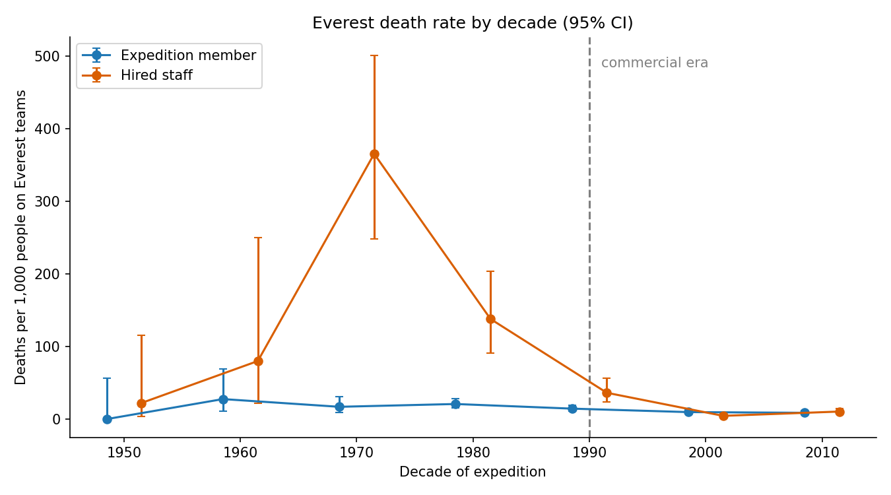

# Has Everest become safer?

**Yes, a lot, but the biggest gains went to the people who carry the risk for everyone else, and those gains have stalled.**

*Source: Himalayan Database, Everest (peak EVER) records for 1950–2019, 21,813 team-member entries. Code and tables are in `outputs/everest-safety/`.*

## Two kinds of climbers

The data separates **expedition members**, who are the paying or permit-holding climbers, from **hired staff**. Hired staff are mostly Sherpa and other high-altitude workers who fix ropes, carry loads and guide. The measure used here is deaths per 1,000 people listed on Everest teams. One person on two expeditions counts twice, so this is closer to risk per expedition than risk per lifetime.

## 1. Before 1990: the staff took the heaviest risk

Between 1950 and 1989, **about 1 in 6 hired staff on the mountain died (157 per 1,000)**, against about 1 in 50 expedition members (20 per 1,000). In the 1970s the staff rate peaked at 365 per 1,000, but that is only 52 people and 19 deaths, so treat it as rough.

## 2. Since 1990: both rates fell, staff far more

| Era | Expedition members | Hired staff |
|---|---|---|
| 1950–1989 | 19.8 per 1,000 (54 deaths) | 157.3 per 1,000 (42 deaths) |
| 1990–2019 | 10.4 per 1,000 (128 deaths) | 10.7 per 1,000 (68 deaths) |

- Member risk **roughly halved**. Staff risk fell about **15-fold**. Both drops are statistically clear (p < 0.001).
- In the commercial era the two groups carry about the same risk (10.4 vs 10.7 per 1,000, no meaningful difference).
- The mountain has also become far more crowded. Team entries were 2,988 in 1950–1989 and 18,653 in 1990–2019, so total deaths rose even as the rate fell.

## 3. What changed

Summit success went up, and **oxygen use rose in step with it**:

- Among expedition members, the summit rate rose from 7% in the 1980s to 52% in the 2010s.
- The share using bottled oxygen rose from 19% to 62% over the same period.

These match the commercial era's guided, supported climbs, but this data cannot prove what caused the safer outcomes. The data does not record fixed ropes, weather forecasting or guide experience.

## 4. Progress has stalled, and disasters hit staff hardest

Hired-staff deaths per 1,000 by five-year period:

| Years | 1990–94 | 1995–99 | 2000–04 | 2005–09 | 2010–14 | 2015–19 |
|---|---|---|---|---|---|---|
| Staff | 46.9 | 28.9 | 3.2 | 5.1 | **15.0** | 7.1 |
| Members | 10.2 | 19.1 | 10.0 | 9.4 | 7.8 | 9.5 |

- Staff risk was at its lowest in the 2000s, then rose again in 2010–14.
- Two events drive this. **2014** (an avalanche in the Khumbu Icefall) killed 17 staff and no members. **2015** (the Nepal earthquake) killed 11 staff and 3 members.
- Without those two years, the 1990–2019 staff rate is **6.8 per 1,000**, against 11.0 for members. That is lower than the members' rate.
- Across the individual years since 1990, there is no statistically clear downward trend for either group. The big drop happened around the turn of the millennium, and since then rates have been flat at about 5–15 per 1,000.

**Causes differ by group** (deaths since 1990):

| Group | Leading causes |
|---|---|
| Hired staff | Avalanche 33 of 68, fall 8 |
| Expedition members | Fall 31, altitude sickness 24, exhaustion 23 |

Staff are lost mostly to mountain hazards they cannot avoid, such as avalanches in the Icefall. Members die more from altitude and exhaustion.

## Bottom line

Everest is safer than it was. A typical climber's risk of dying on a trip is about half what it was before 1990, and for staff it is a small fraction of what it was. But a rate of about 10 deaths per 1,000 is not low, and since 2000 it has stopped improving. Each additional crowded season adds to the number of people exposed to avalanches.

## Caveats

- **Observational data.** These are associations, not proof of what made the mountain safer.
- **Counting people.** The member table lists 6,730 hired-staff entries for Everest, but the expedition table reports 12,741 hired staff above base camp. The member table may therefore miss many staff, and the rate depends on which were recorded. Deaths match exactly (186 members, 120 staff in both tables).
- **Hired-staff numbers before 1990 are small** (267 entries), so those rates are imprecise. See the confidence intervals in `by_decade.csv`.
- **Deaths per summit** (an alternative denominator) gives a similar picture, in `by_era.csv`.
- The records run to spring 2019, so the COVID years and later are not covered. The data shows what was recorded, and unrecorded deaths and early-era gaps are possible.
