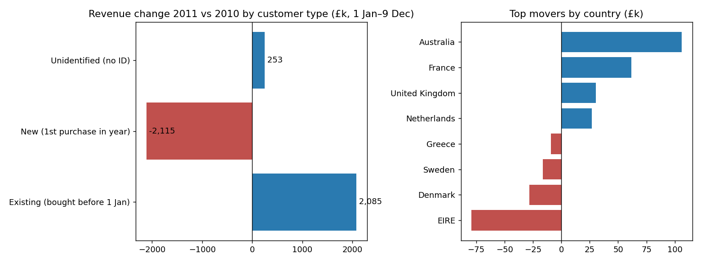

# Doanh thu 2011: tăng nhẹ, nhưng nhờ khách cũ – còn nguồn khách mới đang cạn

**Thông điệp chính:** Doanh thu thuần 2011 chỉ tăng **+2,5%** so với cùng kỳ 2010. Mức tăng đó do khách cũ gánh, trong khi số khách mới giảm mạnh. Khuyến nghị: **ưu tiên giữ chân khách cũ trước, đồng thời sửa kênh thu hút khách mới, vì kênh này đang yếu đi.**

## 1. So sánh công bằng: +2,5%, không phải −1,5%
- Dữ liệu 2011 dừng ngày 9/12/2011. So cả năm 2011 (£9,03 triệu) với cả năm 2010 (£9,17 triệu) sẽ thấy −1,5%, nhưng cách này sai vì 2011 thiếu 3 tuần cuối năm.
- So cùng kỳ **1/1–9/12 mỗi năm**: £8,81 triệu (2010) → **£9,03 triệu (2011), +£223 nghìn, +2,5%**.
- Doanh thu thuần = số lượng × đơn giá, đã trừ hàng trả lại. Tiền trả lại tăng gấp đôi, từ £228 nghìn lên £461 nghìn. Tôi đã bỏ phí vận chuyển, phí ngân hàng và các dòng điều chỉnh. Hai sheet Excel trùng nhau 1.088 hóa đơn ở 1–9/12/2010, nên chỉ giữ một bản.
- Tăng trưởng không đều: tháng 1–4/2011 thấp hơn 2010 (−4% đến −24%), tháng 5–9 cao hơn (+6% đến +20%), tháng 10 đi ngang.

## 2. Khách cũ gánh tăng trưởng, khách mới tụt lại
Phân loại theo lần mua đầu tiên của mỗi mã khách hàng trong toàn bộ dữ liệu:

| Nhóm | 2010 | 2011 | Thay đổi |
|---|---|---|---|
| Khách cũ (đã mua trước 1/1 năm đó) | £4,22 triệu | £6,31 triệu | **+£2,09 triệu** |
| Khách mới (mua lần đầu trong năm) | £3,54 triệu | £1,43 triệu | **−£2,11 triệu** |
| Không có mã khách (khách vãng lai) | £1,04 triệu | £1,30 triệu | +£0,25 triệu |
| **Tổng** | £8,81 triệu | £9,03 triệu | **+£0,22 triệu** |

Hai nhóm lớn gần như triệt tiêu nhau, nên mức +2,5% che giấu một sự dịch chuyển lớn.

**Lưu ý quan trọng:** dữ liệu bắt đầu từ 12/2009, nên ở 2010 gần như ai cũng bị tính là "mới", kể cả người thực ra đã mua từ trước. Con số "khách mới 2010" vì vậy bị thổi phồng và chênh lệch ±£2,1 triệu ở trên là **phóng đại**. Nếu 2011 chỉ nhìn lại đúng 1 tháng như 2010, kết luận thậm chí đảo chiều (khách mới 2011 £3,89 triệu so với £3,54 triệu), nên không nên trích dẫn con số ±£2,1 triệu như thật. Kiểm tra bằng số khách mới theo tháng, tháng 7–11 (lúc này ảnh hưởng của lỗi trên đã nhỏ):
- Khách mới tháng 7–11/2010: **1.278**; cùng kỳ 2011: **807**, tức **−37%**.
- Khách cũ giữ nhịp tốt: 73% khách mua lần đầu 12/2009 và 59% khách mua lần đầu trong 2010 quay lại mua trong 2011.
- Gần như toàn bộ doanh thu "cũ" 2011 (£6,27 triệu trên £6,31 triệu) đến từ khách đã mua trong 2010, rất ít từ khách ngủ đông quay lại.

## 3. Thị trường: Anh đi ngang, tăng đến từ xuất khẩu
Anh chiếm khoảng 84% doanh thu và gần như không đổi (£7,58 triệu → £7,61 triệu, +0,4%). Phần tăng thêm nằm ở các thị trường nhỏ hơn:

| Kéo tăng nhiều nhất | Thay đổi | Kéo giảm nhiều nhất | Thay đổi |
|---|---|---|---|
| Úc | +£106 nghìn (×4,5) | Ireland (EIRE) | −£79 nghìn (−24%) |
| Pháp | +£62 nghìn (+55%) | Đan Mạch | −£28 nghìn (−63%) |
| Hà Lan | +£27 nghìn (+11%) | Thụy Điển | −£16 nghìn (−34%) |
| Tây Ban Nha | +£24 nghìn (+92%) | Hy Lạp | −£9 nghìn (−68%) |

Úc và Pháp cộng lại (+£168 nghìn) bằng khoảng ba phần tư mức tăng ròng £223 nghìn. Nhiều thị trường tăng rất mạnh về tỷ lệ nhưng từ nền nhỏ, nên coi là tín hiệu chứ chưa phải xu hướng. Úc có thể chỉ do vài khách sỉ lớn (chưa kiểm tra). Ở cả Anh lẫn ngoài Anh, khách cũ tăng còn khách mới giảm, nên mô hình này không chỉ nằm ở một thị trường.

## 4. Quyết định cho CEO
1. **Giữ chân khách cũ là nền tảng.** Khoảng 70% doanh thu 2011 đến từ khách đã mua trước 2011. Khách mới 2010 mới giữ được 59%, còn dư địa.
2. **Không bỏ qua khách mới.** Nếu khách mới tiếp tục giảm cỡ 37%, nền khách cũ của 2012 sẽ nhỏ đi và tăng trưởng sẽ cạn. Cần tìm nguyên nhân (ngân sách quảng cáo, kênh bán, sản phẩm) trước khi rót thêm tiền.
3. **Theo dõi hàng trả lại**, đã tăng gấp đôi; cần xem là do nhóm sản phẩm nào.
4. **Xuất khẩu** (Úc, Pháp, Tây Ban Nha) là hướng thử nghiệm nhỏ; Ireland và Bắc Âu cần kiểm tra vì sao giảm.

## Giả định và giới hạn
- Dữ liệu chỉ là quan sát, cho thấy mối liên hệ chứ không chứng minh nguyên nhân.
- Khoảng 11–14% doanh thu không có mã khách hàng, nên không phân loại được cũ/mới.
- "Cũ/mới" dựa trên lần mua đầu thấy trong dữ liệu (từ 12/2009), như đã nói ở mục 2.
- Số liệu do `rev/analysis.py` tạo ra; chi tiết trong các file CSV ở `rev/`.
