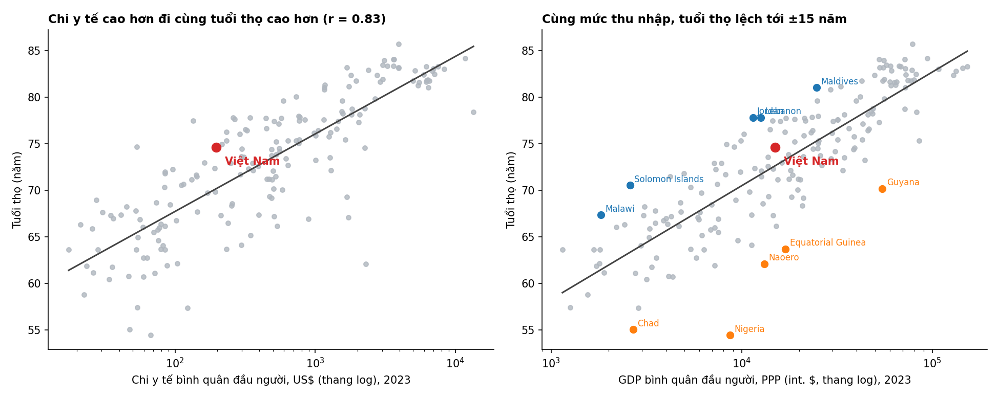
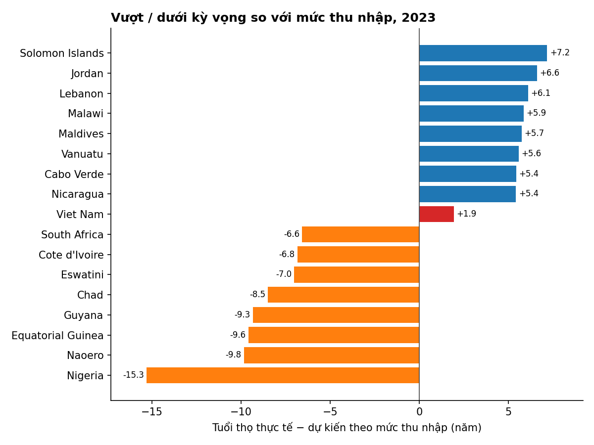

# Chi y tế, thu nhập và tuổi thọ: Việt Nam đang ở đâu?

*Dành cho lãnh đạo Bộ Y tế · Dữ liệu World Bank WDI (cập nhật 10/2026), năm 2023, 184 quốc gia/nền kinh tế có đủ số liệu*

## Thông điệp chính
**Việt Nam vẫn sống thọ hơn mức "kỳ vọng" theo thu nhập (+1,9 năm), nhưng lợi thế này đã thu hẹp mạnh: từ +11,1 năm (hạng 2/180) năm 2000 xuống +1,9 năm (hạng 56/184) năm 2023.** Chi y tế cao hơn đi cùng tuổi thọ cao hơn, song phần lớn mối liên hệ đó là do thu nhập; phần đóng góp riêng của chi y tế nhỏ hơn nhiều.

## 1. Quốc gia chi y tế nhiều hơn có sống thọ hơn không? — Có, nhưng đừng đọc thành "chi thêm là sống thọ hơn"

- Tương quan giữa log chi y tế bình quân đầu người và tuổi thọ là **r = 0,83**; chi y tế giải thích khoảng 69% biến thiên tuổi thọ giữa các nước.
- Nhưng chi y tế và thu nhập gần như đi cùng nhau (r = 0,91). Chỉ riêng thu nhập (GDP/người PPP) đã giải thích **75%** biến thiên tuổi thọ.
- Khi đưa cả hai vào mô hình, tác động riêng của chi y tế giảm còn khoảng **1/3** (hệ số 3,6 → 1,1 năm cho mỗi lần log tăng). Gấp đôi chi y tế đi kèm **+2,5 năm** nếu không kiểm soát thu nhập, chỉ còn **+0,8 năm** khi đã kiểm soát (p = 0,003). Đây là mối liên hệ, không chứng minh nhân quả.
- Mối liên hệ rõ nhất ở nhóm thu nhập cao (r = 0,57) và yếu ở nhóm thu nhập thấp (r ≈ 0): ở nước nghèo, *chi vào đâu* và các yếu tố khác (xung đột, HIV, bệnh truyền nhiễm) quan trọng hơn *chi bao nhiêu*.

## 2. Sau khi tính đến thu nhập: ai vượt, ai dưới kỳ vọng?
Kỳ vọng = tuổi thọ dự đoán từ đường hồi quy tuổi thọ theo log GDP/người PPP. Độ lệch chuẩn của phần dư là 3,6 năm.

| Vượt kỳ vọng nhiều nhất | Chênh (năm) | Dưới kỳ vọng nhiều nhất | Chênh (năm) |
|---|---|---|---|
| Solomon Islands | +7,2 | Nigeria | −15,3 |
| Jordan | +6,6 | Nauru | −9,8 |
| Lebanon | +6,1 | Guinea Xích đạo | −9,6 |
| Malawi | +5,9 | Guyana | −9,3 |
| Maldives | +5,7 | Chad | −8,5 |

- Nhóm vượt kỳ vọng phần lớn là nước thu nhập thấp/trung bình chi y tế khiêm tốn (Malawi chỉ 41 US$/người/năm; Sri Lanka 134 US$ nhưng tuổi thọ 77,5). Cho thấy tuổi thọ cao không nhất thiết đòi hỏi chi tiêu lớn.
- Nhóm dưới kỳ vọng gồm nước giàu tài nguyên (Guinea Xích đạo, Guyana, Nauru, Brunei), nơi GDP/người cao không chuyển thành sức khỏe, và các nước gánh nặng bệnh tật/bất ổn lớn (Nigeria, Chad, Eswatini, Lesotho, Nam Phi, Côte d'Ivoire). Nauru chi y tế 2.292 US$/người vẫn dưới kỳ vọng: **chi nhiều không đảm bảo kết quả**.
- Danh sách khá ổn định: tương quan hạng của phần dư với năm 2019 và 2022 là 0,94, và 0,99 với mô hình bậc hai. Cả 10 nước ở mỗi đầu vẫn lệch ít nhất 4,9 năm khi kiểm soát thêm chi y tế. Riêng Lebanon (2019: +2,9 so với +6,1 năm 2023) và Guyana (−3,3 so với −9,3) biến động mạnh, nên cần đọc thận trọng.

## 3. Việt Nam: tuổi thọ 74,6 năm, chi y tế 197 US$/người, GDP 15.034 int.$/người
- **Dự đoán theo thu nhập: 72,6 năm; thực tế 74,6 → +1,9 năm (hạng 56/184).** Mức này chỉ nằm khoảng +0,5 độ lệch chuẩn, tức là "tốt hơn mức trung bình một chút", chưa phải nổi bật.
- Trong 31 nước có GDP/người gần Việt Nam (−25% đến +33%), Việt Nam đứng **thứ 9/32**. Các nước đứng trước (Jordan, Lebanon, Sri Lanka, Ecuador, Peru, Tunisia, Iran, Algeria) có tuổi thọ 76–78 năm.
- Hiệu quả theo chi tiêu: chỉ **2** trong 59 nước chi y tế ít hơn Việt Nam có tuổi thọ cao hơn. 83 nước sống thọ hơn Việt Nam, với mức chi y tế trung vị khoảng 1.645 US$, gấp ~8 lần Việt Nam.
- So khu vực: Việt Nam trên Indonesia (−1,6), Philippines (−1,2), Malaysia (−0,7) và Singapore (−1,6), xấp xỉ Thái Lan (+1,4) và Campuchia (+1,8), thấp hơn Trung Quốc (+2,6).

**Xu hướng đáng chú ý:**

| Năm | Tuổi thọ VN | Chênh so với kỳ vọng (năm) | Hạng |
|---|---|---|---|
| 2000 | 72,8 | +11,1 | 2/180 |
| 2010 | 73,6 | +6,9 | 6/184 |
| 2019 | 74,2 | +2,9 | 45/186 |
| 2023 | 74,6 | +1,9 | 56/184 |

Tuổi thọ của Việt Nam chỉ tăng 1,8 năm trong 23 năm (72,8 → 74,6), trong khi các nước cùng mức thu nhập đã bắt kịp, nên "dư địa vượt kỳ vọng" bị bào mòn. (Độ lệch mỗi năm so với đường hồi quy của chính năm đó.) Tuổi thọ đã đi gần tới đường trung bình theo thu nhập, nên **một giả thuyết hợp lý (dữ liệu này không kiểm định được) là các thành tựu y tế cơ bản đã được khai thác và bước tiếp theo đòi hỏi giải quyết bệnh không lây nhiễm và chất lượng dịch vụ.**

## Hàm ý cho Bộ Y tế
1. Không nên đặt mục tiêu tuổi thọ chỉ bằng cách tăng tổng chi: bằng chứng cho thấy hiệu quả nằm ở cách chi (Sri Lanka, Maldives, Cabo Verde, Jordan là các tham chiếu học hỏi).
2. Việt Nam chi y tế thấp mà tuổi thọ tương đối cao là điểm mạnh về hiệu quả, nhưng khoảng cách với nhóm tham chiếu cùng thu nhập (76–78 năm) cho thấy còn khoảng 2–3 năm tuổi thọ để cải thiện.
3. Gợi ý (suy luận, chưa kiểm định bằng dữ liệu này): nên bổ sung phân tích theo nguyên nhân tử vong, tuổi thọ khỏe mạnh (HALE), và cơ cấu chi (chi tiền túi, y tế dự phòng/cơ sở) để biết *chi vào đâu* mới hiệu quả. Dữ liệu hiện tại không cho phép trả lời.

## Phương pháp và lưu ý
- Năm 2023 (năm mới nhất có đủ số liệu cho nhiều nước nhất); chỉ giữ quốc gia/nền kinh tế, bỏ các nhóm tổng hợp. Mất 33 trong 217 nền kinh tế do thiếu chi y tế hoặc GDP (không có Việt Nam trong nhóm này). Hồi quy OLS (tuổi thọ theo ln(GDP PPP)), chạy bằng `outputs/health_spending_life_expectancy/analysis.py`.
- **Chi y tế tính theo US$ hiện hành (không phải PPP).** Ở những nước giá cả thấp như Việt Nam, 197 US$ mua được nhiều dịch vụ hơn con số danh nghĩa, nên mức chi thực sự bị đánh giá thấp một phần.
- Đây là so sánh giữa các quốc gia tại một thời điểm, chỉ nêu mối liên hệ, không phải nhân quả. Tuổi thọ còn chịu ảnh hưởng của dinh dưỡng, giáo dục, vệ sinh, xung đột, HIV, v.v.
- Các nước nhỏ hoặc dựa vào tài nguyên/dầu mỏ (Nauru, Guinea Xích đạo, Guyana, Brunei, quần đảo Thái Bình Dương) có GDP/người biến động lớn; ước tính tuổi thọ ở các nước có dữ liệu hạn chế (như Nigeria) có thể kém chắc chắn. Độ lệch của chúng nên được coi là tín hiệu để kiểm tra, không phải kết luận về chất lượng hệ thống y tế.
- Hạng của Việt Nam nhạy với cách làm: phần dư là +1,9 (2023), +2,7 (2022), +2,3 (mô hình bậc hai), +2,7 (khi kiểm soát thêm chi y tế). Kết luận "+2 đến +3 năm, trên trung bình nhưng không nổi bật" là ổn định.

*Tệp kết quả: `country_residuals_2023.csv`, `top10_over.csv`, `top10_under.csv`, `vietnam_trend.csv`, `vietnam_and_neighbours.csv`, `robustness_residuals.csv`, `by_income_group.csv`.*
