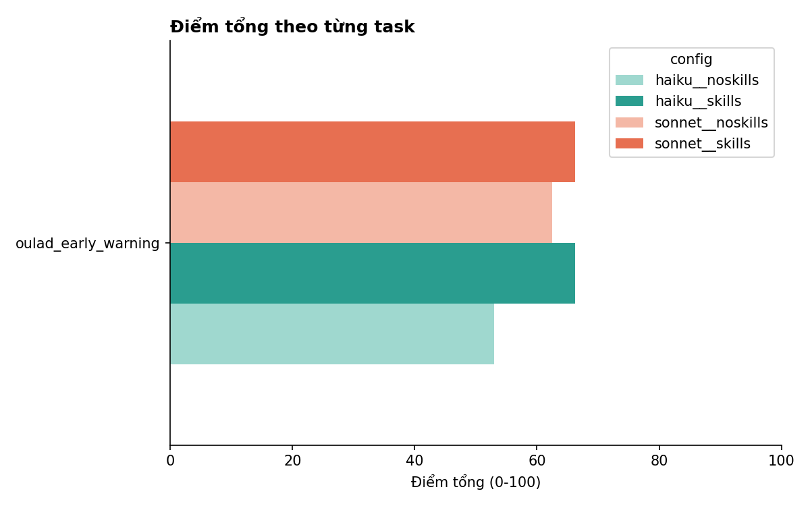
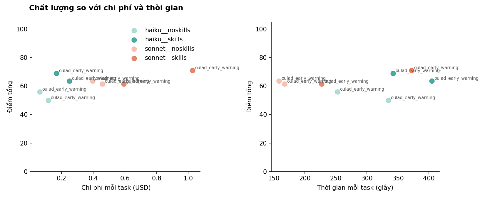
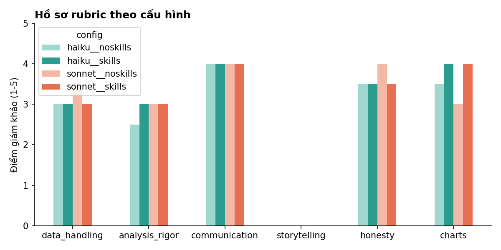

# Benchmark bộ skill - lượt chạy `oulad-1`

## Theo cấu hình (model __ biến thể)
| config | tasks | overall | accuracy | quality | storytelling | cost_total | cost_per_task | time_per_task_s | tokens_per_task | output_tokens_per_task | thinking_tokens_per_task | charts_per_task | turns_per_task | skill_hit_pct | finished | score_per_dollar |
|---|---|---|---|---|---|---|---|---|---|---|---|---|---|---|---|---|
| haiku__noskills | 2 | 53.0 | 50.0 | 57.5 |  | 0.178 | 0.089 | 293.5 | 2,451,090.0 | 57,594.0 | 23,053.0 | 3.500 | 48.0 |  | 2 | 596.5 |
| haiku__skills | 2 | 66.2 | 68.8 | 62.5 |  | 0.416 | 0.208 | 373.2 | 2,434,568.5 | 80,301.0 | 41,056.5 | 4.000 | 47.5 | 0.000 | 2 | 318.4 |
| sonnet__noskills | 2 | 62.5 | 62.5 | 62.5 |  | 0.855 | 0.427 | 162.6 | 484,424.5 | 21,156.5 | 2,176.0 | 2.500 | 18.5 |  | 2 | 146.2 |
| sonnet__skills | 2 | 66.2 | 68.8 | 62.5 |  | 1.620 | 0.810 | 299.6 | 1,362,631.0 | 41,131.5 | 5,471.0 | 5.500 | 27.0 | 0.000 | 2 | 81.8 |

## Hiệu quả của skills (có skills - không skills, cùng model và task)
| task | model | d_overall | d_accuracy_pct | d_quality_pct | d_cost_usd | d_wall_s |
|---|---|---|---|---|---|---|
| oulad_early_warning | haiku | 13.2 | 18.8 | 5.000 | 0.119 | 79.7 |
| oulad_early_warning | sonnet | 3.750 | 6.250 | 0.000 | 0.383 | 137.0 |

| model | d_overall | d_accuracy_pct | d_quality_pct | d_cost_usd | d_wall_s |
|---|---|---|---|---|---|
| haiku | 13.2 | 18.8 | 5.000 | 0.119 | 79.7 |
| sonnet | 3.750 | 6.250 | 0.000 | 0.383 | 137.0 |

## Theo từng task
| task | config | overall | accuracy_pct | quality_pct | s_storytelling | wall_s | cost_usd | total_tokens | output_tokens | turns | skill_hit_pct | n_charts | has_story |
|---|---|---|---|---|---|---|---|---|---|---|---|---|---|
| oulad_early_warning | haiku__noskills | 56.0 | 50.0 | 65.0 |  | 252.4 | 0.062 | 2124809 | 49423 | 45 |  | 3 | True |
| oulad_early_warning | haiku__noskills | 50.0 | 50.0 | 50.0 |  | 334.6 | 0.116 | 2777371 | 65765 | 51 |  | 4 | True |
| oulad_early_warning | haiku__skills | 69.0 | 75.0 | 60.0 |  | 341.9 | 0.168 | 1855186 | 73937 | 36 | 0.000 | 4 | True |
| oulad_early_warning | haiku__skills | 63.5 | 62.5 | 65.0 |  | 404.5 | 0.249 | 3013951 | 86665 | 59 | 0.000 | 4 | True |
| oulad_early_warning | sonnet__noskills | 61.5 | 62.5 | 60.0 |  | 167.1 | 0.458 | 367151 | 24374 | 13 |  | 3 | True |
| oulad_early_warning | sonnet__noskills | 63.5 | 62.5 | 65.0 |  | 158.0 | 0.397 | 601698 | 17939 | 24 |  | 2 | True |
| oulad_early_warning | sonnet__skills | 61.5 | 62.5 | 60.0 |  | 227.1 | 0.593 | 746333 | 32446 | 20 | 0.000 | 5 | True |
| oulad_early_warning | sonnet__skills | 71.0 | 75.0 | 65.0 |  | 372.0 | 1.027 | 1978929 | 49817 | 34 | 0.000 | 6 | True |

## Các tiêu chí bị trượt
| task | config | failed_checks |
|---|---|---|
| oulad_early_warning | haiku__noskills | AQ3 rò rỉ/đạo đức: không dùng cột kết quả/thuộc tính nhạy cảm; tma1_score bị loại hoặc đượ | AQ3 kết quả: PR-AUC test ~0,66±0,05, so với baseline, recall/precision tại ngưỡng từ valid | AQ4: xếp hạng trong từng module-kỳ (200 mỗi nhóm), precision@200 khớp (BBB ~0,76, FFF ~0,8 | AQ5: giải thích theo từng sinh viên bằng tiếng Việt đơn giản, dựa trên đóng góp mô hình, k |
| oulad_early_warning | haiku__noskills | AQ3 rò rỉ/đạo đức: không dùng cột kết quả hay thuộc tính nhạy cảm; tma1_score bị loại hoặc | AQ3 kết quả: PR-AUC test ±0,05 so với tham chiếu, có baseline, recall/precision ở ngưỡng c | AQ4: xếp hạng trong từng module-kỳ trên kỳ test, precision@200 khớp tham chiếu (BBB ~0,76, | Không tuyên bố nhân quả; nêu giới hạn quan sát/khái quát hóa |
| oulad_early_warning | haiku__skills | AQ3 kết quả: PR-AUC test ±0,05 so với tham chiếu, có baseline, nói rõ mục tiêu 70% | AQ4: xếp hạng trong từng module-kỳ trên kỳ test, precision@200 khớp, so với tỉ lệ cơ sở |
| oulad_early_warning | haiku__skills | AQ3 rò rỉ/đạo đức: không dùng cột kết quả/thuộc tính nhạy cảm; tma1_score bị loại hoặc đượ | AQ3 kết quả: PR-AUC test ±0,05 so với tham chiếu (~0,66), có baseline, ngưỡng từ validatio | AQ4: xếp hạng trong từng module-kỳ (200 mỗi bên), precision@200 khớp (BBB ~0,76, FFF ~0,88 |
| oulad_early_warning | sonnet__noskills | AQ3 rò rỉ/đạo đức: không dùng biến kết quả hay biến nhạy cảm; tma1_score bị loại hoặc được | AQ3 kết quả: PR-AUC test ≈0,66 so với baseline; recall tại ngưỡng validation | AQ4: xếp hạng riêng từng module-kỳ, precision@200 ≈ BBB 0,76 / FFF 0,88, so với tỉ lệ nền |
| oulad_early_warning | sonnet__noskills | AQ3 rò rỉ/đạo đức: không dùng cột kết quả hay thuộc tính nhạy cảm; tma1_score bị loại hoặc | AQ3 kết quả: PR-AUC test ±0,05 so với tham chiếu, có baseline, recall/precision tại ngưỡng | AQ4: xếp hạng trong từng module-kỳ (200 mỗi bên), precision@200 khớp tham chiếu, so với tỷ |
| oulad_early_warning | sonnet__skills | AQ3 rò rỉ/đạo đức: không dùng cột kết quả hay thuộc tính nhạy cảm; tma1_score bị loại hoặc | AQ4: xếp hạng trong từng module-kỳ, precision@200 gần tham chiếu, so với tỷ lệ nền | Không khẳng định nhân quả; nêu giới hạn của dữ liệu quan sát |
| oulad_early_warning | sonnet__skills | AQ3 rò rỉ/đạo đức: không dùng biến kết quả hay thuộc tính nhạy cảm; tma1_score bị loại hoặ | AQ4: xếp hạng trong từng module-kỳ (200 mỗi bên), precision@200 khớp tham chiếu (BBB ~0,76 |

## Nhận xét của giám khảo
- **oulad_early_warning / haiku__noskills** (56.0): Bài làm có cấu trúc tốt và viết bằng tiếng Việt. Q1 và Q2 làm chính xác: trung vị khớp tham chiếu, có hiệu chỉnh BH, dùng AUC làm effect size, và kết luận đúng rằng khác biệt có từ tuần 1. Chia train/val/test theo thời gian đúng cột split, ngưỡng đặt trên validation, và báo cáo trung thực rằng recall 0,635 chưa đạt 70%. Quota 200 được áp riêng cho từng module-kỳ và có so với baseline đơn giản. Lỗi chính là rơi vào bẫy tma1_score: biến này nằm trong mô hình chính mà không được cảnh báo look-ahead. Vì vậy PR-AUC test chỉ 0,539 (tham chiếu 0,66) và không được nêu trong answer.md, nơi chỉ báo ROC AUC và không so với prevalence. Precision@200 của BBB chỉ 0,555 (tham chiếu ~0,76), và lời giải thích Q5 bị 'điểm TMA1 thấp' chi phối. Biểu đồ rõ ràng, tiêu đề nêu được thông điệp và khớp số liệu. Phần nói về hạn chế khá tốt, không khẳng định nhân quả.
- **oulad_early_warning / haiku__noskills** (50.0): Câu 1 và 2 làm tốt: đếm theo sinh viên, số khớp tham chiếu, có Holm và cỡ hiệu ứng (AUC đơn chiều), kết luận khác biệt có từ tuần 1. Câu 3 dùng đúng split theo kỳ và chọn ngưỡng trên validation, nhưng mắc hai lỗi lớn. Thứ nhất, agent đưa tma1_score vào mô hình mà không cảnh báo khả năng look-ahead. Thứ hai, agent chọn HGB vì AUC test cao hơn, nên tuyên bố 'đạt 70% recall' không đáng tin (logistic chỉ đạt 63,4%, PR-AUC 0,539). Câu 4 có chia suất theo từng module-kỳ, nhưng số tiêu đề lại gộp cả 8 kỳ chấm bằng LOPO, và precision BBB-2014J là 64,5%, lệch xa tham chiếu 0,76. Câu 5 có câu giải thích tiếng Việt dễ hiểu cho từng sinh viên, nhưng phụ thuộc nhiều vào tma1_score. Văn bản tiếng Việt rõ ràng, có nêu giả định. Biểu đồ đọc được nhưng tiêu đề chỉ mô tả, chưa nêu kết luận, và chú giải biểu đồ Câu 4 bị chồng nhãn. Agent không nói rằng dữ liệu là quan sát và có nhắc '193 sinh viên được giữ lại' từ một tham số giả định.
- **oulad_early_warning / haiku__skills** (69.0): Câu 1–2 làm tốt: đếm theo sinh viên, trung vị khớp tham chiếu (59/33/20), có Holm, có cỡ hiệu ứng (AUC đơn biến), kết luận khác biệt có từ tuần 1. Câu 3 dùng đúng split theo kỳ và chọn ngưỡng trên validation. Bài nói thẳng recall test 63,9% chưa đạt 70%. Tuy nhiên tác tử đưa tma1_score vào mô hình chính (chỉ cảnh báo, không loại bỏ), nên PR-AUC test chỉ 0,50, thấp xa tham chiếu ~0,66. Bài cũng không so baseline trên test. Câu 4 có xếp hạng riêng 200 cho từng module-kỳ (2014J: BBB 0,72, FFF 0,885, có tỉ lệ cơ sở). Nhưng điểm rủi ro lấy từ CV ngẫu nhiên trên mọi kỳ và con số chính 86%/24,6% gộp cả kỳ huấn luyện. Bài có tự ghi chú hạn chế này. Câu 5 giải thích bằng đóng góp logistic, tiếng Việt dễ hiểu, không dùng thuộc tính nhạy cảm, lý do chính khớp tham chiếu. Không có tuyên bố nhân quả. Biểu đồ rõ ràng, nhãn tiếng Việt, một nhãn bị chú giải che ở biểu đồ Câu 4.
- **oulad_early_warning / haiku__skills** (63.5): Bài phân tích có cấu trúc tốt và viết bằng tiếng Việt rõ ràng. Quần thể đúng 13.020 sinh viên, tính theo sinh viên. Đánh giá đúng thiết kế thời gian (train 2013, chọn ngưỡng trên 2014B, test trên 2014J). Q2 dùng Cliff's δ kèm hiệu chỉnh BH và kết luận đúng là khác biệt có từ tuần 1. Q4 xếp hạng 200 riêng cho từng module-kỳ, và bài nói thẳng rằng mục tiêu 70% không đạt được. Lỗi lớn nhất là đưa tma1_score vào mô hình mà không cảnh báo khả năng look-ahead. Hệ quả: PR-AUC test chỉ 0,540 (tham chiếu 0,665), precision@200 của BBB-2014J chỉ 54% (tham chiếu ~76%), và 43% câu giải thích dựa vào 'điểm TMA1 thấp'. Headline dùng ROC-AUC thay vì PR-AUC. Bài có nêu rõ không phải nhân quả và có cảnh báo trôi dạt giữa các kỳ. Biểu đồ dễ đọc nhưng tiêu đề chủ yếu là câu hỏi, chưa nêu ý chính.
- **oulad_early_warning / sonnet__noskills** (61.5): Phần mô tả (Câu 1–2) làm tốt: tính theo sinh viên, số liệu khớp tham chiếu, có Cliff's delta, hiệu chỉnh Holm, và kết luận đúng là khác biệt xuất hiện từ tuần 1. Cách chia train/validation/test theo thời gian đúng, ngưỡng chọn trên validation, xếp hạng 200 người riêng cho mỗi module-kỳ, và loại các biến nhạy cảm. Tuy nhiên, agent đưa tma1_score vào mô hình mà không cảnh báo nguy cơ nhìn trước. Hậu quả là PR-AUC test chỉ 0,533 (core khoảng 0,665), và precision@200 của BBB chỉ 0,52 so với tham chiếu 0,76. Mô hình vì thế còn thua quy tắc đơn giản. Câu trả lời dùng ROC-AUC làm số chính và không nêu PR-AUC. Về trung thực, agent khá tốt: nói rõ recall 66,7% chưa đạt 70%, nêu trần recall khi bị giới hạn 200 suất, và nói rõ đây là quan hệ tương quan chứ không phải nhân quả. Nội dung viết bằng tiếng Việt, rõ ràng. Biểu đồ đọc được nhưng tiêu đề chỉ mô tả, chưa nêu thông điệp chính.
- **oulad_early_warning / sonnet__noskills** (63.5): Bài làm có quy trình tốt: xác định đúng quần thể 13.020 sinh viên và loại 2.644 lượt đã hủy trước ngày 28, chia theo thời gian đúng cột split, chọn ngưỡng trên validation, tách quota 200 cho từng module-kỳ, và nói thẳng rằng recall test 65,3% không đạt mục tiêu 70%. Phần AQ1 và AQ2 khớp tham chiếu: trung vị click tuần 1 là 59/33/20, khác biệt có từ tuần 1, và có dùng kích cỡ hiệu ứng AUC. Lỗi chính là đưa tma1_score (điền trung vị) vào mô hình mà không cảnh báo look-ahead. Hệ quả là AP test chỉ 0,60 (tham chiếu ~0,665) và precision@200 của BBB chỉ 0,61 (tham chiếu ~0,76); 'điểm TMA1 thấp' còn xuất hiện trong lý do gửi cố vấn. Biểu đồ đọc dễ nhưng tiêu đề chỉ mô tả, không nêu thông điệp; biểu đồ 2 cho thấy mô hình gần như không hơn quy tắc 'ít click nhất', nhưng điều này chưa được nói rõ. Câu trả lời viết bằng tiếng Việt rõ ràng và nêu kết luận ngay từ đầu.
- **oulad_early_warning / sonnet__skills** (61.5): Câu Q1 và Q2 làm tốt: đếm đúng theo sinh viên, số liệu khớp tham chiếu, dùng Cliff's delta với hiệu chỉnh FDR, và kết luận đúng là khác biệt có từ tuần 1. Q3 dùng đúng cách chia theo thời gian, chọn ngưỡng trên validation và nói thẳng là recall 67,8% chưa đạt 70%. Sai lầm chính là đưa tma1_score vào mô hình và coi nó là biến mạnh nhất, mặc nhiên giả định điểm đã có trước ngày 28 mà không chạy phân tích độ nhạy. Hậu quả là PR-AUC test của Logistic giảm còn 0,541 và precision@200 của BBB chỉ 63,5% so với tham chiếu ~76%. Báo cáo cũng chỉ nêu ROC-AUC, không nêu PR-AUC. Q4 xếp hạng đúng trong từng module, nhưng đưa ra con số 'cứu được' sinh viên dựa trên tỷ lệ 14% mà agent bịa là 'từ đề bài'. Q5 có lời giải thích bằng tiếng Việt dễ hiểu. Phần tiếng Việt và biểu đồ rõ ràng, tiêu đề biểu đồ nêu được thông điệp chính.
- **oulad_early_warning / sonnet__skills** (71.0): Bài làm khá tốt về cấu trúc.
- Điểm mạnh: chia train/val/test theo thời gian đúng, ngưỡng chọn trên validation, có effect size (Cliff's delta) và Bonferroni, kết luận khác biệt có từ tuần 1, báo cáo trung thực rằng recall test 65,8% chưa đạt 70%. Danh sách ưu tiên xếp riêng 200 người cho mỗi module-kỳ, có so sánh với quy tắc đơn giản và tỷ lệ nền. Lời giải thích Q5 bằng tiếng Việt dựa trên đóng góp thực của mô hình logistic, và không khẳng định nhân quả.
- Điểm yếu chính: tma1_score được đưa vào mô hình mà không cảnh báo nguy cơ look-ahead. Agent chỉ 'sửa' thang điểm bất thường ở BBB 2014J bằng một quy tắc tính trên dữ liệu test, và precision@200 ở BBB chỉ 59% so với tham chiếu ~76%.
- Lỗi đếm: dùng nunique(id_student) dẫn đến tuyên bố sai rằng aq1 chỉ có 12.904 sinh viên.
- Biểu đồ rõ ràng, tiêu đề có thông điệp, nhưng tiêu đề biểu đồ Q5 bị cắt.
- Báo cáo và câu trả lời cuối đều bằng tiếng Việt.