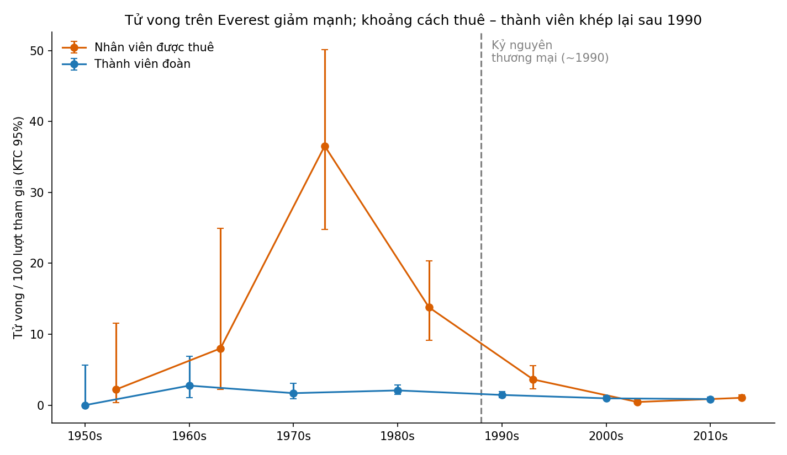
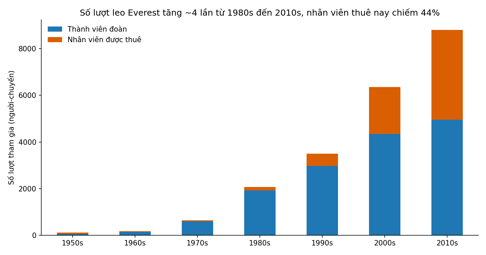

# Everest: đông hơn, nhưng không còn chết chóc như xưa

**Thông điệp chính:** Từ 1990, số người leo Everest tăng gấp nhiều lần mà tỉ lệ tử vong giảm khoảng một nửa với khách leo và giảm hơn 10 lần với nhân viên được thuê, nên khoảng cách rủi ro giữa hai nhóm gần như khép lại.

**Dành cho:** bạn đọc phổ thông tò mò về Everest.

## 1. Bối cảnh
Cơ sở dữ liệu Himalayan Database ghi lại 21.813 lượt người tham gia các đoàn leo Everest đến xuân 2019. Có hai nhóm: **thành viên đoàn** (khách leo) và **nhân viên được thuê** (94% mang quốc tịch Nepal từ 1990, làm các vai trò hỗ trợ như khuân vác, dựng trại, hướng dẫn). Từ khoảng 1990, leo Everest trở thành dịch vụ thương mại.

## 2. Vấn đề
Đông người hơn thì nguy hiểm hơn, đúng không? Và ai gánh rủi ro: khách trả tiền hay người được thuê?

## 3. Phát hiện

- **Nhìn chung, an toàn hơn.** Tính trên 100 lượt tham gia, khách leo chết 1,98 người trước 1990 và 1,04 người từ 1990 (54/2.721 so với 128/12.285).
- **Nhân viên thuê thay đổi nhiều nhất.** Họ từng chịu 15,7 ca chết trên 100 lượt (trước 1990), nay là 1,07. Ở thập niên 1970 con số là 36,5, nhưng chỉ dựa trên 52 lượt nên rất thiếu chắc chắn.
- **Khoảng cách đã khép.** Trước 1990, nhân viên thuê có nguy cơ cao gấp khoảng 8 lần khách; từ 1990 hai nhóm ngang nhau (1,07% so với 1,04%).

- **Đông hơn nhiều.** Từ 2.067 lượt (1980s) lên 8.799 (2010s). Nhân viên thuê từ 7% lên 44% số lượt, tức nghề này lớn lên cùng thị trường dịch vụ leo núi.
- **Người leo lên đỉnh cũng ít chết hơn:** trên 100 người lên được đỉnh, ca chết của khách giảm từ 29,6 (1980s) xuống 1,67 (2010s). Cùng lúc, tỉ lệ dùng oxy tăng từ 19% lên 62%. Hai điều này đi cùng nhau, nhưng dữ liệu không chứng minh cái nào gây ra cái nào.

## 4. Điều vẫn chưa ổn
Rủi ro của nhân viên thuê nằm ở những thảm họa. Năm 2014 có 17 nhân viên thuê chết, không có khách nào; năm 2015 có 11 nhân viên và 3 khách chết. Bỏ hai năm này, tỉ lệ của nhân viên thuê thập niên 2010 chỉ là 0,36%, thấp hơn khách (0,99%). Nghĩa là mức nguy hiểm thường ngày thấp, nhưng khi có thảm họa thì nhân viên thuê chịu thiệt nhiều nhất. Từ 1990, tuyết lở liên quan đến 33 ca chết của nhân viên thuê.

## 5. Gợi ý (không phải kết luận từ dữ liệu)
Khi đánh giá "Everest an toàn đến đâu", nên xem riêng rủi ro thảm họa của người làm thuê (lịch đi qua thác băng, bảo hiểm, thời điểm leo), không chỉ số ca chết trung bình.

## Lưu ý quan trọng
- Dữ liệu trước 1990 về nhân viên thuê rất ít (267 lượt) và có thể ghi chưa đầy đủ, nên con số 15,7% chỉ nên hiểu là "cao hơn nhiều".
- Chúng tôi đếm theo lượt tham gia, không theo số lần qua vùng nguy hiểm. Nhân viên thuê thường đi lại nhiều lần mỗi mùa, nên rủi ro thật của họ có thể cao hơn con số này.
- Đây là mối liên hệ quan sát được, không phải bằng chứng về nguyên nhân. Dữ liệu dừng ở xuân 2019.

*Chi tiết và mã: `answer.md`, `analysis.py`.*
