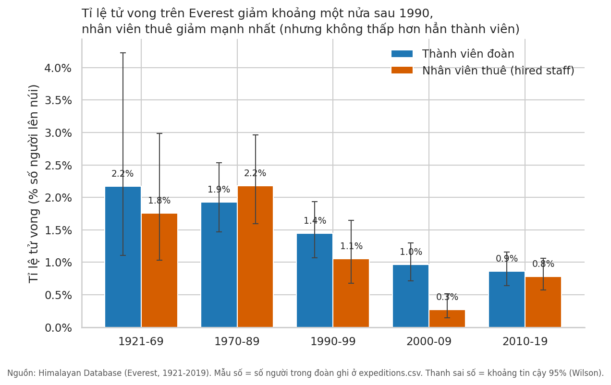
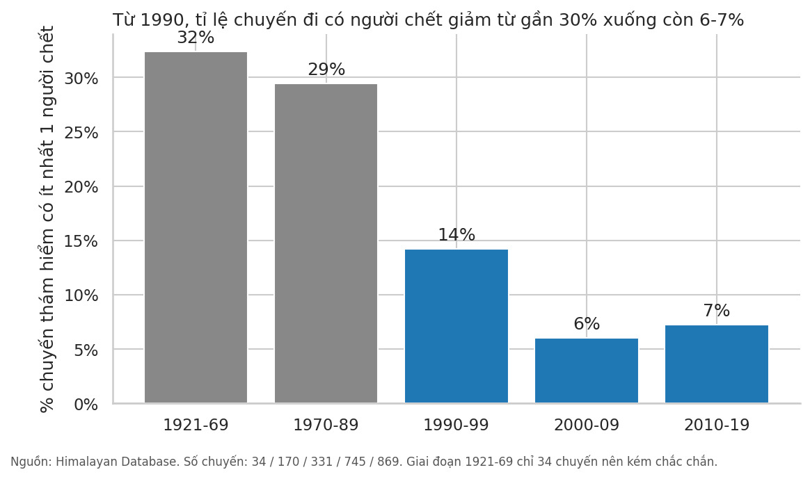
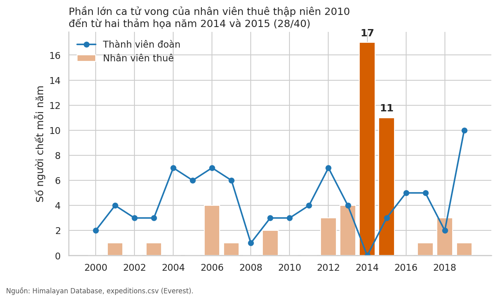

# Everest: đông hơn, thành công hơn — và ít chết hơn một nửa

**Thông điệp chính:** Từ thập niên 1970-80 đến nay, tỉ lệ người chết trên Everest đã giảm khoảng một nửa, cả với du khách lẫn nhân viên được thuê (phần lớn là người Nepal: 6.321 trong 6.730 dòng nhân viên thuê ở danh sách cá nhân); nhưng mức giảm đã dừng lại từ thập niên 2000 và vẫn khoảng 1 người chết trên mỗi 100 người lên núi.

*Dành cho: độc giả phổ thông, quan tâm đến việc leo Everest có "bớt liều" hơn trước không.*

## 1. Bối cảnh
Cơ sở dữ liệu Himalayan Database ghi lại 2.149 chuyến thám hiểm Everest từ 1921 đến 2019. Mỗi chuyến cho biết có bao nhiêu **thành viên đoàn** (người đi leo, thường là khách nước ngoài) và bao nhiêu **nhân viên được thuê** (hired staff: người mang đồ, dẫn đường, nấu ăn... đi lên trên base camp), và bao nhiêu người trong mỗi nhóm đã chết.

## 2. Điều đáng ngạc nhiên
Từ khoảng 1990, Everest trở thành một "ngành dịch vụ": số chuyến mỗi thập niên tăng từ 141 (thập niên 1980) lên 745 (2000s) và 869 (2010s). Nhiều người leo hơn, nhiều người đến được đỉnh hơn — vậy leo núi có nguy hiểm hơn không?

## 3. Điều dữ liệu cho thấy

**Không — tỉ lệ tử vong thấp hơn đáng kể so với trước 1990.**

- **Thành viên đoàn:** 1,9% (50/2.593 người, 1970-89) → 0,9% (43/4.980, 2010-19). Cứ 100 người, trước đây chết gần 2 người, nay chưa đến 1.
- **Nhân viên thuê:** 2,2% (39/1.790, 1970-89) → 1,1% (1990-99) → **0,3%** (9/3.302, 2000-09) → 0,8% (40/5.109, 2010-19). Trong thập niên 2000, nhân viên thuê có tỉ lệ tử vong thấp hơn hẳn thành viên đoàn; ở các thời kỳ khác hai nhóm không khác nhau rõ.
- **Không chỉ do may mắn:** tỉ lệ chuyến đi có ít nhất một người chết giảm từ 29% (1970-89) xuống 6-7% từ 2000 đến 2019.

**Nhưng bức tranh của nhân viên thuê không đều.** Thập niên 2010 trông xấu đi (0,3% → 0,8%) chủ yếu vì hai năm: 2014 (17 người chết) và 2015 (11 người). Hai năm này chiếm 28 trong 40 ca chết của nhân viên thuê trong thập niên đó. Bỏ hai năm này đi, tỉ lệ là 0,27% — vẫn rất thấp. Ngược lại, các tai nạn tập thể như vậy cho thấy rủi ro của nhóm này tập trung vào những biến cố lớn: từ 1990, 63% ca chết của nhân viên thuê là do tuyết lở, sập băng, đá rơi hoặc rơi vào khe nứt, so với 9% ở thành viên đoàn (thành viên chết chủ yếu vì ngã, say độ cao, kiệt sức, tê cóng).

## 4. Điều nên chú ý tiếp (gợi ý, không phải kết luận)
- Mức giảm đến từ giai đoạn 1970-2000; từ 2000 thành viên đoàn dao động quanh 1% mỗi thập niên. Giảm thêm có thể khó hơn, vì phần lớn "dễ" đã đạt được.
- Hiệu ứng của kỷ nguyên thương mại (đoàn tổ chức bài bản, nhiều nhân viên hỗ trợ hơn — số nhân viên thuê trên mỗi thành viên tăng từ 0,69 lên 1,03 — và dùng oxy nhiều hơn, 21% → 71%) **đi cùng** mức tử vong thấp hơn, nhưng dữ liệu này không chứng minh chúng là nguyên nhân.
- Muốn bảo vệ nhân viên thuê hiệu quả, cần nhìn vào rủi ro từ tuyết lở và sập băng (đây là nguyên nhân chính của nhóm này), không chỉ vào số liệu trung bình.

## Những điều cần nhớ
- Tỉ lệ tính theo **người trên mỗi chuyến**, không theo số ngày hay số lần băng qua khu vực nguy hiểm; nhân viên thuê có thể phải đi lại nhiều lần hơn nên rủi ro thật có thể cao hơn con số.
- Số liệu nhân viên thuê trước 2000 kém đầy đủ trong bảng danh sách cá nhân, nên tôi dùng số đếm ở bảng chuyến đi; các thập niên trước 1970 có rất ít chuyến (34 chuyến trước 1970), không nên đọc quá sâu.
- Chỉ là dữ liệu quan sát về Everest (Nepal và hai phía biên giới), không nói gì về các đỉnh khác.
