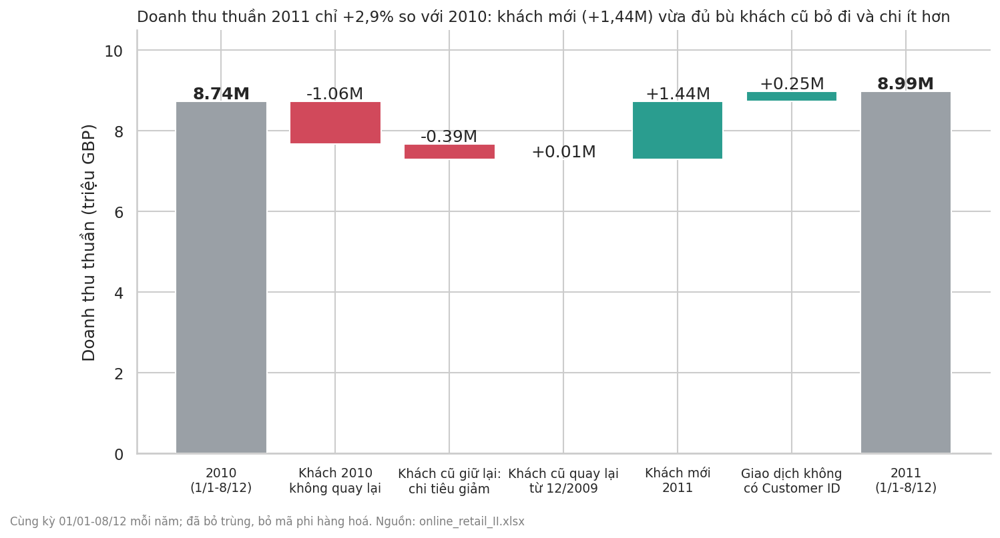
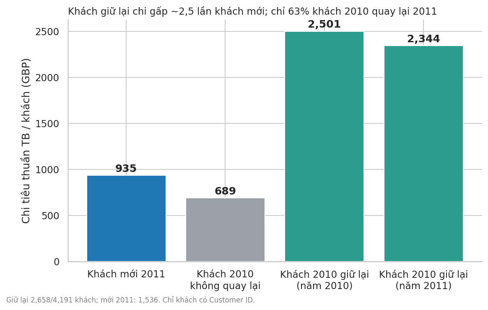
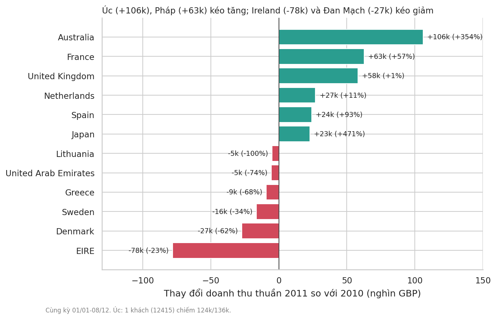

# Tăng trưởng 2011 chỉ là "đổ nước vào thùng thủng": giữ chân khách cũ nên được ưu tiên

**Core message:** Doanh thu thuần 2011 tăng chỉ +2,9% (cùng kỳ), khi khách mới (+£1,44M) gần như chỉ vừa đủ bù khoản £1,45M mất đi từ khách cũ — nên mỗi điểm giữ chân thêm có giá trị lớn hơn việc chạy thêm khách mới.
**Audience:** CEO, cần quyết định dồn nguồn lực vào giữ chân khách cũ hay tìm khách mới.

## 1. Bối cảnh
Dữ liệu giao dịch của một công ty quà tặng online ở Anh, 12/2009–09/12/2011. Vì 2011 mới có số liệu đến 08/12, mình so **01/01–08/12 của cả hai năm** và tính doanh thu *thuần* (đã trừ hàng hoàn/hủy).

## 2. Tension
Con số tổng nhìn khá ổn: **£8,74M → £8,99M, +£254k (+2,9%)**. (So sai kiểu "2011 thiếu 3 tuần vs cả năm 2010" sẽ thấy −1,3%.) Nhưng +2,9% đến từ đâu, và có bền không?

## 3. Insight

- **Khách mới tăng, khách cũ rò rỉ.** 1.536 khách mới đem về +£1,44M. Cùng lúc, 1.533 khách của 2010 không quay lại (−£1,06M) và nhóm khách giữ lại chi ít hơn (−£0,39M; £2.501 → £2.344 mỗi khách). Chỉ **63%** khách 2010 mua lại trong 2011. Riêng nhóm khách có định danh, doanh thu gần như phẳng (+0,04%); phần tăng ròng nằm ở giao dịch không có Customer ID (+£0,25M).
- **Khách giữ lại giá trị hơn hẳn.** Khách giữ lại chi trung bình £2.344 trong 2011, khách mới chỉ £935 trong năm đầu. 
- **Thị trường:** tăng nhờ **Úc (+£106k, nhưng gần như một khách duy nhất: £124k)** và **Pháp (+£63k, +57%, 85 khách so với 48)**; giảm ở **Ireland (−£78k, −23%)** và **Đan Mạch (−£27k, −62%)**. Ngoài UK tăng +16%, UK (≈86% doanh thu) chỉ +0,8%. 

## 4. Gợi ý hành động (đề xuất, không phải kết luận của dữ liệu)
1. **Ưu tiên giữ chân.** Minh hoạ: 1 điểm % giữ chân thêm ≈ 42 khách × £2.501 ≈ £105k/năm — bằng khoảng 41% mức tăng ròng của năm (£254k). Chương trình mua lại/CSKH cho nhóm khách mua nhiều là chỗ đầu tư hiệu quả nhất theo số liệu.
2. **Không bỏ tìm khách mới** — đó là thứ giữ doanh thu không giảm — nhưng đặt kỳ vọng thực tế: khách mới chi ít hơn nhiều trong năm đầu. Pháp là ví dụ tăng khách thật sự (không phụ thuộc 1 khách).
3. **Theo dõi rủi ro tập trung:** Úc phụ thuộc 1 khách, Ireland phụ thuộc 2 khách (~91–94% doanh thu nước đó); chăm sóc tài khoản lớn.

## Caveats
- **Không có dữ liệu chi phí** (thu hút khách, giữ chân), nên chưa so được hiệu quả đầu tư — cần thêm trước khi chốt ngân sách.
- 13,7% doanh thu không có Customer ID nên không phân loại mới/cũ được; kết luận mới/cũ chỉ cho khách định danh.
- "Mới" = chưa mua từ 12/2009 đến hết 2010; "không quay lại" tính đến 08/12/2011 (khách mua theo mùa có thể quay lại sau).
- Đây là dữ liệu quan sát: chỉ cho thấy liên hệ, chưa chứng minh nguyên nhân. Nước nhỏ biến động mạnh do vài khách lớn.
- Chi tiết, kịch bản kiểm tra độ nhạy (+2,9% đến +3,5% tuỳ cách lọc): xem `answer.md`.
