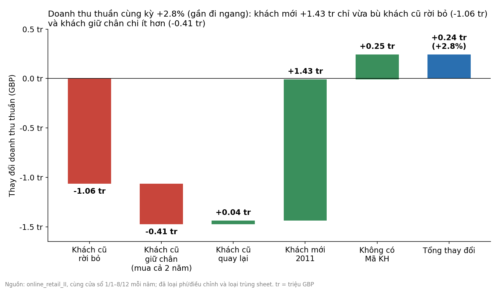
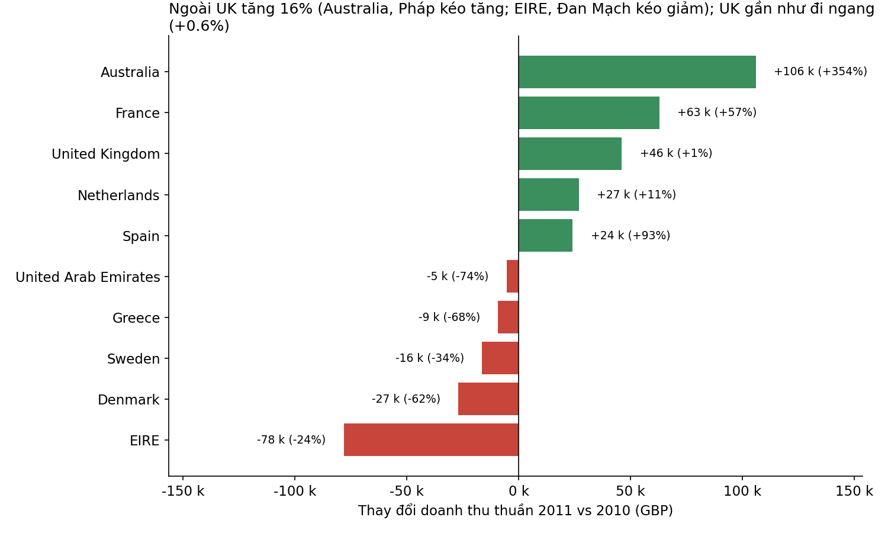
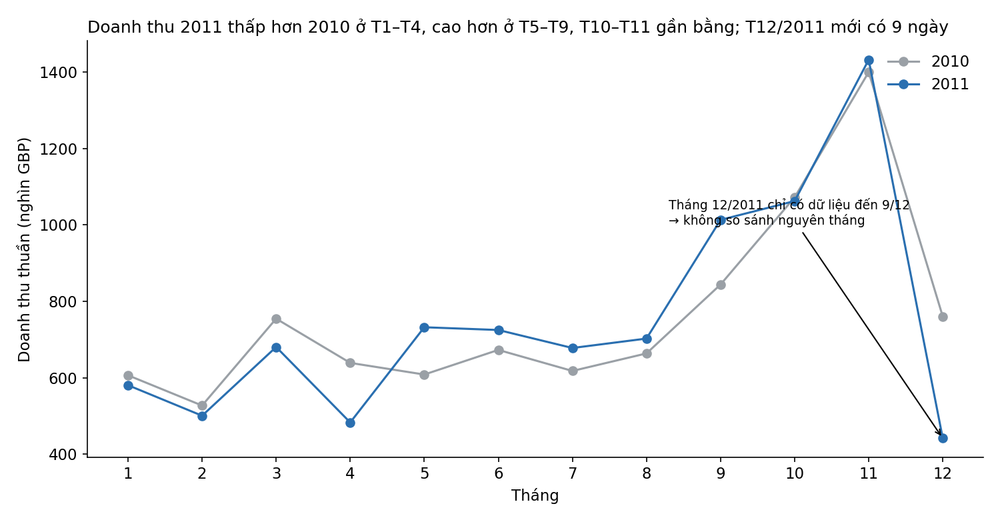

# Doanh thu 2011 đi ngang: chúng ta đang phải chạy nhanh chỉ để đứng yên

**Gửi CEO — thông điệp chính: khách mới đang chỉ vừa đủ bù cho khách cũ bỏ đi. Ưu tiên giữ chân sẽ có lợi hơn so với chỉ mở rộng thêm khách mới.**

## 1. Con số thật (so sánh công bằng)
Dữ liệu 2011 dừng ở 9/12, nên phải so 1/1–8/12 của cả hai năm (và loại phần dữ liệu bị trùng giữa hai file). Kết quả: doanh thu thuần **£9.00 triệu so với £8.76 triệu, +2.8% (+£243k)**. Khoảng tin cậy −5% đến +10%, tức là **về cơ bản đi ngang**. Nếu so thẳng "cả năm 2010" với "2011 đến 9/12" sẽ ra −1.5% — một kết luận sai.

## 2. Cân đối khách mới – khách cũ

- **Khách mới 2011: +£1.43 triệu** (1,533 khách).
- **Khách cũ: −£1.47 triệu**: 1,532 khách của 2010 không quay lại (−£1.06 triệu) và 2,650 khách ở lại nhưng chi ít hơn 6% (£2,515 → £2,361/khách, −£0.41 triệu).
- Chỉ **63%** khách 2010 còn mua trong 2011.
- Phần tăng ròng +£243k đến từ doanh thu không có mã khách (14% tổng doanh thu, không phân loại được); riêng khách có mã gần như bằng 0 (−0.1%).

Điểm đáng chú ý: nhóm giữ chân chỉ là 2,650 khách nhưng tạo ra **£6.3 triệu (khoảng 70% doanh thu 2011)**, mỗi khách trị giá gấp khoảng 2.5 lần khách mới (£2,361 so với £931, dù khách mới mới chỉ có một phần năm để mua). Khách rời bỏ trung bình chỉ £695/khách nên phần lớn là khách nhỏ — mất họ ít đau hơn, nhưng mức chi giảm 6% ở nhóm lớn mới là rủi ro lõi.

## 3. Thị trường

- UK (~84% doanh thu) gần như đi ngang: +0.6%. Ngoài UK +16% (+£197k).
- Kéo tăng: **Australia +£106k, Pháp +£63k**, Hà Lan +£27k, Tây Ban Nha +£24k. Kéo giảm: **EIRE −£78k**, Đan Mạch −£27k, Thụy Điển −£16k.
- Cảnh báo: những biến động này dựa vào rất ít khách (Australia: một khách = 91% doanh thu 2011; EIRE chỉ 3 khách). Đây là tín hiệu về một vài tài khoản bán buôn, chưa phải xu hướng thị trường.

## 4. Mùa vụ không giải thích được tất cả

2011 thấp hơn 2010 ở T1–T4, cao hơn ở T5–T9, T10–T11 xấp xỉ bằng. Tháng 12/2011 mới có 9 ngày nên đừng đọc là "sụt 42%".

## 5. Đề xuất
1. **Ưu tiên giữ chân** nhóm khách hàng chi tiêu lớn: nâng tỷ lệ ở lại từ 63% và chặn mức chi giảm 6%. Mỗi 1 điểm % tỷ lệ giữ chân của khách có giá trị trung bình ~£2.5k tương đương khoảng 40 khách ≈ £100k/năm theo mức chi 2010 (ước tính minh hoạ từ dữ liệu, không phải dự báo).
2. **Duy trì kênh thu hút khách mới** ở mức hiện tại — nó đang giữ doanh thu không giảm — nhưng đừng tăng ngân sách dựa trên số liệu này, vì khách mới trị giá thấp hơn.
3. Với thị trường quốc tế, quản lý theo **tài khoản** (Australia, Pháp, EIRE) thay vì theo quốc gia.
4. Sửa dữ liệu: 14% doanh thu không có mã khách khiến ta không thể đo giữ chân đầy đủ.

*Hạn chế: dữ liệu bắt đầu 12/2009 (một số "khách mới" có thể là khách cũ chưa lộ diện), không có dữ liệu chi phí nên chưa so được hiệu quả đầu tư giữa giữ chân và thu hút; kết quả là quan sát, không chứng minh nhân quả.*
