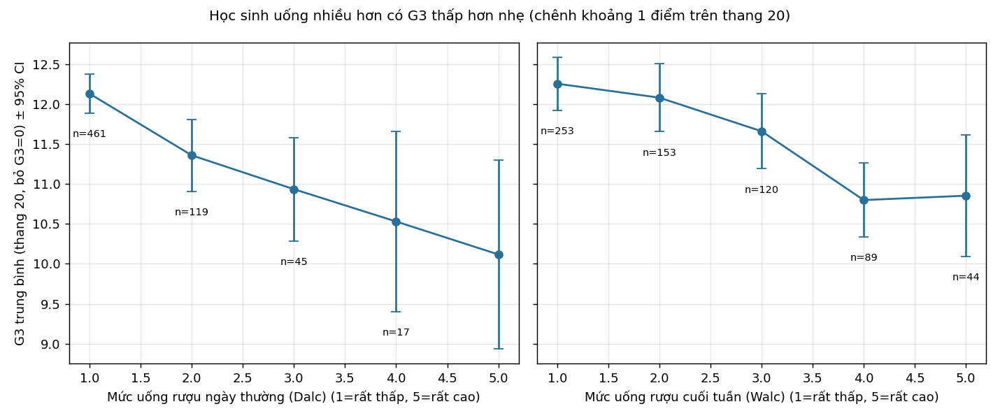

# Mức độ uống rượu và điểm cuối kỳ G3

**Trả lời:** Có. Học sinh uống rượu nhiều hơn có G3 thấp hơn, nhưng mức chênh nhỏ đến trung bình, và phần lớn mức chênh này biến mất khi tính đến điểm kỳ 1 (G1). Đây là mối liên quan, chưa chứng minh được nhân quả.

- **Ngày thường (Dalc):** nhóm uống cao (mức ≥3, n=79) có G3 trung bình 10,67; nhóm uống mức 1 (n=462) có 12,12. Chênh −1,45 điểm trên thang 20. Cohen's d = −0,55 (CI 95% bootstrap −0,75 đến −0,33), Mann-Whitney p < 0,001.
- **Cuối tuần (Walc):** nhóm cao (≥3, n=253) có 11,22; nhóm mức 1 (n=254) có 12,23. Chênh −1,02 điểm. d = −0,39 (CI −0,58 đến −0,22), p < 0,001.
- **Tương quan Spearman với G3:** Dalc ρ = −0,19, Walc ρ = −0,18 (cả hai p < 0,001). Kruskal-Wallis theo 5 mức: p < 0,001, η²_H ≈ 0,03 (hiệu ứng nhỏ).

## Bằng chứng

Mức rượu càng cao thì G3 trung bình càng thấp (Dalc từ 12,13 xuống 10,12). Các nhóm mức 4–5 chỉ có 17–44 học sinh nên CI rộng.

| Mô hình (n=659, sai số HC3) | Hệ số Dalc / bậc | Hệ số Walc / bậc |
|---|---|---|
| Thô, Dalc+Walc cùng lúc | −0,34 (−0,61; −0,08), p=0,012 | −0,25 (−0,45; −0,05), p=0,013 |
| Hiệu chỉnh giới, tuổi, trường, địa chỉ, học vấn bố mẹ, có học cả hai môn | −0,28 (−0,55; −0,005), p=0,046 | −0,23 (−0,43; −0,04), p=0,020 |
| Thêm G1 (độ nhạy) | −0,05 (−0,19; 0,08), p=0,43 | −0,08 (−0,18; 0,01), p=0,089 |

Các mô hình này giải thích rất ít phương sai (R² 0,05–0,12). Khi thêm G1, hệ số gần về 0 và không còn ý nghĩa thống kê. G1 là điểm có từ đầu năm, nên có thể đã phản ánh sẵn tác động của rượu. Do đó không thể kết luận rượu làm giảm điểm trong năm. Cũng có thể học sinh uống nhiều vốn đã yếu hơn từ trước.

## Cách làm
- **Học sinh xuất hiện ở cả hai file:** ghép theo 13 thuộc tính trong `student-merge.R`, thêm số thứ tự trong nhóm trùng khóa để ghép 1-1. Kết quả: 370 học sinh có ở cả hai file, 25 chỉ có ở Toán, 279 chỉ có ở Bồ, tổng 674 học sinh duy nhất. Mỗi người chỉ tính một lần. File R gốc cho 382 dòng vì khóa bị trùng làm nhân dòng. Mức rượu của học sinh ở cả hai file được lấy trung bình hai file (hai file khác nhau ở 1–3% dòng). G3 của học sinh được lấy trung bình các môn có G3 hợp lệ.
- **G3 đáng ngờ:** G3=0 có 38 dòng ở Toán và 15 dòng ở Bồ. Cả 53 dòng đều có `absences`=0, và 33 dòng trong số đó có G2>0. Điều này gợi ý bỏ thi hoặc rút lui, không phải điểm thật. Phân tích chính loại các điểm 0 này (còn 659/674 học sinh). Phân tích độ nhạy giữ lại G3=0: hiệu ứng yếu đi nhưng cùng chiều (Dalc d = −0,37, CI −0,59 đến −0,17; Walc d = −0,27, CI −0,43 đến −0,10).
- **Nhóm so sánh:** thấp = mức 1, cao = mức ≥3 (mức trung gian không dùng trong d). Ngoài ra có Spearman, Kruskal-Wallis và hồi quy.
- **Tính nhất quán theo môn** (từng file, G3>0): Toán Dalc d = −0,37, Walc d = −0,42 (n=357); Bồ Dalc d = −0,62, Walc d = −0,34 (n=634). Hai môn cùng chiều. Hai môn chia sẻ học sinh nên không coi là kiểm chứng độc lập.

## Giả định và lưu ý
- Dữ liệu quan sát. Các biến gây nhiễu chưa đo (động lực, hoàn cảnh gia đình) có thể ảnh hưởng đồng thời đến rượu và điểm.
- Rượu là tự khai trên thang 1–5, không có đơn vị cụ thể. Dalc và Walc tương quan với nhau (≈0,65), nên hệ số riêng từng biến kém ổn định.
- Cách xử lý G3=0 là giả định của chúng tôi. Cả hai cách xử lý đều cho kết quả cùng chiều và có ý nghĩa, chỉ khác độ lớn.
- Mỗi p-value nhỏ không có nghĩa là hiệu ứng lớn. Hiệu ứng thực tế khoảng 1–1,5 điểm trên thang 20.
- Mô hình có G1 chỉ là độ nhạy, không phải mô hình chính. Cần dữ liệu theo thời gian (rượu trước điểm) mới tách được tác động.

Tệp: `analysis.py`, `ket_qua_hieu_ung.csv`, `hoi_quy.csv`, `G3_theo_muc.csv`, `student_level.csv`, `g3_theo_muc_ruou.png`.
