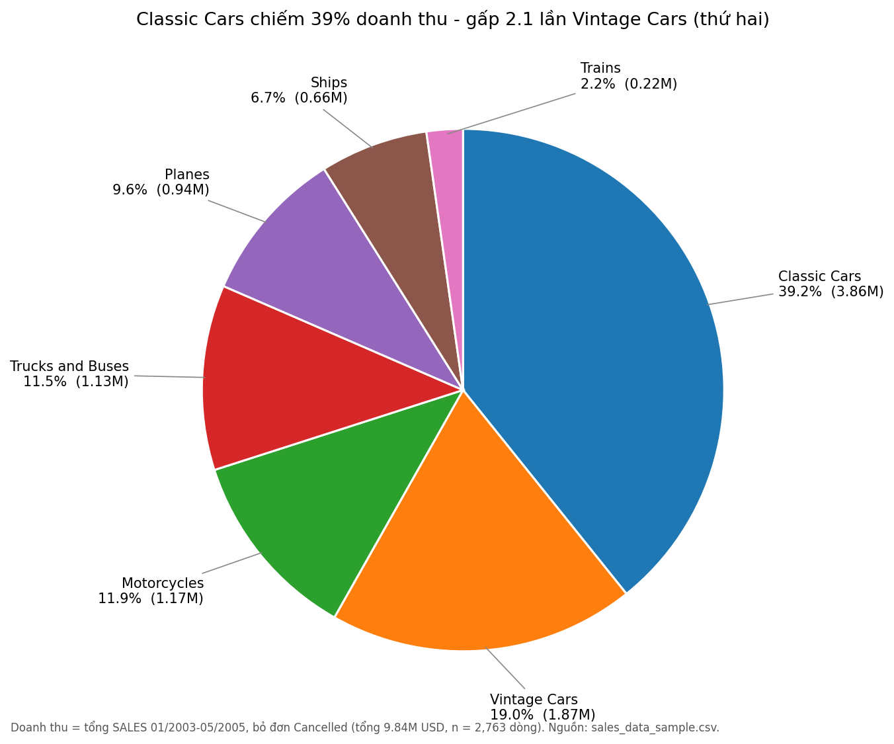

# Doanh thu theo sản phẩm (biểu đồ tròn) - sales_data_sample.csv

**Câu hỏi:** Vẽ biểu đồ tròn biểu diễn doanh thu theo sản phẩm.

## Trả lời
**Classic Cars chiếm 39.2% doanh thu (3.86M USD)**, gấp 2.1 lần dòng thứ hai là Vintage Cars (19.0%). Hai dòng xe này cộng lại chiếm 58% doanh thu; Trains nhỏ nhất (2.2%).

| Dòng sản phẩm | Doanh thu (USD) | Tỷ trọng | Số dòng đơn |
|---|---|---|---|
| Classic Cars | 3,860,373 | 39.2% | 951 |
| Vintage Cars | 1,865,087 | 19.0% | 594 |
| Motorcycles | 1,166,388 | 11.9% | 331 |
| Trucks and Buses | 1,127,790 | 11.5% | 301 |
| Planes | 939,571 | 9.6% | 294 |
| Ships | 657,771 | 6.7% | 216 |
| Trains | 221,161 | 2.2% | 76 |
| **Tổng** | **9,838,141** | 100% | 2,763 |

## Cách làm
- "Sản phẩm" = `PRODUCTLINE` (7 dòng). `PRODUCTCODE` có 109 mã - quá nhiều cho biểu đồ tròn.
- Doanh thu = tổng `SALES` 01/2003-05/2005, bỏ đơn Cancelled (60 dòng). Tính cả đơn hủy thì tỷ trọng chỉ lệch tối đa 0.4 điểm % (Ships 6.7% -> 7.1%).
- Code: [analysis.py](analysis.py); bảng: `revenue_by_productline.csv`.

## Lưu ý
- Biểu đồ tròn với 7 phần khó so sánh các lát gần bằng nhau (Motorcycles 11.9% vs Trucks and Buses 11.5%); nếu cần so sánh chính xác, biểu đồ cột ngang dễ đọc hơn.
